# m_Tgt_C_S_TRS_Pty_OnGoing

IDQ mapping &rarr; CDI **Mapping** `m_Tgt_C_S_TRS_Pty_OnGoing`.

> [ML 10/28/2020] Corrected the run date port on gender and death date exceptions
[ML 01/22/2021] Source SQL Additions to account for re-runs and re-activations
[NG 12/15/2021] Fix Future DOB
[RS 07/11/2023] Source SQL Additions to account Race_Cd & Ethnicity Cd & respective Exceptions from Source Data

## Summary

| IDQ transformation | CDI transformation | Count |
|---|---|---|
| AggregatorTx | Aggregator | 3 |
| ExpressionTx | Expression | 12 |
| FilterTx | Filter | 3 |
| LookupTx | Lookup | 3 |
| MappletTx | Mapplet | 5 |
| RouterTx | Router | 1 |
| SorterTx | Sorter | 4 |
| SourceTx | Source | 1 |
| TargetTx | Target | 9 |

## Not ported (stale MDM timeline)

These steps are not built (and not counted above); their sections below say how to rewire around them.

| Step | IDQ type | Reason |
|---|---|---|
| fltr_Dups | FilterTx | Filter `VERSION_SEQ_NUM = 1`; the version is hard-coded to 1, so it passes every row. Link the fields that feed it straight to the fields it fed. |

Sources:

| Instance | Object | Connection |
|---|---|---|
| Read_STG_TRS_D_DC_INDV | `STG_TRS_D_DC_INDV` | STAGING |

Targets:

| Instance | Object | Connection |
|---|---|---|
| Write_Stg_TRS_Valid_Members | `STG_TRS_VALID_MEMBERS` | STAGING |
| Write_Invalid_Party_Name | `EXC_STG_BAD_REC_MEMB` | STAGING |
| Write_Invalid_Party_Gender | `EXC_STG_BAD_REC_MEMB` | STAGING |
| Write_Invalid_Party_DeathDate | `EXC_STG_BAD_REC_MEMB` | STAGING |
| Write_C_S_TRS_PTY | `C_S_TRS_PTY` | HHS_MDM_ORS |
| Write_C_S_TRS_PTY_RLE | `C_S_TRS_PTY_RLE` | HHS_MDM_ORS |
| Write_Invalid_Party_BirthDate | `EXC_STG_BAD_REC_MEMB` | STAGING |
| Write_Invalid_Party_Ethnicity | `EXC_STG_BAD_REC_MEMB` | STAGING |
| Write_Invalid_Party_Race | `EXC_STG_BAD_REC_MEMB` | STAGING |

## Parameters

Create as CDI input parameters (`$$Name`); defaults go in the parameter file.

| Parameter | Type | Precision | Default | Used in this mapping |
|---|---|---|---|---|
| PTY_BO_CLASS_CD_Member | string | 10 | Indv | yes |
| DC_INDV_TBL_SRC | string | 1000 | DC_INDV | yes |
| MCI_TBL_SRC | string | 1000 | MCI | yes |
| MNG_ATTR_TP_AR | string | 1000 | Auth_Rep | no (declared only) |
| RLE_BO_CLASS_CD_Member | string | 1000 | Member | yes |
| DC_ABS_PAR_SRC | string | 100 | DC_ABSENT_PARENTS | yes |

`$sys.MappingName` is translated to the input parameter `$$MappingName` (default: the mapping name).

## Target load order

Load `Write_Stg_TRS_Valid_Members` before `Write_Stg_TRS_Valid_Members` (CDI mapping *Target Load Order*).

## Flow

```mermaid
flowchart LR
  n0["Read_STG_TRS_D_DC_INDV<br/><i>Source</i>"]
  n1["exp_Tiers_Data_Load<br/><i>Expression</i>"]
  n2["exp_interface<br/><i>Expression</i>"]
  n3["exp_Validate_Death_Dt<br/><i>Expression</i>"]
  n4["lkp_Exc_Death_Dt<br/><i>Lookup</i>"]
  n5["mplt_Gender_Validation<br/><i>Mapplet</i>"]
  n6["mplt_Name_Standardization_Indv_Member<br/><i>Mapplet</i>"]
  n7["mplt_BirthDate_Validation<br/><i>Mapplet</i>"]
  n8["exp_Exception_Consolidation<br/><i>Expression</i>"]
  n9["rtr_Invalid_Party<br/><i>Router</i>"]
  n10["srtr_Dedup_Rec<br/><i>Sorter</i>"]
  n11["Write_Invalid_Party_Gender<br/><i>Target</i>"]
  n12["Write_Invalid_Party_DeathDate<br/><i>Target</i>"]
  n13["exp_Invalid_Party_Name<br/><i>Expression</i>"]
  n14["exp_AttributeValue<br/><i>Expression</i>"]
  n15["Write_Invalid_Party_BirthDate<br/><i>Target</i>"]
  n16["mplt_Ethnicity_Validation<br/><i>Mapplet</i>"]
  n17["mplt_Race_Validation<br/><i>Mapplet</i>"]
  n18["exp_Party_Consolidation<br/><i>Expression</i>"]
  n19["fltr_Dups<br/><i>not ported</i>"]
  n20["exp_TRS_Party_Load<br/><i>Expression</i>"]
  n21["exp_TRS_Pty_Rle_Load<br/><i>Expression</i>"]
  n22["lkp_Stg_TRS_Valid_Members<br/><i>Lookup</i>"]
  n23["fltr_New_Valid_Members<br/><i>Filter</i>"]
  n24["srtr_Pkey<br/><i>Sorter</i>"]
  n25["agg_Valid_Members<br/><i>Aggregator</i>"]
  n26["exp_Stg_Valid_Members<br/><i>Expression</i>"]
  n27["Write_Stg_TRS_Valid_Members<br/><i>Target</i>"]
  n28["Sorter<br/><i>Sorter</i>"]
  n29["Aggregator<br/><i>Aggregator</i>"]
  n30["Write_C_S_TRS_PTY_RLE<br/><i>Target</i>"]
  n31["Sorter1<br/><i>Sorter</i>"]
  n32["Aggregator1<br/><i>Aggregator</i>"]
  n33["Write_C_S_TRS_PTY<br/><i>Target</i>"]
  n34["Fil_Race_Exceptions<br/><i>Filter</i>"]
  n35["Exp_Race_Exceptions<br/><i>Expression</i>"]
  n36["Write_Invalid_Party_Race<br/><i>Target</i>"]
  n37["Fil_Ethnicity_Exceptions<br/><i>Filter</i>"]
  n38["Exp_Ethnicity_Exceptions<br/><i>Expression</i>"]
  n39["Write_Invalid_Party_Ethnicity<br/><i>Target</i>"]
  n40["Lookup_EXC_LOOKUP_CODE_VALUE<br/><i>Lookup</i>"]
  n41["Write_Invalid_Party_Name<br/><i>Target</i>"]
  n0 --> n1
  n1 --> n2
  n2 --> n3
  n2 --> n5
  n2 --> n6
  n2 --> n7
  n2 --> n8
  n3 --> n4
  n4 --> n8
  n5 --> n8
  n6 --> n8
  n7 --> n8
  n8 --> n9
  n9 --> n10
  n9 --> n11
  n9 --> n12
  n9 --> n13
  n9 --> n14
  n9 --> n15
  n10 --> n16
  n10 --> n17
  n10 --> n18
  n13 --> n40
  n13 --> n41
  n14 --> n15
  n16 --> n18
  n17 --> n18
  n18 --> n19
  n19 --> n20
  n19 --> n21
  n19 --> n22
  n19 --> n23
  n19 --> n34
  n19 --> n37
  n20 --> n31
  n21 --> n28
  n22 --> n23
  n23 --> n24
  n24 --> n25
  n25 --> n26
  n26 --> n27
  n28 --> n29
  n29 --> n30
  n31 --> n32
  n32 --> n33
  n34 --> n35
  n35 --> n36
  n37 --> n38
  n38 --> n39
  n40 --> n41
  classDef retired stroke-dasharray: 5 5,opacity:0.5
  class n19 retired
```



## Transformations

In data-flow order.

### Read_STG_TRS_D_DC_INDV

IDQ `SourceTx` &rarr; CDI **Source**. Oracle connector source; carry the SQL override / filter below verbatim.

| Property | Value |
|---|---|
| Connection | STAGING |
| Object | STG_TRS_D_DC_INDV |
| queryMode | SEMI |

Filter (CDI source/lookup *Filter* property; translated):

```sql
INDV_ID=504937068
```

SQL override (CDI *SQL Override*; translated):

```sql
with New_Valid_indvs as  		-- "Merge" new records from delta with prior valid data to from a master list
(
select /*+ parallel (8) */
	distinct indv_id
from STG_TRS_D_CV_MCI_EDG_INDV_TOA
where conversion_ind = 'C'

union

select /*+ parallel (8) */
	distinct indv_id
from STG_TRS_D_DC_INDV
where FILE_CLEARANCE_SW = 'Y'
and Inactive_ind = 'N'
and delete_sw = 'N'

UNION

select /*+ parallel (8) */
	distinct indv_id
from STG_TRS_D_CV_DC_MCI_INDV
where  Inactive_ind = 'N'

UNION

select /*+ parallel (8) */
	distinct indv_id
from STG_TRS_VALID_MEMBERS

minus                           -- *** Remove any records that will be inactivated today

select /*+ parallel (8) */
	distinct indv_id
from STG_TRS_D_DC_INDV
where Inactive_ind = 'Y'
or delete_sw = 'Y'

minus

select /*+ parallel (8) */
	distinct indv_id
from STG_TRS_D_CV_DC_MCI_INDV
where  Inactive_ind = 'Y'

-- [ML 01/22/2021] Additions to account for re-runs and re-activations
Minus

Select indv_id
from STG_TRS_DEACTIVED_MEMBERS
)
-- [ML 10/22/2020]  Removed 1/2 cleared relations based on guidance from TC that
--			1. He wants to suppress relation exception on invalid / deactivcated members
--          2. That if an active member deactivates, we deactivate all their relations
--,rel as  -- Find relation records only 1/2 cleared that were reported today
--(
--select /*+ parallel (8) */ distinct
--    case when c1.indv_id is null then rel.indv_id else rel.ref_indv_id end indv_id
--	 --count(*), count(distinct rel.indv_id)
--from STG_TRS_D_DC_RELATIONSHIPS rel
--left join New_Valid_indvs c1
--	on  rel.indv_id = c1.indv_id
--left join New_Valid_indvs c2
--	on  rel.ref_indv_id = c2.indv_id
--where
--	(
--		c1.indv_id is null and c2.indv_id is not null
--	or
--		c2.indv_id is null and c1.indv_id is not null
--	)
--)
--,filter as    -- merge new relation records to form a master list
--(
--select /*+ parallel (8) */ indv_id from rel
--union
--select /*+ parallel (8) */ indv_id from New_Valid_indvs
--)


, ALL_INDV as  --
(
SELECT
	INDV_ID,
	FIRST_NAME,
	MID_NAME,
	LAST_NAME,
	SUFX_NAME,
	PREFIX_NAME,
	GENDER_CD,
	RACE_CD,
	ETHNICITY_CD,
	NULL as SSA_VAL_SW,
	NULL as FILE_CL_SW,
	DOB_DT,
	NULL AS DEATH_DT,
	CREATE_DT,
	'$$MCI_TBL_SRC' as SRC_TBL
FROM STG_TRS_D_CV_DC_MCI_INDV MCI_INDV
	UNION ALL

SELECT
	INDV_ID,
	FIRST_NAME,
	MID_NAME,
	LAST_NAME,
	SUFX_NAME,
	PREFIX_NAME,
	GENDER_CD,
	RACE_CD,
	ETHNICITY_CD,
	SSA_VALIDATION_SW as SSA_VAL_SW,
	FILE_CLEARANCE_SW as FILE_CL_SW,
	DOB_DT,
	DEATH_DT,
	CREATE_DT,
	'$$DC_INDV_TBL_SRC' as SRC_TBL
FROM STG_TRS_D_DC_INDV INDV
)
SELECT  /*+ parallel (8) */
	DISTINCT all_indv.INDV_ID as INDV_ID,
	RTRIM(LTRIM(FIRST_NAME)) AS FIRST_NAME,
	RTRIM(LTRIM(MID_NAME)) AS MID_NAME,
	RTRIM(LTRIM(LAST_NAME)) AS LAST_NAME,
    RTRIM(SUFX_NAME) AS SUFX_NAME,
	RTRIM(PREFIX_NAME) AS PREFIX_NAME,
	GENDER_CD AS GENDER_CD,
	RACE_CD,
	ETHNICITY_CD,
	SSA_VAL_SW,
	FILE_CL_SW,
	DOB_DT AS DOB_DT,
	CREATE_DT as CREATE_DT ,
	SRC_TBL,
	DEATH_DT as DEATH_DT
FROM ALL_INDV
inner join New_Valid_indvs filter
	on filter.indv_id = all_indv.indv_id
order by all_indv.INDV_ID, src_tbl -- [ML 10/19/2020] needed for agg step
```

Columns: `None`, `None`, `None`, `None`, `None`, `None`, `None`, `None`, `None`, `None`, `None`, `None`, `None`, `None`, `None`

### exp_Tiers_Data_Load

IDQ `ExpressionTx` &rarr; CDI **Expression**. Same expression language; variable fields are supported.

| Field | Kind | Type | Expression (CDI) |
|---|---|---|---|
| Indv_Id | in/out | double | `Indv_Id` |
| First_Name | in/out | string(30) | `First_Name` |
| Mid_Name | in/out | string(30) | `Mid_Name` |
| Last_Name | in/out | string(30) | `Last_Name` |
| Sufx_Name | in/out | string(4) | `Sufx_Name` |
| Prefix_Name | in/out | string(4) | `Prefix_Name` |
| Gender_Cd | in/out | string(1) | `Gender_Cd` |
| Dob_Dt | in/out | date/time | `Dob_Dt` |
| Update_Dt | in/out | date/time | `Update_Dt` |
| SSA_Val_Sw | in/out | string(1) |  |
| File_CL_Sw | in/out | string(1) |  |
| Src_System | out | string(10) | `'TRS'` |
| Object_Name | out | string(100) | `'C_S_TRS_PTY'` |
| Src_Tbl | in/out | string(17) |  |
| Pkey_Src_Object_Pty | out | string(255) | `Decode(True,<br>SRC_TBL=$$DC_INDV_TBL_SRC,<br>to_CHAR(INDV_ID) \|\| '\|' \|\| $$DC_INDV_TBL_SRC,<br>TO_CHAR(INDV_ID))<br><br><br>--IIF(SRC_TBL=$$DC_INDV_TBL_SRC, to_CHAR(INDV_ID) \|\| '\|' --\|\| $$DC_INDV_TBL_SRC,<br>-- IIF(SRC_TBL= $$DC_ABS_PAR_SRC, --$$DC_ABS_PAR_SRC \|\| '\|' \|\| --TO_CHAR(ABSENT_PAR_SQ_NM), to_CHAR(INDV_ID)))` |
| Death_Dt | in/out | date/time |  |
| Race_Cd | in/out | string(10) | `Race_Cd` |
| Ethnicity_Cd | in/out | string(10) | `Ethnicity_Cd` |

Links (target field &larr; upstream field):

| Field | From |
|---|---|
| First_Name | Read_STG_TRS_D_DC_INDV.FIRST_NAME |
| Mid_Name | Read_STG_TRS_D_DC_INDV.MID_NAME |
| Last_Name | Read_STG_TRS_D_DC_INDV.LAST_NAME |
| Sufx_Name | Read_STG_TRS_D_DC_INDV.SUFX_NAME |
| Gender_Cd | Read_STG_TRS_D_DC_INDV.GENDER_CD |
| Dob_Dt | Read_STG_TRS_D_DC_INDV.DOB_DT |
| Update_Dt | Read_STG_TRS_D_DC_INDV.CREATE_DT |
| Indv_Id | Read_STG_TRS_D_DC_INDV.INDV_ID |
| Prefix_Name | Read_STG_TRS_D_DC_INDV.PREFIX_NAME |
| Src_Tbl | Read_STG_TRS_D_DC_INDV.SRC_TBL |
| Death_Dt | Read_STG_TRS_D_DC_INDV.DEATH_DT |
| SSA_Val_Sw | Read_STG_TRS_D_DC_INDV.SSA_VAL_SW |
| File_CL_Sw | Read_STG_TRS_D_DC_INDV.FILE_CL_SW |
| Race_Cd | Read_STG_TRS_D_DC_INDV.RACE_CD |
| Ethnicity_Cd | Read_STG_TRS_D_DC_INDV.ETHNICITY_CD |

### exp_interface

IDQ `ExpressionTx` &rarr; CDI **Expression**. Same expression language; variable fields are supported.

| Field | Kind | Type | Expression (CDI) |
|---|---|---|---|
| Src_System_Id | in/out | string(255) | `Src_System_Id` |
| Party_Type | out | string(10) | `'Indv'` |
| Period_Start_Date | in/out | date/time | `Period_Start_Date` |
| Member_Id | in/out | string(9) | `Member_Id` |
| SSN | in/out | string(9) | `SSN` |
| MEDICAID_ID | in/out | string(9) | `MEDICAID_ID` |
| Birth_Dt | in/out | date/time | `Birth_Dt` |
| Gender_Code | in/out | string(1) | `Gender_Code` |
| Prfx_Nm | in/out | string(10) | `Prfx_Nm` |
| Frst_Nm | in/out | string(50) | `Frst_Nm` |
| Mdl_Nm | in/out | string(50) | `Mdl_Nm` |
| Lst_Nm | in/out | string(50) | `Lst_Nm` |
| Sfx_Nm | in/out | string(10) | `Sfx_Nm` |
| Src_System | in/out | string(10) | `Src_System` |
| Object_Name | in/out | string(50) | `Object_Name` |
| Last_Update_Date | in/out | date/time | `Last_Update_Date` |
| v_Full_Nm | variable | string(100) | `LTRIM(RTRIM(<br>FRST_NM\|\| IIF(NOT ISNULL(MDL_NM ) ,<br>' ' \|\| LTRIM(RTRIM(MDL_NM)), '') \|\| ' ' \|\|  LTRIM(LST_NM)) )` |
| Full_Nm | out | string(100) | `v_Full_Nm` |
| Pkey_Src_Object | out | string(255) | `IIF(Src_Tbl=$$DC_INDV_TBL_SRC, to_CHAR(Member_Id) \|\| '\|' \|\| $$DC_INDV_TBL_SRC, to_CHAR(Member_Id))` |
| Missing_First_Name_Fl | out | string(10) | `IIF(LENGTH(RTRIM(FRST_NM))=0 , 'Y', 'N')` |
| Src_Tbl | in/out | string(50) | `Src_Tbl` |
| Phone_Number | in/out | string(10) | `Phone_Number` |
| Rec_Ind | in/out | string(15) | `Rec_Ind` |
| Death_Dt | in/out | date/time | `Death_Dt` |
| Missing_Last_Name_Fl | out | string(10) | `IIF(LENGTH(RTRIM(LST_NM))=0 , 'Y', 'N')` |
| Version_Seq_Num (stale timeline: omit) | in/out | integer | `Version_Seq_Num` |
| Src_Full_Nm | out | string(100) | `v_Full_Nm` |
| B_Test | out | string(29) | `'XXX'` |
| Race_Cd | in/out | string(10) | `Race_Cd` |
| Ethnicity_Cd | in/out | string(10) | `Ethnicity_Cd` |

Links (target field &larr; upstream field):

| Field | From |
|---|---|
| Src_System_Id | exp_Tiers_Data_Load.Src_System |
| Period_Start_Date | exp_Tiers_Data_Load.Update_Dt |
| Birth_Dt | exp_Tiers_Data_Load.Dob_Dt |
| Gender_Code | exp_Tiers_Data_Load.Gender_Cd |
| Prfx_Nm | exp_Tiers_Data_Load.Prefix_Name |
| Frst_Nm | exp_Tiers_Data_Load.First_Name |
| Mdl_Nm | exp_Tiers_Data_Load.Mid_Name |
| Lst_Nm | exp_Tiers_Data_Load.Last_Name |
| Sfx_Nm | exp_Tiers_Data_Load.Sufx_Name |
| Src_System | exp_Tiers_Data_Load.Src_System |
| Object_Name | exp_Tiers_Data_Load.Object_Name |
| Last_Update_Date | exp_Tiers_Data_Load.Update_Dt |
| Src_Tbl | exp_Tiers_Data_Load.Src_Tbl |
| Member_Id | exp_Tiers_Data_Load.Indv_Id |
| Death_Dt | exp_Tiers_Data_Load.Death_Dt |
| Race_Cd | exp_Tiers_Data_Load.Race_Cd |
| Ethnicity_Cd | exp_Tiers_Data_Load.Ethnicity_Cd |

### exp_Validate_Death_Dt

IDQ `ExpressionTx` &rarr; CDI **Expression**. Same expression language; variable fields are supported.

| Field | Kind | Type | Expression (CDI) |
|---|---|---|---|
| Death_Dt | in/out | date/time | `Death_Dt` |
| Exception_Code_Death_Dt | out | string(300) | `IIF(DEATH_DT > Sysdate,'Invalid_Death_Date',null)` |

Links (target field &larr; upstream field):

| Field | From |
|---|---|
| Death_Dt | exp_interface.Death_Dt |

### lkp_Exc_Death_Dt

IDQ `LookupTx` &rarr; CDI **Lookup**. Connected lookup unless a return port is set (then unconnected).

| Property | Value |
|---|---|
| Connection | STAGING |
| Object | EXC_LOOKUP_CODE_VALUE |
| Lookup condition | EXCEPTION_CODE = Exception_Code_Death_Dt |
| Multiple matches | Return any row |
| Cache | static cache |

| Lookup input field | Type |
|---|---|
| Exception_Code_Death_Dt | string(300) |

| Return / pass-through field | Feeds |
|---|---|
| EXCEPTION_CODE | exp_Exception_Consolidation.Exception_Code_Death_Date |
| EXCEPTION_DESC | exp_Exception_Consolidation.Exception_Desc_Death_Date |
| EXCEPTION_TYPE | exp_Exception_Consolidation.Exception_Type_Death_Date |

Links (target field &larr; upstream field):

| Field | From |
|---|---|
| Exception_Code_Death_Dt | exp_Validate_Death_Dt.Exception_Code_Death_Dt |

### mplt_Gender_Validation

IDQ `MappletTx` &rarr; CDI **Mapplet**. Reusable CDI mapplet (see the mapplets folder).

Mapplet: [`mplt_Gender_Validation`](../mapplets/mplt_Gender_Validation.md)

Links (target field &larr; upstream field):

| Field | From |
|---|---|
| Group.Src_Sys | exp_interface.Src_System |
| Group.Party_Type | exp_interface.Party_Type |
| Group.Gender_Code | exp_interface.Gender_Code |

### mplt_Name_Standardization_Indv_Member

IDQ `MappletTx` &rarr; CDI **Mapplet**. Reusable CDI mapplet (see the mapplets folder).

Mapplet: [`mplt_Name_Standardization_Indv_Member`](../mapplets/mplt_Name_Standardization_Indv_Member.md)

Links (target field &larr; upstream field):

| Field | From |
|---|---|
| Group.First_Name | exp_interface.Frst_Nm |
| Group.Mdl_Name | exp_interface.Mdl_Nm |
| Group.Lst_Name | exp_interface.Lst_Nm |
| Group.Sfx_Name | exp_interface.Sfx_Nm |
| Group.Prfx_Name | exp_interface.Prfx_Nm |
| Group.Full_Name | exp_interface.Full_Nm |
| Group.Src_System | exp_interface.Src_System |

### mplt_BirthDate_Validation

IDQ `MappletTx` &rarr; CDI **Mapplet**. Reusable CDI mapplet (see the mapplets folder).

Mapplet: [`mplt_BirthDate_Validation`](../mapplets/mplt_BirthDate_Validation.md)

Links (target field &larr; upstream field):

| Field | From |
|---|---|
| Group.SrcSys | exp_interface.Src_System |
| Group.PartyType | exp_interface.Party_Type |
| Group.BirthDate | exp_interface.Birth_Dt |

### exp_Exception_Consolidation

IDQ `ExpressionTx` &rarr; CDI **Expression**. Same expression language; variable fields are supported.

| Field | Kind | Type | Expression (CDI) |
|---|---|---|---|
| Src_System_Id | in/out | string(255) | `Src_System_Id` |
| Mapping_Name | out | string(255) | `Substr($$MappingName, INSTR($$MappingName,'/',0)+1)` |
| Party_Type | in/out | string(10) | `Party_Type` |
| Period_Start_Date | in/out | date/time | `Period_Start_Date` |
| Member_Id | in/out | string(9) | `Member_Id` |
| Gender_Code | in/out | string(1) | `Gender_Code` |
| Prfx_Nm | in/out | string(10) | `Prfx_Nm` |
| Frst_Nm | in/out | string(50) | `Frst_Nm` |
| Mdl_Nm | in/out | string(50) | `Mdl_Nm` |
| Lst_Nm | in/out | string(50) | `Lst_Nm` |
| Sfx_Nm | in/out | string(10) | `Sfx_Nm` |
| Src_System | in/out | string(10) | `Src_System` |
| Object_Name | in/out | string(50) | `Object_Name` |
| Last_Update_Date | in/out | date/time | `Last_Update_Date` |
| Full_Nm | in/out | string(100) | `Full_Nm` |
| Pkey_Src_Object | in/out | string(255) | `Pkey_Src_Object` |
| Missing_First_Name_Fl | in/out | string(10) | `Missing_First_Name_Fl` |
| Src_Tbl | in/out | string(50) | `Src_Tbl` |
| Death_Dt | in/out | date/time | `Death_Dt` |
| Missing_Last_Name_Fl | in/out | string(10) | `Missing_Last_Name_Fl` |
| Exception_Code_Death_Date | in/out | string(300) |  |
| Exception_Desc_Death_Date | in/out | string(300) |  |
| Exception_Type_Death_Date | in/out | string(300) |  |
| Gender_Exception_Code | in/out | string(100) | `Gender_Exception_Code` |
| Gender_Exception_Description | in/out | string(100) | `Gender_Exception_Description` |
| Gender_Exception_Type | in/out | string(100) | `Gender_Exception_Type` |
| MDM_Gender_Code | in/out | string(255) | `MDM_Gender_Code` |
| Exception_Desc_Name | out | string(50) | `Decode(True,<br>Missing_First_Name_Fl = 'Y' ,'Missing First Name',<br>Missing_Last_Name_Fl ='Y','Missing Last Name',NULL)` |
| Exception_Type_Name | out | string(50) | `Decode(True,<br>Missing_First_Name_Fl = 'Y' ,'Exception Value',<br>Missing_Last_Name_Fl ='Y','Exception Value',NULL)` |
| Attribute_Name_Name | out | string(255) | `'Name'` |
| Attribute_Name_Gender | out | string(255) | `'Gender'` |
| Attribute_Name_DeathDt | out | string(255) | `'Death Date'` |
| Attribute_Name_BirthDate | in/out | string(100) | `Attribute_Name_BirthDate` |
| Src_Full_Nm | in/out | string(100) | `Src_Full_Nm` |
| Run_Date | out | date/time | `SESSSTARTTIME` |
| BirthDate_Exception_Code | in/out | string(100) | `BirthDate_Exception_Code` |
| BirthDate_Exception_Description | in/out | string(100) | `BirthDate_Exception_Description` |
| BirthDate_Exception_Type | in/out | string(100) | `BirthDate_Exception_Type` |
| Birth_Dt | in/out | date/time | `Birth_Dt` |
| Src_Birth_Dt | in/out | date/time | `Src_Birth_Dt` |
| Race_Cd | in/out | string(10) | `Race_Cd` |
| Ethnicity_Cd | in/out | string(10) | `Ethnicity_Cd` |

Links (target field &larr; upstream field):

| Field | From |
|---|---|
| Src_System_Id | exp_interface.Src_System_Id |
| Party_Type | exp_interface.Party_Type |
| Period_Start_Date | exp_interface.Period_Start_Date |
| Member_Id | exp_interface.Member_Id |
| Birth_Dt | mplt_BirthDate_Validation.o_BirthDate.BirthDate |
| Gender_Code | exp_interface.Gender_Code |
| Prfx_Nm | mplt_Name_Standardization_Indv_Member.out_Standardized_Names.Prfx_Name |
| Src_System | exp_interface.Src_System |
| Object_Name | exp_interface.Object_Name |
| Last_Update_Date | exp_interface.Last_Update_Date |
| Pkey_Src_Object | exp_interface.Pkey_Src_Object |
| Missing_First_Name_Fl | exp_interface.Missing_First_Name_Fl |
| Src_Tbl | exp_interface.Src_Tbl |
| Death_Dt | exp_interface.Death_Dt |
| Missing_Last_Name_Fl | exp_interface.Missing_Last_Name_Fl |
| Exception_Code_Death_Date | lkp_Exc_Death_Dt.EXCEPTION_CODE |
| Exception_Desc_Death_Date | lkp_Exc_Death_Dt.EXCEPTION_DESC |
| Exception_Type_Death_Date | lkp_Exc_Death_Dt.EXCEPTION_TYPE |
| Gender_Exception_Code | mplt_Gender_Validation.out_Gender_Code_Validation.Gender_Exception_Code |
| Gender_Exception_Description | mplt_Gender_Validation.out_Gender_Code_Validation.Gender_Exception_Description |
| Gender_Exception_Type | mplt_Gender_Validation.out_Gender_Code_Validation.Gender_Exception_Type |
| MDM_Gender_Code | mplt_Gender_Validation.out_Gender_Code_Validation.MDM_Gender_Code |
| Frst_Nm | mplt_Name_Standardization_Indv_Member.out_Standardized_Names.First_Name |
| Mdl_Nm | mplt_Name_Standardization_Indv_Member.out_Standardized_Names.Mdl_Name |
| Lst_Nm | mplt_Name_Standardization_Indv_Member.out_Standardized_Names.Lst_Name |
| Sfx_Nm | mplt_Name_Standardization_Indv_Member.out_Standardized_Names.Sfx_Name |
| Full_Nm | mplt_Name_Standardization_Indv_Member.out_Standardized_Names.Full_Name |
| Src_Full_Nm | exp_interface.Src_Full_Nm |
| BirthDate_Exception_Code | mplt_BirthDate_Validation.o_BirthDate.Exception_Code |
| BirthDate_Exception_Description | mplt_BirthDate_Validation.o_BirthDate.Exception_Description |
| BirthDate_Exception_Type | mplt_BirthDate_Validation.o_BirthDate.Exception_Type |
| Attribute_Name_BirthDate | mplt_BirthDate_Validation.o_BirthDate.Attribute_Name |
| Src_Birth_Dt | exp_interface.Birth_Dt |
| Race_Cd | exp_interface.Race_Cd |
| Ethnicity_Cd | exp_interface.Ethnicity_Cd |

### rtr_Invalid_Party

IDQ `RouterTx` &rarr; CDI **Router**. One output group per IDQ group; the default group is created automatically.

| Output group | Condition |
|---|---|
| Invalid_Party_Name | `Length(Rtrim(Frst_Nm))=0 <br>OR <br>Length(Rtrim(Lst_Nm))=0 <br>OR <br>IsNULL(Frst_Nm) <br>OR <br>IsNULL(Lst_Nm)` |
| Invalid_Gender_Code | `NOT ISNULL(Gender_Exception_Description)` |
| Invalid_Death_Date | `NOT ISNULL(Exception_Desc_Death_Date)` |
| Invalid_BirthDate | `NOT ISNULL(BirthDate_Exception_Code)` |
| Valid_Party | `--Gender Code and Death Date exceptions are not considered for rejecting the Party. Those records will be still processed and also route to Exceptions for future corrections<br>LENGTH(RTRIM(FRST_NM)) !=0 OR LENGTH(RTRIM(LST_NM))!=0 OR <br>NOT ISNULL(FRST_NM) OR <br>NOT ISNULL(LST_NM)` |
| Default | (default group) |

Links (target field &larr; upstream field):

| Field | From |
|---|---|
| Src_System_Id | exp_Exception_Consolidation.Src_System_Id |
| Period_Start_Date | exp_Exception_Consolidation.Period_Start_Date |
| Member_Id | exp_Exception_Consolidation.Member_Id |
| Gender_Code | exp_Exception_Consolidation.Gender_Code |
| Prfx_Nm | exp_Exception_Consolidation.Prfx_Nm |
| Frst_Nm | exp_Exception_Consolidation.Frst_Nm |
| Md_Nm | exp_Exception_Consolidation.Mdl_Nm |
| Lst_Nm | exp_Exception_Consolidation.Lst_Nm |
| Sfx_Nm | exp_Exception_Consolidation.Sfx_Nm |
| Src_Sys | exp_Exception_Consolidation.Src_System |
| Object_Name | exp_Exception_Consolidation.Object_Name |
| Missing_Last_Name_Fl | exp_Exception_Consolidation.Missing_Last_Name_Fl |
| Missing_First_Name_Fl | exp_Exception_Consolidation.Missing_First_Name_Fl |
| Pkey_Src_Object | exp_Exception_Consolidation.Pkey_Src_Object |
| Full_Nm | exp_Exception_Consolidation.Full_Nm |
| Last_Update_Date | exp_Exception_Consolidation.Last_Update_Date |
| Src_Tbl | exp_Exception_Consolidation.Src_Tbl |
| Death_Dt | exp_Exception_Consolidation.Death_Dt |
| Exception_Code_Death_Date | exp_Exception_Consolidation.Exception_Code_Death_Date |
| Exception_Desc_Death_Date | exp_Exception_Consolidation.Exception_Desc_Death_Date |
| Exception_Type_Death_Date | exp_Exception_Consolidation.Exception_Type_Death_Date |
| Gender_Exception_Code | exp_Exception_Consolidation.Gender_Exception_Code |
| Gender_Exception_Description | exp_Exception_Consolidation.Gender_Exception_Description |
| Gender_Exception_Type | exp_Exception_Consolidation.Gender_Exception_Type |
| MDM_Gender_Code | exp_Exception_Consolidation.MDM_Gender_Code |
| Exception_Desc_Name | exp_Exception_Consolidation.Exception_Desc_Name |
| Exception_Type_Name | exp_Exception_Consolidation.Exception_Type_Name |
| Mapping_Name | exp_Exception_Consolidation.Mapping_Name |
| Attribute_Name_Name | exp_Exception_Consolidation.Attribute_Name_Name |
| Attribute_Name_Gender | exp_Exception_Consolidation.Attribute_Name_Gender |
| Attribute_Name_DeathDt | exp_Exception_Consolidation.Attribute_Name_DeathDt |
| Src_Full_Nm | exp_Exception_Consolidation.Src_Full_Nm |
| Run_Date | exp_Exception_Consolidation.Run_Date |
| BirthDate_Exception_Code | exp_Exception_Consolidation.BirthDate_Exception_Code |
| BirthDate_Exception_Description | exp_Exception_Consolidation.BirthDate_Exception_Description |
| BirthDate_Exception_Type | exp_Exception_Consolidation.BirthDate_Exception_Type |
| Attribute_Name_BirthDate | exp_Exception_Consolidation.Attribute_Name_BirthDate |
| Birth_Dt | exp_Exception_Consolidation.Birth_Dt |
| Src_Birth_Dt | exp_Exception_Consolidation.Src_Birth_Dt |
| Race_Cd | exp_Exception_Consolidation.Race_Cd |
| Ethnicity_Cd | exp_Exception_Consolidation.Ethnicity_Cd |

### srtr_Dedup_Rec

IDQ `SorterTx` &rarr; CDI **Sorter**. Sort keys in the order listed; distinct, case and null settings below.

| # | Sort key | Order |
|---|---|---|
| 1 | PKEY_SRC_OBJECT_PTY | ascending |
| 2 | UPDATE_DT | ascending |
| 3 | INDV_ID | ascending |
| 4 | SRC_TBL | ascending |
| 5 | GNDR_CD | ascending |
| 6 | SFX_NM | ascending |
| 7 | FRST_NM | ascending |
| 8 | PRFX_NM | ascending |
| 9 | LST_NM | ascending |
| 10 | MDL_NM | ascending |
| 11 | BIRTH_DT | ascending |
| 12 | FULL_NM | ascending |

| Property | Value |
|---|---|
| Distinct | yes |
| Case sensitive | yes |
| Null treated high | yes |

Links (target field &larr; upstream field):

| Field | From |
|---|---|
| INDV_ID | rtr_Invalid_Party.Valid_Party.Member_Id |
| BIRTH_DT | rtr_Invalid_Party.Valid_Party.Birth_Dt |
| SFX_NM | rtr_Invalid_Party.Valid_Party.Sfx_Nm |
| GNDR_CD | rtr_Invalid_Party.Valid_Party.MDM_Gender_Code |
| FRST_NM | rtr_Invalid_Party.Valid_Party.Frst_Nm |
| PRFX_NM | rtr_Invalid_Party.Valid_Party.Prfx_Nm |
| UPDATE_DT | rtr_Invalid_Party.Valid_Party.Period_Start_Date |
| MDL_NM | rtr_Invalid_Party.Valid_Party.Md_Nm |
| LST_NM | rtr_Invalid_Party.Valid_Party.Lst_Nm |
| FULL_NM | rtr_Invalid_Party.Valid_Party.Full_Nm |
| SRC_TBL | rtr_Invalid_Party.Valid_Party.Src_Tbl |
| PKEY_SRC_OBJECT_PTY | rtr_Invalid_Party.Valid_Party.Pkey_Src_Object |
| SRC_SYS | rtr_Invalid_Party.Valid_Party.Src_Sys |
| DEATH_DT | rtr_Invalid_Party.Valid_Party.Death_Dt |
| Src_Full_Nm | rtr_Invalid_Party.Valid_Party.Src_Full_Nm |
| Last_Update_Date | rtr_Invalid_Party.Valid_Party.Last_Update_Date |
| Race_Cd | rtr_Invalid_Party.Valid_Party.Race_Cd |
| Ethnicity_Cd | rtr_Invalid_Party.Valid_Party.Ethnicity_Cd |
| Run_Date | rtr_Invalid_Party.Valid_Party.Run_Date |

### Write_Invalid_Party_Gender

IDQ `TargetTx` &rarr; CDI **Target**. Oracle connector target.

| Property | Value |
|---|---|
| Connection | STAGING |
| Object | EXC_STG_BAD_REC_MEMB |
| Operation | Insert |
| Truncate target table | no |
| Load type | normal (no bulk load) |
| Reject file | Write_EXC_STG_BAD_REC_MEMB.bad |

Links (target field &larr; upstream field):

| Field | From |
|---|---|
| GENDER | rtr_Invalid_Party.Invalid_Gender_Code.Gender_Code |
| PREFIX | rtr_Invalid_Party.Invalid_Gender_Code.Prfx_Nm |
| FIRST_NAME | rtr_Invalid_Party.Invalid_Gender_Code.Frst_Nm |
| MIDDLE_NAME | rtr_Invalid_Party.Invalid_Gender_Code.Md_Nm |
| LAST_NAME | rtr_Invalid_Party.Invalid_Gender_Code.Lst_Nm |
| SUFFIX | rtr_Invalid_Party.Invalid_Gender_Code.Sfx_Nm |
| SRC_SYS | rtr_Invalid_Party.Invalid_Gender_Code.Src_Sys |
| EXCEPTION_CODE | rtr_Invalid_Party.Invalid_Gender_Code.Gender_Exception_Code |
| EXCEPTION_DESC | rtr_Invalid_Party.Invalid_Gender_Code.Gender_Exception_Description |
| EXCEPTION_TYPE | rtr_Invalid_Party.Invalid_Gender_Code.Gender_Exception_Type |
| BIRTH_DATE | rtr_Invalid_Party.Invalid_Gender_Code.Birth_Dt |
| ATTRIBUTE_NAME | rtr_Invalid_Party.Invalid_Gender_Code.Attribute_Name_Gender |
| MAPPING_NAME | rtr_Invalid_Party.Invalid_Gender_Code.Mapping_Name |
| PERIOD_START_DATE | rtr_Invalid_Party.Invalid_Gender_Code.Period_Start_Date |
| ATTRIBUTE_VALUE | rtr_Invalid_Party.Invalid_Gender_Code.Gender_Code |
| DEATH_DT | rtr_Invalid_Party.Invalid_Gender_Code.Death_Dt |
| RUN_DATE | rtr_Invalid_Party.Invalid_Gender_Code.Run_Date |
| SRC_SYS_ID_1 | rtr_Invalid_Party.Invalid_Gender_Code.Pkey_Src_Object |

### Write_Invalid_Party_DeathDate

IDQ `TargetTx` &rarr; CDI **Target**. Oracle connector target.

| Property | Value |
|---|---|
| Connection | STAGING |
| Object | EXC_STG_BAD_REC_MEMB |
| Operation | Insert |
| Truncate target table | no |
| Load type | normal (no bulk load) |
| Reject file | Write_EXC_STG_BAD_REC_MEMB.bad |

Links (target field &larr; upstream field):

| Field | From |
|---|---|
| SRC_SYS | rtr_Invalid_Party.Invalid_Death_Date.Src_Sys |
| PREFIX | rtr_Invalid_Party.Invalid_Death_Date.Prfx_Nm |
| FIRST_NAME | rtr_Invalid_Party.Invalid_Death_Date.Frst_Nm |
| MIDDLE_NAME | rtr_Invalid_Party.Invalid_Death_Date.Md_Nm |
| LAST_NAME | rtr_Invalid_Party.Invalid_Death_Date.Lst_Nm |
| SUFFIX | rtr_Invalid_Party.Invalid_Death_Date.Sfx_Nm |
| GENDER | rtr_Invalid_Party.Invalid_Death_Date.Gender_Code |
| BIRTH_DATE | rtr_Invalid_Party.Invalid_Death_Date.Birth_Dt |
| EXCEPTION_CODE | rtr_Invalid_Party.Invalid_Death_Date.Exception_Code_Death_Date |
| EXCEPTION_DESC | rtr_Invalid_Party.Invalid_Death_Date.Exception_Desc_Death_Date |
| EXCEPTION_TYPE | rtr_Invalid_Party.Invalid_Death_Date.Exception_Type_Death_Date |
| DEATH_DT | rtr_Invalid_Party.Invalid_Death_Date.Death_Dt |
| ATTRIBUTE_VALUE | rtr_Invalid_Party.Invalid_Death_Date.Death_Dt |
| ATTRIBUTE_NAME | rtr_Invalid_Party.Invalid_Death_Date.Attribute_Name_DeathDt |
| PERIOD_START_DATE | rtr_Invalid_Party.Invalid_Death_Date.Period_Start_Date |
| RUN_DATE | rtr_Invalid_Party.Invalid_Death_Date.Run_Date |
| SRC_SYS_ID_1 | rtr_Invalid_Party.Invalid_Death_Date.Pkey_Src_Object |

### exp_Invalid_Party_Name

IDQ `ExpressionTx` &rarr; CDI **Expression**. Same expression language; variable fields are supported.

| Field | Kind | Type | Expression (CDI) |
|---|---|---|---|
| Src_System_Id | in/out | string(255) | `Src_System_Id` |
| Period_Start_Date | in/out | date/time | `Period_Start_Date` |
| Member_Id | in/out | string(9) | `Member_Id` |
| Birth_Dt | in/out | date/time | `Birth_Dt` |
| Gender_Code | in/out | string(1) | `Gender_Code` |
| Prfx_Nm | in/out | string(10) | `Prfx_Nm` |
| Frst_Nm | in/out | string(50) | `Frst_Nm` |
| Md_Nm | in/out | string(50) | `Md_Nm` |
| Lst_Nm | in/out | string(50) | `Lst_Nm` |
| Sfx_Nm | in/out | string(10) | `Sfx_Nm` |
| Src_Sys | in/out | string(10) | `Src_Sys` |
| Object_Name | in/out | string(50) | `Object_Name` |
| Last_Update_Date | in/out | date/time | `Last_Update_Date` |
| Full_Nm | in/out | string(100) | `Full_Nm` |
| Pkey_Src_Object | in/out | string(255) | `Pkey_Src_Object` |
| Src_Tbl | in/out | string(50) | `Src_Tbl` |
| Death_Dt | in/out | date/time | `Death_Dt` |
| MDM_Gender_Code | in/out | string(255) | `MDM_Gender_Code` |
| Exception_Desc_Name | out | string(50) | `Decode(True,<br>Length(Rtrim(Frst_Nm))=0 <br>OR <br>IsNULL(Frst_Nm) ,'Missing First Name',<br>Length(Rtrim(Lst_Nm))=0 <br>OR <br>IsNULL(Lst_Nm),'Missing Last Name')` |
| Exception_Type_Name | in/out | string(50) | `Exception_Type_Name` |
| Mapping_Name | out | string(255) | `'m_Tgt_C_S_TRS_Pty_OnGoing'` |
| Attribute_Name_Name | out | string(255) | `Decode(True,<br>Length(Rtrim(Frst_Nm))=0 <br>OR <br>IsNULL(Frst_Nm) ,'First Name',<br>Length(Rtrim(Lst_Nm))=0 <br>OR <br>IsNULL(Lst_Nm),'Last Name')` |
| Attribute_Value | out | string(255) | `Decode(True,<br>Length(Rtrim(Frst_Nm))=0 <br>OR <br>IsNULL(Frst_Nm) ,Frst_Nm,<br>Length(Rtrim(Lst_Nm))=0 <br>OR <br>IsNULL(Lst_Nm),Lst_Nm)` |
| Src_Full_Nm | in/out | string(100) | `Src_Full_Nm` |
| Run_Date | out | date/time | `SYSTIMESTAMP()` |
| Exception_Code_Name | out | string(150) | `Decode(True,<br>Length(Rtrim(Frst_Nm))=0 <br>OR <br>IsNULL(Frst_Nm) ,'Missing_First_Name',<br>Length(Rtrim(Lst_Nm))=0 <br>OR <br>IsNULL(Lst_Nm),'Missing_Last_Name')` |
| Race_Cd | in/out | string(10) | `Race_Cd` |
| Ethnicity_Cd | in/out | string(10) | `Ethnicity_Cd` |

Links (target field &larr; upstream field):

| Field | From |
|---|---|
| Src_System_Id | rtr_Invalid_Party.Invalid_Party_Name.Src_System_Id |
| Period_Start_Date | rtr_Invalid_Party.Invalid_Party_Name.Period_Start_Date |
| Member_Id | rtr_Invalid_Party.Invalid_Party_Name.Member_Id |
| Birth_Dt | rtr_Invalid_Party.Invalid_Party_Name.Birth_Dt |
| Gender_Code | rtr_Invalid_Party.Invalid_Party_Name.Gender_Code |
| Prfx_Nm | rtr_Invalid_Party.Invalid_Party_Name.Prfx_Nm |
| Frst_Nm | rtr_Invalid_Party.Invalid_Party_Name.Frst_Nm |
| Md_Nm | rtr_Invalid_Party.Invalid_Party_Name.Md_Nm |
| Lst_Nm | rtr_Invalid_Party.Invalid_Party_Name.Lst_Nm |
| Sfx_Nm | rtr_Invalid_Party.Invalid_Party_Name.Sfx_Nm |
| Src_Sys | rtr_Invalid_Party.Invalid_Party_Name.Src_Sys |
| Object_Name | rtr_Invalid_Party.Invalid_Party_Name.Object_Name |
| Last_Update_Date | rtr_Invalid_Party.Invalid_Party_Name.Last_Update_Date |
| Full_Nm | rtr_Invalid_Party.Invalid_Party_Name.Full_Nm |
| Pkey_Src_Object | rtr_Invalid_Party.Invalid_Party_Name.Pkey_Src_Object |
| Src_Tbl | rtr_Invalid_Party.Invalid_Party_Name.Src_Tbl |
| Death_Dt | rtr_Invalid_Party.Invalid_Party_Name.Death_Dt |
| MDM_Gender_Code | rtr_Invalid_Party.Invalid_Party_Name.MDM_Gender_Code |
| Src_Full_Nm | rtr_Invalid_Party.Invalid_Party_Name.Src_Full_Nm |

### exp_AttributeValue

IDQ `ExpressionTx` &rarr; CDI **Expression**. Same expression language; variable fields are supported.

| Field | Kind | Type | Expression (CDI) |
|---|---|---|---|
| Birth_Dt | in | date/time |  |
| BirthDate | out | string(29) | `TO_CHAR(Birth_Dt,'MM/DD/YYYY')` |
| Pkey_Src_Object | in/out | string(255) | `Pkey_Src_Object` |

Links (target field &larr; upstream field):

| Field | From |
|---|---|
| Birth_Dt | rtr_Invalid_Party.Invalid_BirthDate.Src_Birth_Dt |
| Pkey_Src_Object | rtr_Invalid_Party.Invalid_BirthDate.Pkey_Src_Object |

### Write_Invalid_Party_BirthDate

IDQ `TargetTx` &rarr; CDI **Target**. Oracle connector target.

| Property | Value |
|---|---|
| Connection | STAGING |
| Object | EXC_STG_BAD_REC_MEMB |
| Operation | Insert |
| Truncate target table | no |
| Load type | normal (no bulk load) |
| Reject file | Write_EXC_STG_BAD_REC_MEMB.bad |

Links (target field &larr; upstream field):

| Field | From |
|---|---|
| SRC_SYS | rtr_Invalid_Party.Invalid_BirthDate.Src_Sys |
| FIRST_NAME | rtr_Invalid_Party.Invalid_BirthDate.Frst_Nm |
| MIDDLE_NAME | rtr_Invalid_Party.Invalid_BirthDate.Md_Nm |
| LAST_NAME | rtr_Invalid_Party.Invalid_BirthDate.Lst_Nm |
| SUFFIX | rtr_Invalid_Party.Invalid_BirthDate.Sfx_Nm |
| RUN_DATE | rtr_Invalid_Party.Invalid_BirthDate.Run_Date |
| PREFIX | rtr_Invalid_Party.Invalid_BirthDate.Prfx_Nm |
| EXCEPTION_CODE | rtr_Invalid_Party.Invalid_BirthDate.BirthDate_Exception_Code |
| EXCEPTION_TYPE | rtr_Invalid_Party.Invalid_BirthDate.BirthDate_Exception_Type |
| EXCEPTION_DESC | rtr_Invalid_Party.Invalid_BirthDate.BirthDate_Exception_Description |
| BIRTH_DATE | rtr_Invalid_Party.Invalid_BirthDate.Birth_Dt |
| GENDER | rtr_Invalid_Party.Invalid_BirthDate.Gender_Code |
| ATTRIBUTE_NAME | rtr_Invalid_Party.Invalid_BirthDate.Attribute_Name_BirthDate |
| MAPPING_NAME | rtr_Invalid_Party.Invalid_BirthDate.Mapping_Name |
| PERIOD_START_DATE | rtr_Invalid_Party.Invalid_BirthDate.Period_Start_Date |
| DEATH_DT | rtr_Invalid_Party.Invalid_BirthDate.Death_Dt |
| ATTRIBUTE_VALUE | exp_AttributeValue.BirthDate |
| SRC_SYS_ID_1 | exp_AttributeValue.Pkey_Src_Object |

### mplt_Ethnicity_Validation

IDQ `MappletTx` &rarr; CDI **Mapplet**. Reusable CDI mapplet (see the mapplets folder).

Mapplet: [`mplt_Ethnicity_Validation`](../mapplets/mplt_Ethnicity_Validation.md)

Links (target field &larr; upstream field):

| Field | From |
|---|---|
| Group1.Ethnicity_Cd | srtr_Dedup_Rec.Ethnicity_Cd |
| Group1.Src_Sys | srtr_Dedup_Rec.SRC_SYS |

### mplt_Race_Validation

IDQ `MappletTx` &rarr; CDI **Mapplet**. Reusable CDI mapplet (see the mapplets folder).

Mapplet: [`mplt_Race_Validation`](../mapplets/mplt_Race_Validation.md)

Links (target field &larr; upstream field):

| Field | From |
|---|---|
| Group1.Race_Cd | srtr_Dedup_Rec.Race_Cd |
| Group1.Src_Sys | srtr_Dedup_Rec.SRC_SYS |

### exp_Party_Consolidation

IDQ `ExpressionTx` &rarr; CDI **Expression**. Same expression language; variable fields are supported.

| Field | Kind | Type | Expression (CDI) |
|---|---|---|---|
| INDV_ID | in/out | double | `INDV_ID` |
| SRC_TBL | in/out | string(17) |  |
| PKEY_SRC_OBJECT | in | string(255) |  |
| out_Pkey_Src_Object | out | string(255) | `LTRIM(RTRIM(PKEY_SRC_OBJECT))` |
| v_CUR_PKEY_SRC_OBJECT | variable | string(255) | `PKEY_SRC_OBJECT` |
| GNDR_CD | in/out | string(5) | `GNDR_CD` |
| SFX_NM | in/out | string(10) | `SFX_NM` |
| FRST_NM | in/out | string(50) | `FRST_NM` |
| PRFX_NM | in/out | string(10) | `PRFX_NM` |
| LST_NM | in/out | string(50) | `LST_NM` |
| MDL_NM | in/out | string(50) | `MDL_NM` |
| v_MD5 | variable | string(30) | `MD5(TO_CHAR(GNDR_CD) \|\| '\|' \|\|<br>SFX_NM\|\| '\|' \|\|<br>FRST_NM \|\| '\|' \|\|<br>PRFX_NM \|\| '\|' \|\|<br>LST_NM \|\| '\|' \|\|<br>MDL_NM \|\| '\|' \|\|<br>FULL_NM \|\| '\|' \|\|<br>TO_CHAR(BIRTH_DT, 'YYYYDDMM') )` |
| v_VERS_SEQ_NUM | variable | integer | `--IIF(v_CUR_PKEY_SRC_OBJECT <> v_LST_PKEY_SRC_OBJECT, 1, IIF(v_MD5 = v_LAST_MD5, v_VERS_SEQ_NUM, v_VERS_SEQ_NUM + 1))<br>1` |
| v_DUP_RANK (stale timeline: omit) | variable | integer | `IIF(v_CUR_PKEY_SRC_OBJECT<> v_LST_PKEY_SRC_OBJECT, 1, IIF(v_VERS_SEQ_NUM>v_LST_VERS_SEQ_NUM, 1, v_DUP_RANK+1))` |
| DUP_RANK (stale timeline: omit) | out | integer | `v_DUP_RANK` |
| FULL_NM | in/out | string(100) |  |
| SRC_SYS | in/out | string(50) |  |
| VERSION_SEQ_NUM (stale timeline: omit) | out | integer | `v_VERS_SEQ_NUM` |
| BIRTH_DT | in/out | date/time |  |
| min_UPDATE_DT | in/out | date/time | `min_UPDATE_DT` |
| v_LAST_MD5 | variable | string(30) | `v_MD5` |
| v_UPDATE_DT_LAST | variable | date/time | `min_UPDATE_DT` |
| v_LST_PKEY_SRC_OBJECT | variable | string(255) | `v_CUR_PKEY_SRC_OBJECT` |
| v_LST_VERS_SEQ_NUM | variable | integer | `v_VERS_SEQ_NUM` |
| DEATH_DT | in/out | date/time |  |
| Src_Full_Nm | in/out | string(100) |  |
| Last_Update_Date | in/out | date/time |  |
| Src_Race_Cd | in/out | string(10) | `Src_Race_Cd` |
| MDM_Race_Cd | in/out | string(10) | `MDM_Race_Cd` |
| Attribute_Name_Race | out | string(10) | `'Race_Cd'` |
| Race_Exception_Code | in/out | string(300) | `Race_Exception_Code` |
| Race_Exception_Desc | in/out | string(300) | `Race_Exception_Desc` |
| Race_Exception_Type | in/out | string(300) | `Race_Exception_Type` |
| Src_Ethnicity_Cd | in/out | string(10) | `Src_Ethnicity_Cd` |
| MDM_Ethnicity_Cd | in/out | string(10) | `MDM_Ethnicity_Cd` |
| Attribute_Name_Ethnicity | out | string(10) | `'Ethnicity_Cd'` |
| Ethnicity_Exception_Code | in/out | string(300) | `Ethnicity_Exception_Code` |
| Ethnicity_Exception_Desc | in/out | string(300) | `Ethnicity_Exception_Desc` |
| Ethnicity_Exception_Type | in/out | string(300) | `Ethnicity_Exception_Type` |
| Run_Date | in/out | date/time |  |

Links (target field &larr; upstream field):

| Field | From |
|---|---|
| INDV_ID | srtr_Dedup_Rec.INDV_ID |
| min_UPDATE_DT | srtr_Dedup_Rec.UPDATE_DT |
| GNDR_CD | srtr_Dedup_Rec.GNDR_CD |
| SFX_NM | srtr_Dedup_Rec.SFX_NM |
| FRST_NM | srtr_Dedup_Rec.FRST_NM |
| PRFX_NM | srtr_Dedup_Rec.PRFX_NM |
| LST_NM | srtr_Dedup_Rec.LST_NM |
| MDL_NM | srtr_Dedup_Rec.MDL_NM |
| FULL_NM | srtr_Dedup_Rec.FULL_NM |
| BIRTH_DT | srtr_Dedup_Rec.BIRTH_DT |
| PKEY_SRC_OBJECT | srtr_Dedup_Rec.PKEY_SRC_OBJECT_PTY |
| SRC_TBL | srtr_Dedup_Rec.SRC_TBL |
| SRC_SYS | srtr_Dedup_Rec.SRC_SYS |
| DEATH_DT | srtr_Dedup_Rec.DEATH_DT |
| Src_Full_Nm | srtr_Dedup_Rec.Src_Full_Nm |
| Last_Update_Date | srtr_Dedup_Rec.Last_Update_Date |
| MDM_Race_Cd | mplt_Race_Validation.NEWOUTPUT.MSTR_CODE_VALUE |
| Src_Race_Cd | mplt_Race_Validation.NEWOUTPUT.Race_Cd |
| Race_Exception_Code | mplt_Race_Validation.NEWOUTPUT.EXCEPTION_CODE |
| Race_Exception_Desc | mplt_Race_Validation.NEWOUTPUT.EXCEPTION_DESC |
| Race_Exception_Type | mplt_Race_Validation.NEWOUTPUT.EXCEPTION_TYPE |
| MDM_Ethnicity_Cd | mplt_Ethnicity_Validation.NEWOUTPUT.MSTR_CODE_VALUE |
| Src_Ethnicity_Cd | mplt_Ethnicity_Validation.NEWOUTPUT.Ethnicity_Cd |
| Ethnicity_Exception_Code | mplt_Ethnicity_Validation.NEWOUTPUT.EXCEPTION_CODE |
| Ethnicity_Exception_Desc | mplt_Ethnicity_Validation.NEWOUTPUT.EXCEPTION_DESC |
| Ethnicity_Exception_Type | mplt_Ethnicity_Validation.NEWOUTPUT.EXCEPTION_TYPE |
| Run_Date | srtr_Dedup_Rec.Run_Date |

### fltr_Dups (not ported)

IDQ `FilterTx`. **Not ported: stale MDM timeline.** Filter `VERSION_SEQ_NUM = 1`; the version is hard-coded to 1, so it passes every row. Link the fields that feed it straight to the fields it fed.

Links (target field &larr; upstream field):

| Field | From |
|---|---|
| INDV_ID | exp_Party_Consolidation.INDV_ID |
| SRC_TBL | exp_Party_Consolidation.SRC_TBL |
| PKEY_SRC_OBJECT | exp_Party_Consolidation.out_Pkey_Src_Object |
| GNDR_CD | exp_Party_Consolidation.GNDR_CD |
| SFX_NM | exp_Party_Consolidation.SFX_NM |
| FRST_NM | exp_Party_Consolidation.FRST_NM |
| PRFX_NM | exp_Party_Consolidation.PRFX_NM |
| LST_NM | exp_Party_Consolidation.LST_NM |
| MDL_NM | exp_Party_Consolidation.MDL_NM |
| FULL_NM | exp_Party_Consolidation.FULL_NM |
| SRC_SYS | exp_Party_Consolidation.SRC_SYS |
| VERSION_SEQ_NUM (stale timeline: do not map) | exp_Party_Consolidation.VERSION_SEQ_NUM |
| BIRTH_DT | exp_Party_Consolidation.BIRTH_DT |
| EFF_BEGIN_DT | exp_Party_Consolidation.min_UPDATE_DT |
| DUP_RANK (stale timeline: do not map) | exp_Party_Consolidation.DUP_RANK |
| DEATH_DT | exp_Party_Consolidation.DEATH_DT |
| Src_Full_Nm | exp_Party_Consolidation.Src_Full_Nm |
| Last_Update_Date | exp_Party_Consolidation.Last_Update_Date |
| Race_Cd | exp_Party_Consolidation.MDM_Race_Cd |
| Ethnicity_Cd | exp_Party_Consolidation.MDM_Ethnicity_Cd |
| Attribute_Name_Race | exp_Party_Consolidation.Attribute_Name_Race |
| Race_Exception_Code | exp_Party_Consolidation.Race_Exception_Code |
| Race_Exception_Desc | exp_Party_Consolidation.Race_Exception_Desc |
| Race_Exception_Type | exp_Party_Consolidation.Race_Exception_Type |
| Attribute_Name_Ethnicity | exp_Party_Consolidation.Attribute_Name_Ethnicity |
| Ethnicity_Exception_Code | exp_Party_Consolidation.Ethnicity_Exception_Code |
| Ethnicity_Exception_Desc | exp_Party_Consolidation.Ethnicity_Exception_Desc |
| Ethnicity_Exception_Type | exp_Party_Consolidation.Ethnicity_Exception_Type |
| Run_Date | exp_Party_Consolidation.Run_Date |
| Src_Race_Cd | exp_Party_Consolidation.Src_Race_Cd |
| Src_Ethnicity_Cd | exp_Party_Consolidation.Src_Ethnicity_Cd |

### exp_TRS_Party_Load

IDQ `ExpressionTx` &rarr; CDI **Expression**. Same expression language; variable fields are supported.

| Field | Kind | Type | Expression (CDI) |
|---|---|---|---|
| SRC_TBL | in/out | string(17) |  |
| INDV_ID | in/out | string(15) | `INDV_ID` |
| PKEY_SRC_OBJECT | in/out | string(255) | `PKEY_SRC_OBJECT` |
| ROWID_OBJECT | in/out | string(14) | `ROWID_OBJECT` |
| DELETED_IND | in/out | decimal(38) | `DELETED_IND` |
| DELETED_DATE | in/out | date/time | `DELETED_DATE` |
| DELETED_BY | in/out | string(50) | `DELETED_BY` |
| GNDR_CD | in/out | string(5) | `GNDR_CD` |
| SFX_NM | in/out | string(10) | `SFX_NM` |
| PTY_BO_CLASS_CD | out | string(255) | `$$PTY_BO_CLASS_CD_Member` |
| FRST_NM | in/out | string(50) | `FRST_NM` |
| PRFX_NM | in/out | string(10) | `PRFX_NM` |
| LST_NM | in/out | string(50) | `LST_NM` |
| MDL_NM | in/out | string(50) | `MDL_NM` |
| FULL_NM | in/out | string(100) | `FULL_NM` |
| BIRTH_DT | in/out | date/time | `BIRTH_DT` |
| v_Rank | variable | integer | `IIF(PKEY_SRC_OBJECT<>v_LAST_PKEY,1, v_RANK+1)` |
| Rank | out | integer | `v_RANK` |
| VERSION_SEQ (stale timeline: omit) | in/out | decimal(38) | `VERSION_SEQ` |
| PERIOD_REFERENCE_TIME (stale timeline: omit) | in/out | date/time | `PERIOD_REFERENCE_TIME` |
| TIMELINE_ACTION (stale timeline: omit) | in/out | decimal(38) | `TIMELINE_ACTION` |
| min_PERIOD_START_DATE | in/out | date/time | `min_PERIOD_START_DATE` |
| PERIOD_END_DATE | in/out | date/time | `PERIOD_END_DATE` |
| LAST_UPDATE_DATE | out | date/time | `SYSTIMESTAMP()` |
| UPDATED_BY | in/out | string(50) | `UPDATED_BY` |
| CREATE_DATE | in/out | date/time | `CREATE_DATE` |
| CREATOR | in/out | string(50) | `CREATOR` |
| SRC_ROWID | in/out | string(30) | `SRC_ROWID` |
| HUB_STATE_IND | in/out | decimal(38) | `HUB_STATE_IND` |
| FLAG_SRC | in/out | string(10) | `FLAG_SRC` |
| DEATH_DT | in/out | date/time |  |
| Facility_Number | in/out | string(100) | `Facility_Number` |
| SRC_FULL_NM | in/out | string(255) | `SRC_FULL_NM` |
| Last_Update_Date1 | in/out | date/time |  |
| v_LAST_PKEY | variable | string(255) | `PKEY_SRC_OBJECT` |
| Race_Cd | in/out | string(10) |  |
| Ethnicity_Cd | in/out | string(10) |  |
| Src_Race_Cd | in/out | string(10) |  |
| Src_Ethnicity_Cd | in/out | string(10) |  |

Links (target field &larr; upstream field):

| Field | From |
|---|---|
| PKEY_SRC_OBJECT | fltr_Dups.PKEY_SRC_OBJECT |
| GNDR_CD | fltr_Dups.GNDR_CD |
| SFX_NM | fltr_Dups.SFX_NM |
| FRST_NM | fltr_Dups.FRST_NM |
| PRFX_NM | fltr_Dups.PRFX_NM |
| LST_NM | fltr_Dups.LST_NM |
| MDL_NM | fltr_Dups.MDL_NM |
| FULL_NM | fltr_Dups.FULL_NM |
| BIRTH_DT | fltr_Dups.BIRTH_DT |
| VERSION_SEQ (stale timeline: do not map) | fltr_Dups.VERSION_SEQ_NUM |
| min_PERIOD_START_DATE | fltr_Dups.EFF_BEGIN_DT |
| SRC_TBL | fltr_Dups.SRC_TBL |
| INDV_ID | fltr_Dups.INDV_ID |
| DEATH_DT | fltr_Dups.DEATH_DT |
| SRC_FULL_NM | fltr_Dups.Src_Full_Nm |
| Last_Update_Date1 | fltr_Dups.Last_Update_Date |
| Race_Cd | fltr_Dups.Race_Cd |
| Ethnicity_Cd | fltr_Dups.Ethnicity_Cd |
| Src_Race_Cd | fltr_Dups.Src_Race_Cd |
| Src_Ethnicity_Cd | fltr_Dups.Src_Ethnicity_Cd |

### exp_TRS_Pty_Rle_Load

IDQ `ExpressionTx` &rarr; CDI **Expression**. Same expression language; variable fields are supported.

| Field | Kind | Type | Expression (CDI) |
|---|---|---|---|
| PKEY_SRC_OBJECT_PTY | in/out | string(255) | `PKEY_SRC_OBJECT_PTY` |
| PKEY_SRC_OBJECT_PTY_RLE | out | string(255) | `PKEY_SRC_OBJECT_PTY \|\| '\|' \|\| $$RLE_BO_CLASS_CD_Member` |
| RowId_Object | in/out | string(14) | `RowId_Object` |
| Deleted_Ind | in/out | decimal(38) | `Deleted_Ind` |
| Deleted_Date | in/out | date/time | `Deleted_Date` |
| Deleted_By | in/out | string(50) | `Deleted_By` |
| RLE_BO_CLASS_CD | out | string(255) | `$$RLE_BO_CLASS_CD_Member` |
| VERSION_SEQ (stale timeline: omit) | in/out | decimal(38) | `VERSION_SEQ` |
| min_PERIOD_START_DATE | in/out | date/time | `min_PERIOD_START_DATE` |
| Period_End_Date | in/out | date/time | `Period_End_Date` |
| Period_Reference_Time (stale timeline: omit) | in/out | date/time | `Period_Reference_Time` |
| Timeline_Action (stale timeline: omit) | in/out | decimal(38) | `Timeline_Action` |
| Last_Update_Date | out | date/time | `SESSSTARTTIME` |
| Updated_By | in/out | string(50) | `Updated_By` |
| Create_Date | in/out | date/time | `Create_Date` |
| Creator | in/out | string(50) | `Creator` |
| Hub_State_Ind | in/out | decimal(38) | `Hub_State_Ind` |
| Last_Update_Date1 | in/out | date/time |  |

Links (target field &larr; upstream field):

| Field | From |
|---|---|
| VERSION_SEQ (stale timeline: do not map) | fltr_Dups.VERSION_SEQ_NUM |
| min_PERIOD_START_DATE | fltr_Dups.EFF_BEGIN_DT |
| PKEY_SRC_OBJECT_PTY | fltr_Dups.PKEY_SRC_OBJECT |
| Last_Update_Date1 | fltr_Dups.Last_Update_Date |

### lkp_Stg_TRS_Valid_Members

IDQ `LookupTx` &rarr; CDI **Lookup**. Connected lookup unless a return port is set (then unconnected).

| Property | Value |
|---|---|
| Connection | STAGING |
| Object | STG_TRS_VALID_MEMBERS |
| Lookup condition | PTY_PK = PTY_PK_IN |
| Multiple matches | Return any row |
| Cache | static cache |

| Lookup input field | Type |
|---|---|
| PTY_PK_IN | string(48) |

| Return / pass-through field | Feeds |
|---|---|
| PTY_PK | fltr_New_Valid_Members.PTY_PK_EXISTS |

Links (target field &larr; upstream field):

| Field | From |
|---|---|
| PTY_PK_IN | fltr_Dups.PKEY_SRC_OBJECT |

### fltr_New_Valid_Members

IDQ `FilterTx` &rarr; CDI **Filter**. Advanced filter condition.

Filter condition:

```
ISNULL(PTY_PK_EXISTS)
```

Links (target field &larr; upstream field):

| Field | From |
|---|---|
| INDV_ID1 | fltr_Dups.INDV_ID |
| PTY_PK | fltr_Dups.PKEY_SRC_OBJECT |
| SRC_TBL | fltr_Dups.SRC_TBL |
| PTY_PK_EXISTS | lkp_Stg_TRS_Valid_Members.PTY_PK |

### srtr_Pkey

IDQ `SorterTx` &rarr; CDI **Sorter**. Sort keys in the order listed; distinct, case and null settings below.

| # | Sort key | Order |
|---|---|---|
| 1 | PTY_PK | ascending |

| Property | Value |
|---|---|
| Distinct | no |
| Case sensitive | yes |
| Null treated high | yes |

Links (target field &larr; upstream field):

| Field | From |
|---|---|
| PTY_PK_EXISTS | fltr_New_Valid_Members.PTY_PK_EXISTS |
| INDV_ID1 | fltr_New_Valid_Members.INDV_ID1 |
| PTY_PK | fltr_New_Valid_Members.PTY_PK |
| SRC_TBL | fltr_New_Valid_Members.SRC_TBL |

### agg_Valid_Members

IDQ `AggregatorTx` &rarr; CDI **Aggregator**. Group-by fields and aggregate expressions below.

| Property | Value |
|---|---|
| Group by | `PTY_PK` |
| Sorted input | yes |

| Field | Kind | Type | Aggregate expression (CDI) |
|---|---|---|---|
| PTY_PK | group by | string(48) |  |
| INDV_ID1 | in/out | double |  |
| SRC_TBL | in/out | string(17) |  |

Links (target field &larr; upstream field):

| Field | From |
|---|---|
| INDV_ID1 | srtr_Pkey.INDV_ID1 |
| PTY_PK | srtr_Pkey.PTY_PK |
| SRC_TBL | srtr_Pkey.SRC_TBL |

### exp_Stg_Valid_Members

IDQ `ExpressionTx` &rarr; CDI **Expression**. Same expression language; variable fields are supported.

| Field | Kind | Type | Expression (CDI) |
|---|---|---|---|
| INDV_ID1 | in/out | double |  |
| PTY_PK | in/out | string(48) |  |
| SRC_TBL | in/out | string(17) |  |
| CREATE_DT | out | date/time | `SESSSTARTTIME` |

Links (target field &larr; upstream field):

| Field | From |
|---|---|
| INDV_ID1 | agg_Valid_Members.INDV_ID1 |
| PTY_PK | agg_Valid_Members.PTY_PK |
| SRC_TBL | agg_Valid_Members.SRC_TBL |

### Write_Stg_TRS_Valid_Members

IDQ `TargetTx` &rarr; CDI **Target**. Oracle connector target.

| Property | Value |
|---|---|
| Connection | STAGING |
| Object | STG_TRS_VALID_MEMBERS |
| Operation | Insert |
| Truncate target table | no |
| Load type | normal (no bulk load) |
| Reject file | Write_STG_TRS_VALID_MEMBERS.bad |

Links (target field &larr; upstream field):

| Field | From |
|---|---|
| SRC_TBL | exp_Stg_Valid_Members.SRC_TBL |
| PTY_PK | exp_Stg_Valid_Members.PTY_PK |
| INDV_ID | exp_Stg_Valid_Members.INDV_ID1 |
| CREATE_DATE | exp_Stg_Valid_Members.CREATE_DT |

### Sorter

IDQ `SorterTx` &rarr; CDI **Sorter**. Sort keys in the order listed; distinct, case and null settings below.

| # | Sort key | Order |
|---|---|---|
| 1 | PKEY_SRC_OBJECT_PTY_RLE | ascending |

| Property | Value |
|---|---|
| Distinct | no |
| Case sensitive | yes |
| Null treated high | yes |

Links (target field &larr; upstream field):

| Field | From |
|---|---|
| PKEY_SRC_OBJECT_PTY | exp_TRS_Pty_Rle_Load.PKEY_SRC_OBJECT_PTY |
| PKEY_SRC_OBJECT_PTY_RLE | exp_TRS_Pty_Rle_Load.PKEY_SRC_OBJECT_PTY_RLE |
| RowId_Object | exp_TRS_Pty_Rle_Load.RowId_Object |
| Deleted_Ind | exp_TRS_Pty_Rle_Load.Deleted_Ind |
| Deleted_Date | exp_TRS_Pty_Rle_Load.Deleted_Date |
| Deleted_By | exp_TRS_Pty_Rle_Load.Deleted_By |
| RLE_BO_CLASS_CD | exp_TRS_Pty_Rle_Load.RLE_BO_CLASS_CD |
| VERSION_SEQ (stale timeline: do not map) | exp_TRS_Pty_Rle_Load.VERSION_SEQ |
| min_PERIOD_START_DATE | exp_TRS_Pty_Rle_Load.min_PERIOD_START_DATE |
| Period_End_Date | exp_TRS_Pty_Rle_Load.Period_End_Date |
| Period_Reference_Time (stale timeline: do not map) | exp_TRS_Pty_Rle_Load.Period_Reference_Time |
| Timeline_Action (stale timeline: do not map) | exp_TRS_Pty_Rle_Load.Timeline_Action |
| Last_Update_Date | exp_TRS_Pty_Rle_Load.Last_Update_Date |
| Updated_By | exp_TRS_Pty_Rle_Load.Updated_By |
| Create_Date | exp_TRS_Pty_Rle_Load.Create_Date |
| Creator | exp_TRS_Pty_Rle_Load.Creator |
| Hub_State_Ind | exp_TRS_Pty_Rle_Load.Hub_State_Ind |
| Last_Update_Date1 | exp_TRS_Pty_Rle_Load.Last_Update_Date1 |

### Aggregator

IDQ `AggregatorTx` &rarr; CDI **Aggregator**. Group-by fields and aggregate expressions below.

| Property | Value |
|---|---|
| Group by | `PKEY_SRC_OBJECT_PTY_RLE` |
| Sorted input | yes |

| Field | Kind | Type | Aggregate expression (CDI) |
|---|---|---|---|
| PKEY_SRC_OBJECT_PTY | in/out | string(255) | `PKEY_SRC_OBJECT_PTY` |
| PKEY_SRC_OBJECT_PTY_RLE | group by | string(255) | `PKEY_SRC_OBJECT_PTY_RLE` |
| RowId_Object | in/out | string(14) | `RowId_Object` |
| Deleted_Ind | in/out | decimal(38) | `Deleted_Ind` |
| Deleted_Date | in/out | date/time | `Deleted_Date` |
| Deleted_By | in/out | string(50) | `Deleted_By` |
| RLE_BO_CLASS_CD | in/out | string(255) | `RLE_BO_CLASS_CD` |
| VERSION_SEQ (stale timeline: omit) | in/out | decimal(38) | `VERSION_SEQ` |
| min_PERIOD_START_DATE | in/out | date/time | `min_PERIOD_START_DATE` |
| Period_End_Date | in/out | date/time | `Period_End_Date` |
| out_Period_End_Date | out | date/time | `MAX(Period_End_Date)` |
| Period_Reference_Time (stale timeline: omit) | in/out | date/time | `Period_Reference_Time` |
| Timeline_Action (stale timeline: omit) | in/out | decimal(38) | `Timeline_Action` |
| Last_Update_Date | in/out | date/time | `Last_Update_Date` |
| Updated_By | in/out | string(50) | `Updated_By` |
| Create_Date | in/out | date/time | `Create_Date` |
| Creator | in/out | string(50) | `Creator` |
| Hub_State_Ind | in/out | decimal(38) | `Hub_State_Ind` |
| Last_Update_Date1 | in/out | date/time |  |

Links (target field &larr; upstream field):

| Field | From |
|---|---|
| PKEY_SRC_OBJECT_PTY | Sorter.PKEY_SRC_OBJECT_PTY |
| PKEY_SRC_OBJECT_PTY_RLE | Sorter.PKEY_SRC_OBJECT_PTY_RLE |
| RowId_Object | Sorter.RowId_Object |
| Deleted_Ind | Sorter.Deleted_Ind |
| Deleted_Date | Sorter.Deleted_Date |
| Deleted_By | Sorter.Deleted_By |
| RLE_BO_CLASS_CD | Sorter.RLE_BO_CLASS_CD |
| VERSION_SEQ (stale timeline: do not map) | Sorter.VERSION_SEQ |
| min_PERIOD_START_DATE | Sorter.min_PERIOD_START_DATE |
| Period_Reference_Time (stale timeline: do not map) | Sorter.Period_Reference_Time |
| Timeline_Action (stale timeline: do not map) | Sorter.Timeline_Action |
| Last_Update_Date | Sorter.Last_Update_Date |
| Updated_By | Sorter.Updated_By |
| Create_Date | Sorter.Create_Date |
| Creator | Sorter.Creator |
| Hub_State_Ind | Sorter.Hub_State_Ind |
| Last_Update_Date1 | Sorter.Last_Update_Date1 |
| Period_End_Date | Sorter.Period_End_Date |

### Write_C_S_TRS_PTY_RLE

IDQ `TargetTx` &rarr; CDI **Target**. Oracle connector target.

| Property | Value |
|---|---|
| Connection | HHS_MDM_ORS |
| Object | C_S_TRS_PTY_RLE |
| Operation | Insert |
| Truncate target table | yes |
| Load type | normal (no bulk load) |
| Reject file | Write_C_S_TRS_PTY_RLE1.bad |

Links (target field &larr; upstream field):

| Field | From |
|---|---|
| PTY_FK | Aggregator.PKEY_SRC_OBJECT_PTY |
| PKEY_SRC_OBJECT | Aggregator.PKEY_SRC_OBJECT_PTY_RLE |
| ROWID_OBJECT | Aggregator.RowId_Object |
| DELETED_IND | Aggregator.Deleted_Ind |
| DELETED_DATE | Aggregator.Deleted_Date |
| DELETED_BY | Aggregator.Deleted_By |
| RLE_BO_CLASS_CD | Aggregator.RLE_BO_CLASS_CD |
| VERSION_SEQ (stale timeline: do not map) | Aggregator.VERSION_SEQ |
| PERIOD_END_DATE | Aggregator.out_Period_End_Date |
| PERIOD_START_DATE | Aggregator.min_PERIOD_START_DATE |
| TIMELINE_ACTION (stale timeline: do not map) | Aggregator.Timeline_Action |
| PERIOD_REFERENCE_TIME (stale timeline: do not map) | Aggregator.Period_Reference_Time |
| UPDATED_BY | Aggregator.Updated_By |
| CREATE_DATE | Aggregator.Create_Date |
| CREATOR | Aggregator.Creator |
| SRC_LAST_UPD_DT | Aggregator.Last_Update_Date1 |
| HUB_STATE_IND | Aggregator.Hub_State_Ind |
| SRC_ROWID | Aggregator.PKEY_SRC_OBJECT_PTY_RLE |
| LAST_UPDATE_DATE | Aggregator.Last_Update_Date |

### Sorter1

IDQ `SorterTx` &rarr; CDI **Sorter**. Sort keys in the order listed; distinct, case and null settings below.

| # | Sort key | Order |
|---|---|---|
| 1 | PKEY_SRC_OBJECT | ascending |

| Property | Value |
|---|---|
| Distinct | no |
| Case sensitive | yes |
| Null treated high | yes |

Links (target field &larr; upstream field):

| Field | From |
|---|---|
| SRC_TBL | exp_TRS_Party_Load.SRC_TBL |
| INDV_ID | exp_TRS_Party_Load.INDV_ID |
| PKEY_SRC_OBJECT | exp_TRS_Party_Load.PKEY_SRC_OBJECT |
| ROWID_OBJECT | exp_TRS_Party_Load.ROWID_OBJECT |
| DELETED_IND | exp_TRS_Party_Load.DELETED_IND |
| DELETED_DATE | exp_TRS_Party_Load.DELETED_DATE |
| DELETED_BY | exp_TRS_Party_Load.DELETED_BY |
| GNDR_CD | exp_TRS_Party_Load.GNDR_CD |
| SFX_NM | exp_TRS_Party_Load.SFX_NM |
| PTY_BO_CLASS_CD | exp_TRS_Party_Load.PTY_BO_CLASS_CD |
| FRST_NM | exp_TRS_Party_Load.FRST_NM |
| PRFX_NM | exp_TRS_Party_Load.PRFX_NM |
| LST_NM | exp_TRS_Party_Load.LST_NM |
| MDL_NM | exp_TRS_Party_Load.MDL_NM |
| FULL_NM | exp_TRS_Party_Load.FULL_NM |
| BIRTH_DT | exp_TRS_Party_Load.BIRTH_DT |
| Rank | exp_TRS_Party_Load.Rank |
| VERSION_SEQ (stale timeline: do not map) | exp_TRS_Party_Load.VERSION_SEQ |
| PERIOD_REFERENCE_TIME (stale timeline: do not map) | exp_TRS_Party_Load.PERIOD_REFERENCE_TIME |
| TIMELINE_ACTION (stale timeline: do not map) | exp_TRS_Party_Load.TIMELINE_ACTION |
| min_PERIOD_START_DATE | exp_TRS_Party_Load.min_PERIOD_START_DATE |
| PERIOD_END_DATE | exp_TRS_Party_Load.PERIOD_END_DATE |
| LAST_UPDATE_DATE | exp_TRS_Party_Load.LAST_UPDATE_DATE |
| UPDATED_BY | exp_TRS_Party_Load.UPDATED_BY |
| CREATE_DATE | exp_TRS_Party_Load.CREATE_DATE |
| CREATOR | exp_TRS_Party_Load.CREATOR |
| SRC_ROWID | exp_TRS_Party_Load.SRC_ROWID |
| HUB_STATE_IND | exp_TRS_Party_Load.HUB_STATE_IND |
| FLAG_SRC | exp_TRS_Party_Load.FLAG_SRC |
| DEATH_DT | exp_TRS_Party_Load.DEATH_DT |
| Facility_Number | exp_TRS_Party_Load.Facility_Number |
| SRC_FULL_NM | exp_TRS_Party_Load.SRC_FULL_NM |
| Last_Update_Date1 | exp_TRS_Party_Load.Last_Update_Date1 |
| Race_Cd | exp_TRS_Party_Load.Race_Cd |
| Ethnicity_Cd | exp_TRS_Party_Load.Ethnicity_Cd |
| Src_Race_Cd | exp_TRS_Party_Load.Src_Race_Cd |
| Src_Ethnicity_Cd | exp_TRS_Party_Load.Src_Ethnicity_Cd |

### Aggregator1

IDQ `AggregatorTx` &rarr; CDI **Aggregator**. Group-by fields and aggregate expressions below.

| Property | Value |
|---|---|
| Group by | `PKEY_SRC_OBJECT` |
| Sorted input | yes |

| Field | Kind | Type | Aggregate expression (CDI) |
|---|---|---|---|
| SRC_TBL | in/out | string(17) |  |
| INDV_ID | in/out | string(15) |  |
| PKEY_SRC_OBJECT | group by | string(255) |  |
| ROWID_OBJECT | in/out | string(14) |  |
| DELETED_IND | in/out | decimal(38) |  |
| DELETED_DATE | in/out | date/time |  |
| DELETED_BY | in/out | string(50) |  |
| GNDR_CD | in/out | string(5) |  |
| SFX_NM | in/out | string(10) |  |
| PTY_BO_CLASS_CD | in/out | string(255) |  |
| FRST_NM | in/out | string(50) |  |
| PRFX_NM | in/out | string(10) |  |
| LST_NM | in/out | string(50) |  |
| MDL_NM | in/out | string(50) |  |
| FULL_NM | in/out | string(100) |  |
| BIRTH_DT | in/out | date/time |  |
| Rank | in/out | integer |  |
| VERSION_SEQ (stale timeline: omit) | in/out | decimal(38) |  |
| PERIOD_REFERENCE_TIME (stale timeline: omit) | in/out | date/time |  |
| TIMELINE_ACTION (stale timeline: omit) | in/out | decimal(38) |  |
| min_PERIOD_START_DATE | in/out | date/time |  |
| PERIOD_END_DATE | in/out | date/time | `PERIOD_END_DATE` |
| out_Period_End_Date | out | date/time | `MAX(PERIOD_END_DATE)` |
| LAST_UPDATE_DATE | in/out | date/time |  |
| UPDATED_BY | in/out | string(50) |  |
| CREATE_DATE | in/out | date/time |  |
| CREATOR | in/out | string(50) |  |
| SRC_ROWID | in/out | string(30) |  |
| HUB_STATE_IND | in/out | decimal(38) |  |
| FLAG_SRC | in/out | string(10) |  |
| DEATH_DT | in/out | date/time |  |
| Facility_Number | in/out | string(100) |  |
| SRC_FULL_NM | in/out | string(255) |  |
| Last_Update_Date1 | in/out | date/time |  |
| Race_Cd | in/out | string(10) |  |
| Ethnicity_Cd | in/out | string(10) |  |
| Src_Race_Cd | in/out | string(10) |  |
| Src_Ethnicity_Cd | in/out | string(10) |  |

Links (target field &larr; upstream field):

| Field | From |
|---|---|
| SRC_TBL | Sorter1.SRC_TBL |
| INDV_ID | Sorter1.INDV_ID |
| PKEY_SRC_OBJECT | Sorter1.PKEY_SRC_OBJECT |
| ROWID_OBJECT | Sorter1.ROWID_OBJECT |
| DELETED_IND | Sorter1.DELETED_IND |
| DELETED_DATE | Sorter1.DELETED_DATE |
| DELETED_BY | Sorter1.DELETED_BY |
| GNDR_CD | Sorter1.GNDR_CD |
| SFX_NM | Sorter1.SFX_NM |
| PTY_BO_CLASS_CD | Sorter1.PTY_BO_CLASS_CD |
| FRST_NM | Sorter1.FRST_NM |
| PRFX_NM | Sorter1.PRFX_NM |
| LST_NM | Sorter1.LST_NM |
| MDL_NM | Sorter1.MDL_NM |
| FULL_NM | Sorter1.FULL_NM |
| BIRTH_DT | Sorter1.BIRTH_DT |
| Rank | Sorter1.Rank |
| VERSION_SEQ (stale timeline: do not map) | Sorter1.VERSION_SEQ |
| PERIOD_REFERENCE_TIME (stale timeline: do not map) | Sorter1.PERIOD_REFERENCE_TIME |
| TIMELINE_ACTION (stale timeline: do not map) | Sorter1.TIMELINE_ACTION |
| min_PERIOD_START_DATE | Sorter1.min_PERIOD_START_DATE |
| PERIOD_END_DATE | Sorter1.PERIOD_END_DATE |
| LAST_UPDATE_DATE | Sorter1.LAST_UPDATE_DATE |
| UPDATED_BY | Sorter1.UPDATED_BY |
| CREATE_DATE | Sorter1.CREATE_DATE |
| CREATOR | Sorter1.CREATOR |
| SRC_ROWID | Sorter1.SRC_ROWID |
| HUB_STATE_IND | Sorter1.HUB_STATE_IND |
| FLAG_SRC | Sorter1.FLAG_SRC |
| DEATH_DT | Sorter1.DEATH_DT |
| Facility_Number | Sorter1.Facility_Number |
| SRC_FULL_NM | Sorter1.SRC_FULL_NM |
| Last_Update_Date1 | Sorter1.Last_Update_Date1 |
| Race_Cd | Sorter1.Race_Cd |
| Ethnicity_Cd | Sorter1.Ethnicity_Cd |
| Src_Race_Cd | Sorter1.Src_Race_Cd |
| Src_Ethnicity_Cd | Sorter1.Src_Ethnicity_Cd |

### Write_C_S_TRS_PTY

IDQ `TargetTx` &rarr; CDI **Target**. Oracle connector target.

| Property | Value |
|---|---|
| Connection | HHS_MDM_ORS |
| Object | C_S_TRS_PTY |
| Operation | Insert |
| Truncate target table | yes |
| Load type | normal (no bulk load) |
| Reject file | Write_C_S_TRS_PTY1.bad |

Links (target field &larr; upstream field):

| Field | From |
|---|---|
| PKEY_SRC_OBJECT | Aggregator1.PKEY_SRC_OBJECT |
| ROWID_OBJECT | Aggregator1.ROWID_OBJECT |
| DELETED_IND | Aggregator1.DELETED_IND |
| DELETED_DATE | Aggregator1.DELETED_DATE |
| DELETED_BY | Aggregator1.DELETED_BY |
| GNDR_CD | Aggregator1.GNDR_CD |
| SFX_NM | Aggregator1.SFX_NM |
| PTY_BO_CLASS_CD | Aggregator1.PTY_BO_CLASS_CD |
| FRST_NM | Aggregator1.FRST_NM |
| PRFX_NM | Aggregator1.PRFX_NM |
| LST_NM | Aggregator1.LST_NM |
| MDL_NM | Aggregator1.MDL_NM |
| FULL_NM | Aggregator1.FULL_NM |
| BIRTH_DT | Aggregator1.BIRTH_DT |
| VERSION_SEQ (stale timeline: do not map) | Aggregator1.VERSION_SEQ |
| PERIOD_REFERENCE_TIME (stale timeline: do not map) | Aggregator1.PERIOD_REFERENCE_TIME |
| TIMELINE_ACTION (stale timeline: do not map) | Aggregator1.TIMELINE_ACTION |
| LAST_UPDATE_DATE | Aggregator1.LAST_UPDATE_DATE |
| UPDATED_BY | Aggregator1.UPDATED_BY |
| CREATE_DATE | Aggregator1.CREATE_DATE |
| CREATOR | Aggregator1.CREATOR |
| HUB_STATE_IND | Aggregator1.HUB_STATE_IND |
| FLAG_SRC | Aggregator1.FLAG_SRC |
| DEATH_DT | Aggregator1.DEATH_DT |
| SRC_FULL_NM | Aggregator1.SRC_FULL_NM |
| PERIOD_START_DATE | Aggregator1.min_PERIOD_START_DATE |
| PERIOD_END_DATE | Aggregator1.out_Period_End_Date |
| SRC_LAST_UPD_DT | Aggregator1.Last_Update_Date1 |
| SRC_ROWID | Aggregator1.PKEY_SRC_OBJECT |
| RACE_CD | Aggregator1.Race_Cd |
| ETHNCTY | Aggregator1.Ethnicity_Cd |
| SRC_ETHNCTY | Aggregator1.Src_Ethnicity_Cd |
| SRC_RACE_CD | Aggregator1.Src_Race_Cd |

### Fil_Race_Exceptions

IDQ `FilterTx` &rarr; CDI **Filter**. Advanced filter condition.

Filter condition:

```
NOT ISNULL(Race_Exception_Code)
```

Links (target field &larr; upstream field):

| Field | From |
|---|---|
| INDV_ID | fltr_Dups.INDV_ID |
| SRC_TBL | fltr_Dups.SRC_TBL |
| PKEY_SRC_OBJECT | fltr_Dups.PKEY_SRC_OBJECT |
| GNDR_CD | fltr_Dups.GNDR_CD |
| SFX_NM | fltr_Dups.SFX_NM |
| FRST_NM | fltr_Dups.FRST_NM |
| PRFX_NM | fltr_Dups.PRFX_NM |
| LST_NM | fltr_Dups.LST_NM |
| MDL_NM | fltr_Dups.MDL_NM |
| DUP_RANK (stale timeline: do not map) | fltr_Dups.DUP_RANK |
| FULL_NM | fltr_Dups.FULL_NM |
| SRC_SYS | fltr_Dups.SRC_SYS |
| VERSION_SEQ_NUM (stale timeline: do not map) | fltr_Dups.VERSION_SEQ_NUM |
| BIRTH_DT | fltr_Dups.BIRTH_DT |
| EFF_BEGIN_DT | fltr_Dups.EFF_BEGIN_DT |
| DEATH_DT | fltr_Dups.DEATH_DT |
| Src_Full_Nm | fltr_Dups.Src_Full_Nm |
| Last_Update_Date | fltr_Dups.Last_Update_Date |
| Race_Cd | fltr_Dups.Race_Cd |
| Ethnicity_Cd | fltr_Dups.Ethnicity_Cd |
| Attribute_Name_Race | fltr_Dups.Attribute_Name_Race |
| Race_Exception_Code | fltr_Dups.Race_Exception_Code |
| Race_Exception_Desc | fltr_Dups.Race_Exception_Desc |
| Race_Exception_Type | fltr_Dups.Race_Exception_Type |
| Run_Date | fltr_Dups.Run_Date |

### Exp_Race_Exceptions

IDQ `ExpressionTx` &rarr; CDI **Expression**. Same expression language; variable fields are supported.

| Field | Kind | Type | Expression (CDI) |
|---|---|---|---|
| From_Fil_Race_Exceptions | in/out | Rule |  |
| Mapping_Name | out | string(255) | `Substr($$MappingName, INSTR($$MappingName,'/',0)+1)` |

### Write_Invalid_Party_Race

IDQ `TargetTx` &rarr; CDI **Target**. Oracle connector target.

| Property | Value |
|---|---|
| Connection | STAGING |
| Object | EXC_STG_BAD_REC_MEMB |
| Operation | Insert |
| Truncate target table | no |
| Load type | normal (no bulk load) |
| Reject file | Write_EXC_STG_BAD_REC_MEMB.bad |

Links (target field &larr; upstream field):

| Field | From |
|---|---|
| MAPPING_NAME | Exp_Race_Exceptions.Mapping_Name |

### Fil_Ethnicity_Exceptions

IDQ `FilterTx` &rarr; CDI **Filter**. Advanced filter condition.

Filter condition:

```
NOT ISNULL(Ethnicity_Exception_Code)
```

Links (target field &larr; upstream field):

| Field | From |
|---|---|
| INDV_ID | fltr_Dups.INDV_ID |
| SRC_TBL | fltr_Dups.SRC_TBL |
| PKEY_SRC_OBJECT | fltr_Dups.PKEY_SRC_OBJECT |
| GNDR_CD | fltr_Dups.GNDR_CD |
| SFX_NM | fltr_Dups.SFX_NM |
| FRST_NM | fltr_Dups.FRST_NM |
| PRFX_NM | fltr_Dups.PRFX_NM |
| LST_NM | fltr_Dups.LST_NM |
| MDL_NM | fltr_Dups.MDL_NM |
| DUP_RANK (stale timeline: do not map) | fltr_Dups.DUP_RANK |
| FULL_NM | fltr_Dups.FULL_NM |
| SRC_SYS | fltr_Dups.SRC_SYS |
| VERSION_SEQ_NUM (stale timeline: do not map) | fltr_Dups.VERSION_SEQ_NUM |
| BIRTH_DT | fltr_Dups.BIRTH_DT |
| EFF_BEGIN_DT | fltr_Dups.EFF_BEGIN_DT |
| DEATH_DT | fltr_Dups.DEATH_DT |
| Src_Full_Nm | fltr_Dups.Src_Full_Nm |
| Last_Update_Date | fltr_Dups.Last_Update_Date |
| Race_Cd | fltr_Dups.Race_Cd |
| Ethnicity_Cd | fltr_Dups.Ethnicity_Cd |
| Attribute_Name_Ethnicity | fltr_Dups.Attribute_Name_Ethnicity |
| Ethnicity_Exception_Code | fltr_Dups.Ethnicity_Exception_Code |
| Ethnicity_Exception_Desc | fltr_Dups.Ethnicity_Exception_Desc |
| Ethnicity_Exception_Type | fltr_Dups.Ethnicity_Exception_Type |
| Run_Date | fltr_Dups.Run_Date |

### Exp_Ethnicity_Exceptions

IDQ `ExpressionTx` &rarr; CDI **Expression**. Same expression language; variable fields are supported.

| Field | Kind | Type | Expression (CDI) |
|---|---|---|---|
| From_Fil_Ethnicity_Exceptions | in/out | Rule |  |
| Mapping_Name | out | string(255) | `Substr($$MappingName, INSTR($$MappingName,'/',0)+1)` |

### Write_Invalid_Party_Ethnicity

IDQ `TargetTx` &rarr; CDI **Target**. Oracle connector target.

| Property | Value |
|---|---|
| Connection | STAGING |
| Object | EXC_STG_BAD_REC_MEMB |
| Operation | Insert |
| Truncate target table | no |
| Load type | normal (no bulk load) |
| Reject file | Write_EXC_STG_BAD_REC_MEMB.bad |

Links (target field &larr; upstream field):

| Field | From |
|---|---|
| MAPPING_NAME | Exp_Ethnicity_Exceptions.Mapping_Name |

### Lookup_EXC_LOOKUP_CODE_VALUE

IDQ `LookupTx` &rarr; CDI **Lookup**. Connected lookup unless a return port is set (then unconnected).

| Property | Value |
|---|---|
| Connection | STAGING |
| Object | EXC_LOOKUP_CODE_VALUE |
| Lookup condition | EXCEPTION_CODE = Exception_Code_Name |
| Multiple matches | Return any row |
| Cache | static cache |

| Lookup input field | Type |
|---|---|
| Exception_Code_Name | string(150) |

| Return / pass-through field | Feeds |
|---|---|
| EXCEPTION_TYPE | Write_Invalid_Party_Name.EXCEPTION_TYPE |
| EXCEPTION_DESC | Write_Invalid_Party_Name.EXCEPTION_DESC |

Links (target field &larr; upstream field):

| Field | From |
|---|---|
| Exception_Code_Name | exp_Invalid_Party_Name.Exception_Code_Name |

### Write_Invalid_Party_Name

IDQ `TargetTx` &rarr; CDI **Target**. Oracle connector target.

| Property | Value |
|---|---|
| Connection | STAGING |
| Object | EXC_STG_BAD_REC_MEMB |
| Operation | Insert |
| Truncate target table | no |
| Load type | normal (no bulk load) |
| Reject file | Write_EXC_STG_BAD_REC_MEMB.bad |

Links (target field &larr; upstream field):

| Field | From |
|---|---|
| PERIOD_START_DATE | exp_Invalid_Party_Name.Period_Start_Date |
| SRC_SYS | exp_Invalid_Party_Name.Src_Sys |
| DEATH_DT | exp_Invalid_Party_Name.Death_Dt |
| MAPPING_NAME | exp_Invalid_Party_Name.Mapping_Name |
| MIDDLE_NAME | exp_Invalid_Party_Name.Md_Nm |
| LAST_NAME | exp_Invalid_Party_Name.Lst_Nm |
| FIRST_NAME | exp_Invalid_Party_Name.Frst_Nm |
| ATTRIBUTE_NAME | exp_Invalid_Party_Name.Attribute_Name_Name |
| ATTRIBUTE_VALUE | exp_Invalid_Party_Name.Attribute_Value |
| RUN_DATE | exp_Invalid_Party_Name.Run_Date |
| EXCEPTION_CODE | exp_Invalid_Party_Name.Exception_Code_Name |
| SRC_SYS_ID_1 | exp_Invalid_Party_Name.Pkey_Src_Object |
| EXCEPTION_TYPE | Lookup_EXC_LOOKUP_CODE_VALUE.EXCEPTION_TYPE |
| EXCEPTION_DESC | Lookup_EXC_LOOKUP_CODE_VALUE.EXCEPTION_DESC |
