# m_Tgt_C_S_TRS_Pty_Rle_Phn_And_EAddr

IDQ mapping &rarr; CDI **Mapping** `m_Tgt_C_S_TRS_Pty_Rle_Phn_And_EAddr`.

> Pre-MDM Staging to MDM Staging mapping for TIERS Phone and Electronic Address

[ML 3/7/2022] Correct exception logging (log CASE_NUM at SRC_SYS_ID_2,
ML 3/12/2025] Upgrade to ehanced email validation routine

## Summary

| IDQ transformation | CDI transformation | Count |
|---|---|---|
| AggregatorTx | Aggregator | 2 |
| ExpressionTx | Expression | 6 |
| FilterTx | Filter | 2 |
| MappletTx | Mapplet | 4 |
| RouterTx | Router | 2 |
| SorterTx | Sorter | 2 |
| SourceTx | Source | 1 |
| TargetTx | Target | 4 |

Sources:

| Instance | Object | Connection |
|---|---|---|
| read_Staging_Delta_Tables | `STG_TRS_D_DC_CASES` | STAGING |

Targets:

| Instance | Object | Connection |
|---|---|---|
| write_Phone_EXC_STG_BAD_REC_MEMB | `EXC_STG_BAD_REC_MEMB` | STAGING |
| write_Email_EXC_STG_BAD_REC_MEMB | `EXC_STG_BAD_REC_MEMB` | STAGING |
| Write_C_S_TRS_PTY_RLE_PHN | `C_S_TRS_PTY_RLE_PHN` | HHS_MDM_ORS |
| Write_C_S_TRS_PTY_RLE_EADDR | `C_S_TRS_PTY_RLE_EADDR` | HHS_MDM_ORS |

`$sys.MappingName` is translated to the input parameter `$$MappingName` (default: the mapping name).

## Flow

```mermaid
flowchart LR
  n0["read_Staging_Delta_Tables<br/><i>Source</i>"]
  n1["exp_Stage_Source_Attributes<br/><i>Expression</i>"]
  n2["fltr_Hold<br/><i>Filter</i>"]
  n3["mplt_Phone_Normalization<br/><i>Mapplet</i>"]
  n4["rtr_Valid_Phone_Records<br/><i>Router</i>"]
  n5["mplt_Phone_Consolidation<br/><i>Mapplet</i>"]
  n6["exp_Stage_Target_Phone_Attributes<br/><i>Expression</i>"]
  n7["exp_Stage_Phone_Exceptions<br/><i>Expression</i>"]
  n8["write_Phone_EXC_STG_BAD_REC_MEMB<br/><i>Target</i>"]
  n9["fltr_Null_Emails<br/><i>Filter</i>"]
  n10["srtr_Pty_Rle_Phone<br/><i>Sorter</i>"]
  n11["agg_Pty_Rle_Phone<br/><i>Aggregator</i>"]
  n12["Write_C_S_TRS_PTY_RLE_PHN<br/><i>Target</i>"]
  n13["rule_email_validation_v01<br/><i>Mapplet</i>"]
  n14["exp_Setup_Attributes<br/><i>Expression</i>"]
  n15["rtr_Valid_EAddr_Records<br/><i>Router</i>"]
  n16["mplt_EAddr_Consolidation<br/><i>Mapplet</i>"]
  n17["exp_Stage_Target_EAddr_Attributes<br/><i>Expression</i>"]
  n18["exp_Stage_Email_Exceptions<br/><i>Expression</i>"]
  n19["write_Email_EXC_STG_BAD_REC_MEMB<br/><i>Target</i>"]
  n20["srtr_Pty_Rle_Eaddr<br/><i>Sorter</i>"]
  n21["agg_Pty_Rle_Eaddr<br/><i>Aggregator</i>"]
  n22["Write_C_S_TRS_PTY_RLE_EADDR<br/><i>Target</i>"]
  n0 --> n1
  n1 --> n2
  n2 --> n3
  n2 --> n9
  n3 --> n4
  n4 --> n5
  n4 --> n7
  n5 --> n6
  n6 --> n10
  n7 --> n8
  n9 --> n13
  n9 --> n14
  n10 --> n11
  n11 --> n12
  n13 --> n14
  n14 --> n15
  n15 --> n16
  n15 --> n18
  n16 --> n17
  n17 --> n20
  n18 --> n19
  n20 --> n21
  n21 --> n22
```



## Filtered data

Every step that can stop, divert or collapse rows, and what happens to the rows that do not pass. A Filter keeps a row only when its condition is TRUE: FALSE **or NULL** drops the row silently (no target, no reject file). A Router writes a row to **every** group whose condition is TRUE; a row that matches no group goes to the default group and is discarded when that group is not linked. Comments (`--`, `//`) are removed from the conditions shown here. A `= ...` line reads a null check on a lookup return in plain terms; *no matching row* also covers a matching row whose returned field is NULL.

### Steps that filter rows

| Step | IDQ type | Rule | Rows that pass go to | Rows that do not pass |
|---|---|---|---|---|
| read_Staging_Delta_Tables | SourceTx | custom SQL query (see the step): only the rows it returns<br>Note: filter `rownum < 100000` is also stored; it is not part of the custom query text and looks like a test filter: confirm it is not applied | `EXC_STG_BAD_REC_MEMB`, `C_S_TRS_PTY_RLE_PHN`, `C_S_TRS_PTY_RLE_EADDR` | never read |
| fltr_Hold | FilterTx | keep `TRUE` | `EXC_STG_BAD_REC_MEMB`, `C_S_TRS_PTY_RLE_PHN`, `C_S_TRS_PTY_RLE_EADDR` | never (condition is always TRUE) |
| mplt_Phone_Normalization | MappletTx | `Filter_Null_Phone_Nums`: keep `ISNULL(PHN_NUM) = false` | `EXC_STG_BAD_REC_MEMB`, `C_S_TRS_PTY_RLE_PHN` | **discarded** inside the mapplet |
| rtr_Valid_Phone_Records | RouterTx | group `Valid_Records`: `ISNULL(DQ_Exception_Code)` | `C_S_TRS_PTY_RLE_PHN` |  |
| rtr_Valid_Phone_Records | RouterTx | default group `Default`: rows that match no other group | `EXC_STG_BAD_REC_MEMB` |  |
| mplt_Phone_Consolidation | MappletTx | `fltr_Null_Phone`: keep `ISNULL(PHN_NUM) = 0`<br>`srtr_Pkey_Src_Object`: distinct: exact duplicate rows are collapsed into one | `C_S_TRS_PTY_RLE_PHN` | **discarded** inside the mapplet |
| fltr_Null_Emails | FilterTx | keep `not isnull(rtrim(ltrim(ELEC_ADDR)))` | `EXC_STG_BAD_REC_MEMB`, `C_S_TRS_PTY_RLE_EADDR` | **discarded** |
| agg_Pty_Rle_Phone | AggregatorTx | one row per `PKEY_SRC_OBJECT` | `C_S_TRS_PTY_RLE_PHN` | collapsed into the row kept for the same key |
| rtr_Valid_EAddr_Records | RouterTx | group `Valid_Records`: `ISNULL(DQ_Exception_Code)` | `C_S_TRS_PTY_RLE_EADDR` |  |
| rtr_Valid_EAddr_Records | RouterTx | default group `Default`: rows that match no other group | `EXC_STG_BAD_REC_MEMB` |  |
| mplt_EAddr_Consolidation | MappletTx | `fltr_Null_Email`: keep `ISNULL(ELEC_ADDR) = 0`<br>`srtr_Pkey_Src_Object`: distinct: exact duplicate rows are collapsed into one | `C_S_TRS_PTY_RLE_EADDR` | **discarded** inside the mapplet |
| agg_Pty_Rle_Eaddr | AggregatorTx | one row per `PKEY_SRC_OBJECT` | `C_S_TRS_PTY_RLE_EADDR` | collapsed into the row kept for the same key |

### Where the condition fields come from

| Step | Field | Origin |
|---|---|---|
| rtr_Valid_Phone_Records | `DQ_Exception_Code` | mapplet `mplt_Member_Pty_Rle_Phn_Normalization`: `DQ_Exception_Code` output of `Normalizer` (CDI Normalizer) |
| fltr_Null_Emails | `ELEC_ADDR` | source column `EMAIL` read by `read_Staging_Delta_Tables` |
| rtr_Valid_EAddr_Records | `DQ_Exception_Code` | mapplet `rule_email_validation_v01`: `EXCEPTION_CODE` returned by lookup `lkp_EXC_LOOKUP_CODE_VALUE` on `EXC_LOOKUP_CODE_VALUE` where `EXCEPTION_CODE = in_ExceptionCode`; NULL when no row matches |

### Rows that do not reach `C_S_*` tables

**`C_S_TRS_PTY_RLE_PHN`** (`Write_C_S_TRS_PTY_RLE_PHN`): a source row is written only when it passes every step below.

| Step | Must hold | Otherwise the row |
|---|---|---|
| `read_Staging_Delta_Tables` | custom SQL query (see the step): only the rows it returns<br>Note: filter `rownum < 100000` is also stored; it is not part of the custom query text and looks like a test filter: confirm it is not applied | never read |
| `fltr_Hold` | `TRUE` | never (condition is always TRUE) |
| `mplt_Phone_Normalization` | `Filter_Null_Phone_Nums`: keep `ISNULL(PHN_NUM) = false` | **discarded** inside the mapplet |
| `rtr_Valid_Phone_Records` | group `Valid_Records`: `ISNULL(DQ_Exception_Code)` | if no group matches: default group `Default` &rarr; `EXC_STG_BAD_REC_MEMB` |
| `mplt_Phone_Consolidation` | `fltr_Null_Phone`: keep `ISNULL(PHN_NUM) = 0`<br>`srtr_Pkey_Src_Object`: distinct: exact duplicate rows are collapsed into one | **discarded** inside the mapplet |
| `agg_Pty_Rle_Phone` | one row per `PKEY_SRC_OBJECT` | merged into the one row written for its key |

**`C_S_TRS_PTY_RLE_EADDR`** (`Write_C_S_TRS_PTY_RLE_EADDR`): a source row is written only when it passes every step below.

| Step | Must hold | Otherwise the row |
|---|---|---|
| `read_Staging_Delta_Tables` | custom SQL query (see the step): only the rows it returns<br>Note: filter `rownum < 100000` is also stored; it is not part of the custom query text and looks like a test filter: confirm it is not applied | never read |
| `fltr_Hold` | `TRUE` | never (condition is always TRUE) |
| `fltr_Null_Emails` | `not isnull(rtrim(ltrim(ELEC_ADDR)))` | **discarded** (not written anywhere) |
| `rtr_Valid_EAddr_Records` | group `Valid_Records`: `ISNULL(DQ_Exception_Code)` | if no group matches: default group `Default` &rarr; `EXC_STG_BAD_REC_MEMB` |
| `mplt_EAddr_Consolidation` | `fltr_Null_Email`: keep `ISNULL(ELEC_ADDR) = 0`<br>`srtr_Pkey_Src_Object`: distinct: exact duplicate rows are collapsed into one | **discarded** inside the mapplet |
| `agg_Pty_Rle_Eaddr` | one row per `PKEY_SRC_OBJECT` | merged into the one row written for its key |

## Transformations

In data-flow order.

### read_Staging_Delta_Tables

IDQ `SourceTx` &rarr; CDI **Source**. Oracle connector source; carry the SQL override / filter below verbatim.

| Property | Value |
|---|---|
| Connection | STAGING |
| Object | STG_TRS_D_DC_CASES |
| queryMode | SEMI |

Filter (CDI source/lookup *Filter* property; translated):

```sql
rownum < 100000
```

SQL override (CDI *SQL Override*; translated):

```sql
SELECT DISTINCT I.INDV_ID
,C.CASE_NUM
,C.CREATE_DT
,C.WORK_PH_NUM
,C.OTHER_PH_NUM
,C.EMAIL
,C.PH_NUM
,C.OFFICE_NUM
,C.WORK_PH_NUM_EXT
,TO_CHAR(I.INDV_ID) as PTY_PK
FROM STG_TRS_D_DC_CASES C
JOIN STG_TRS_DC_CASE_INDV I
	ON C.CASE_NUM = I.CASE_NUM
JOIN STG_TRS_VALID_MEMBERS VM
	ON TO_CHAR(I.INDV_ID) = VM.PTY_PK
```

Columns: `None`, `None`, `None`, `None`, `None`, `None`, `None`, `None`, `None`, `None`

### exp_Stage_Source_Attributes

IDQ `ExpressionTx` &rarr; CDI **Expression**. Same expression language; variable fields are supported.

| Field | Kind | Type | Expression (CDI) |
|---|---|---|---|
| INDV_ID | in/out | double | `INDV_ID` |
| CASE_NUM | in/out | double | `CASE_NUM` |
| CREATE_DT | in | date/time |  |
| WORK_PH_NUM | in | string(255) |  |
| OTHER_PH_NUM | in | string(255) |  |
| EMAIL | in | string(255) |  |
| PH_NUM | in | string(255) |  |
| OFFICE_NUM | in | double |  |
| WORK_PH_NUM_EXT | in | double |  |
| PTY_FK | in/out | string(255) | `PTY_FK` |
| out_PERIOD_START_DATE | out | date/time | `CREATE_DT` |
| out_USG_TP_Primary | out | string(255) | `'001'` |
| out_PHN_TP_Primary | out | string(255) | `'Telephone'` |
| out_PHN_NUM_Primary | out | string(255) | `PH_NUM` |
| out_USG_TP_Secondary | out | string(255) | `'002'` |
| out_PHN_TP_Secondary | out | string(255) | `'Telephone'` |
| out_PHN_NUM_Secondary | out | string(255) | `IIF(ISNULL(WORK_PH_NUM), NULL, RTRIM( WORK_PH_NUM \|\| ' ' \|\| WORK_PH_NUM_EXT))` |
| out_USG_TP_Tertiary | out | string(255) | `'003'` |
| out_PHN_TP_Tertiary | out | string(255) | `'Telephone'` |
| out_PHN_NUM_Tertiary | out | string(255) | `OTHER_PH_NUM` |
| out_PKEY_SRC_OBJECT_EADDR | out | string(255) | `INDV_ID \|\| '\|Member\|' \|\| v_EMAIL_ADDR_TP \|\| '\|' \|\| EMAIL` |
| out_ELEC_ADDR | out | string(255) | `EMAIL` |
| out_SRC_SYS | out | string(255) | `'TRS'` |
| v_EMAIL_ADDR_TP | variable | string(10) | `'001'` |

Links (target field &larr; upstream field):

| Field | From |
|---|---|
| INDV_ID | read_Staging_Delta_Tables.INDV_ID |
| PTY_FK | read_Staging_Delta_Tables.PTY_PK |
| CASE_NUM | read_Staging_Delta_Tables.CASE_NUM |
| CREATE_DT | read_Staging_Delta_Tables.CREATE_DT |
| WORK_PH_NUM | read_Staging_Delta_Tables.WORK_PH_NUM |
| OTHER_PH_NUM | read_Staging_Delta_Tables.OTHER_PH_NUM |
| EMAIL | read_Staging_Delta_Tables.EMAIL |
| PH_NUM | read_Staging_Delta_Tables.PH_NUM |
| OFFICE_NUM | read_Staging_Delta_Tables.OFFICE_NUM |
| WORK_PH_NUM_EXT | read_Staging_Delta_Tables.WORK_PH_NUM_EXT |

### fltr_Hold

IDQ `FilterTx` &rarr; CDI **Filter**. Advanced filter condition.

Filter condition:

```
TRUE
```

Links (target field &larr; upstream field):

| Field | From |
|---|---|
| PERIOD_START_DATE | exp_Stage_Source_Attributes.out_PERIOD_START_DATE |
| PTY_FK | exp_Stage_Source_Attributes.PTY_FK |
| USG_TP_Primary | exp_Stage_Source_Attributes.out_USG_TP_Primary |
| PHN_TP_Primary | exp_Stage_Source_Attributes.out_PHN_TP_Primary |
| PHN_NUM_Primary | exp_Stage_Source_Attributes.out_PHN_NUM_Primary |
| USG_TP_Secondary | exp_Stage_Source_Attributes.out_USG_TP_Secondary |
| PHN_TP_Secondary | exp_Stage_Source_Attributes.out_PHN_TP_Secondary |
| PHN_NUM_Secondary | exp_Stage_Source_Attributes.out_PHN_NUM_Secondary |
| USG_TP_Tertiary | exp_Stage_Source_Attributes.out_USG_TP_Tertiary |
| PHN_TP_Tertiary | exp_Stage_Source_Attributes.out_PHN_TP_Tertiary |
| PHN_NUM_Tertiary | exp_Stage_Source_Attributes.out_PHN_NUM_Tertiary |
| PKEY_SRC_OBJECT_EADDR | exp_Stage_Source_Attributes.out_PKEY_SRC_OBJECT_EADDR |
| ELEC_ADDR | exp_Stage_Source_Attributes.out_ELEC_ADDR |
| INDV_ID | exp_Stage_Source_Attributes.INDV_ID |
| SRC_SYS | exp_Stage_Source_Attributes.out_SRC_SYS |
| CASE_NUM | exp_Stage_Source_Attributes.CASE_NUM |

### mplt_Phone_Normalization

IDQ `MappletTx` &rarr; CDI **Mapplet**. Reusable CDI mapplet (see the mapplets folder).

Mapplet: [`mplt_Member_Pty_Rle_Phn_Normalization`](../mapplets/mplt_Member_Pty_Rle_Phn_Normalization.md)

Links (target field &larr; upstream field):

| Field | From |
|---|---|
| Group.PERIOD_START_DATE | fltr_Hold.PERIOD_START_DATE |
| Group.PTY_FK | fltr_Hold.PTY_FK |
| Group.USG_TP_Primary | fltr_Hold.USG_TP_Primary |
| Group.PHN_TP_Primary | fltr_Hold.PHN_TP_Primary |
| Group.PHN_NUM_Primary | fltr_Hold.PHN_NUM_Primary |
| Group.USG_TP_Secondary | fltr_Hold.USG_TP_Secondary |
| Group.PHN_TP_Secondary | fltr_Hold.PHN_TP_Secondary |
| Group.PHN_NUM_Secondary | fltr_Hold.PHN_NUM_Secondary |
| Group.USG_TP_Tertiary | fltr_Hold.USG_TP_Tertiary |
| Group.PHN_TP_Tertiary | fltr_Hold.PHN_TP_Tertiary |
| Group.PHN_NUM_Tertiary | fltr_Hold.PHN_NUM_Tertiary |
| Group.SRC_SYS | fltr_Hold.SRC_SYS |
| Group.CaseNumber | fltr_Hold.CASE_NUM |

### rtr_Valid_Phone_Records

IDQ `RouterTx` &rarr; CDI **Router**. One output group per IDQ group; the default group is created automatically.

| Output group | Condition |
|---|---|
| Valid_Records | `ISNULL(DQ_Exception_Code)` |
| Default | (default group) |

Links (target field &larr; upstream field):

| Field | From |
|---|---|
| PERIOD_START_DATE | mplt_Phone_Normalization.NEWOUTPUT.PERIOD_START_DATE |
| PTY_FK | mplt_Phone_Normalization.NEWOUTPUT.PTY_FK |
| PREF_LVL | mplt_Phone_Normalization.NEWOUTPUT.PREF_LVL |
| USG_TP | mplt_Phone_Normalization.NEWOUTPUT.USG_TP |
| PHN_TP | mplt_Phone_Normalization.NEWOUTPUT.PHN_TP |
| PHN_NUM | mplt_Phone_Normalization.NEWOUTPUT.PHN_NUM |
| DQ_Exception | mplt_Phone_Normalization.NEWOUTPUT.DQ_Exception |
| DQ_Exception_Code | mplt_Phone_Normalization.NEWOUTPUT.DQ_Exception_Code |
| PKEY_SRC_OBJECT | mplt_Phone_Normalization.NEWOUTPUT.PKEY_SRC_OBJECT |
| PTY_RLE_FK | mplt_Phone_Normalization.NEWOUTPUT.PTY_RLE_FK |
| CaseNumber | mplt_Phone_Normalization.NEWOUTPUT.CaseNumber |

### mplt_Phone_Consolidation

IDQ `MappletTx` &rarr; CDI **Mapplet**. Reusable CDI mapplet (see the mapplets folder).

Mapplet: [`mplt_Member_Pty_Rle_Phn_Consolidation`](../mapplets/mplt_Member_Pty_Rle_Phn_Consolidation.md)

Links (target field &larr; upstream field):

| Field | From |
|---|---|
| Group.PERIOD_START_DATE | rtr_Valid_Phone_Records.Valid_Records.PERIOD_START_DATE |
| Group.PKEY_SRC_OBJECT | rtr_Valid_Phone_Records.Valid_Records.PKEY_SRC_OBJECT |
| Group.PREF_LVL | rtr_Valid_Phone_Records.Valid_Records.PREF_LVL |
| Group.PHN_NUM | rtr_Valid_Phone_Records.Valid_Records.PHN_NUM |
| Group.USG_TP | rtr_Valid_Phone_Records.Valid_Records.USG_TP |
| Group.PHN_TP | rtr_Valid_Phone_Records.Valid_Records.PHN_TP |
| Group.PTY_RLE_FK | rtr_Valid_Phone_Records.Valid_Records.PTY_RLE_FK |

### exp_Stage_Target_Phone_Attributes

IDQ `ExpressionTx` &rarr; CDI **Expression**. Same expression language; variable fields are supported.

| Field | Kind | Type | Expression (CDI) |
|---|---|---|---|
| PKEY_SRC_OBJECT | in/out | string(255) |  |
| ROWID_OBJECT | in/out | string(14) |  |
| DELETED_IND | in/out | decimal(38) |  |
| DELETED_DATE | in/out | date/time |  |
| DELETED_BY | in/out | string(50) |  |
| PERIOD_START_DATE | in/out | date/time |  |
| PERIOD_END_DATE | in/out | date/time |  |
| VERSION_SEQ (stale timeline: omit) | in/out | decimal(38) |  |
| PERIOD_REFERENCE_TIME (stale timeline: omit) | in/out | date/time |  |
| TIMELINE_ACTION (stale timeline: omit) | in/out | decimal(38) |  |
| LAST_UPDATE_DATE | in/out | date/time |  |
| UPDATED_BY | in/out | string(50) |  |
| CREATE_DATE | in/out | date/time |  |
| CREATOR | in/out | string(50) |  |
| SRC_ROWID | in/out | string(30) |  |
| HUB_STATE_IND | in/out | decimal(38) |  |
| PTY_RLE_FK | in/out | string(255) |  |
| USG_TP | in/out | string(50) | `USG_TP` |
| PHN_TP | in/out | string(20) | `PHN_TP` |
| PHN_NUM | in/out | string(20) |  |
| PREF_LVL | in/out | string(20) |  |

Links (target field &larr; upstream field):

| Field | From |
|---|---|
| PKEY_SRC_OBJECT | mplt_Phone_Consolidation.out_Phone_Consolidation.PKEY_SRC_OBJECT |
| PERIOD_START_DATE | mplt_Phone_Consolidation.out_Phone_Consolidation.PERIOD_START_DATE |
| VERSION_SEQ (stale timeline: do not map) | mplt_Phone_Consolidation.out_Phone_Consolidation.VERSION_SEQ |
| LAST_UPDATE_DATE | mplt_Phone_Consolidation.out_Phone_Consolidation.LAST_UPDATE_DATE |
| SRC_ROWID | mplt_Phone_Consolidation.out_Phone_Consolidation.SRC_ROWID |
| PTY_RLE_FK | mplt_Phone_Consolidation.out_Phone_Consolidation.PTY_RLE_FK |
| USG_TP | mplt_Phone_Consolidation.out_Phone_Consolidation.USG_TP |
| PHN_TP | mplt_Phone_Consolidation.out_Phone_Consolidation.PHN_TP |
| PHN_NUM | mplt_Phone_Consolidation.out_Phone_Consolidation.PHN_NUM |
| PREF_LVL | mplt_Phone_Consolidation.out_Phone_Consolidation.PREF_LVL |
| CREATE_DATE | mplt_Phone_Consolidation.out_Phone_Consolidation.PERIOD_START_DATE |

### exp_Stage_Phone_Exceptions

IDQ `ExpressionTx` &rarr; CDI **Expression**. Same expression language; variable fields are supported.

| Field | Kind | Type | Expression (CDI) |
|---|---|---|---|
| SRC_SYS | out | string(50) | `'TRS'` |
| OBJECT_NAME | out | string(50) | `'C_S_TRS_PTY_RLE_PHN'` |
| EXCEPTION_CODE | in/out | string(255) |  |
| EXCEPTION_DESC | in/out | string(255) |  |
| EXC_Type | out | string(50) | `'Bad Value'` |
| PTY_RLE_FK | in/out | string(255) | `PTY_RLE_FK` |
| PHN_TP | in/out | string(20) | `PHN_TP` |
| RUN_DATE | out | date/time | `systimestamp()` |
| PERIOD_START_DATE | in/out | date/time | `PERIOD_START_DATE` |
| PTY_FK | in/out | string(255) | `PTY_FK` |
| USG_TP | in/out | string(255) | `USG_TP` |
| ATTRIBUTE_OUT | out | string(50) | `DECODE(true,<br>USG_TP='001', 'Main Phone',<br>USG_TP='002', 'Work Phone',<br>USG_TP='003', 'Other Phone'<br>)` |
| PREF_LVL | in/out | string(255) | `PREF_LVL` |
| PHN_NUM | in/out | string(20) | `PHN_NUM` |
| PRIMARY_PHONE | out | string(20) | `iif(PREF_LVL='Primary', PHN_NUM, null)` |
| WORK_PHONE | out | string(20) | `iif(USG_TP='Work', PHN_NUM, null)` |
| SECONDARY_PHONE | out | string(20) | `iif(PREF_LVL='Secondary', PHN_NUM, null)` |
| MAPPING_NAME | out | string(255) | `--Substr($$MappingName, --INSTR($$MappingName,'/',0)+1)<br>'m_Tgt_C_S_TRS_Pty_Rle_Phn_And_EAddr'` |
| CaseNumber | in/out | double | `CaseNumber` |

Links (target field &larr; upstream field):

| Field | From |
|---|---|
| EXCEPTION_CODE | rtr_Valid_Phone_Records.Default.DQ_Exception_Code |
| EXCEPTION_DESC | rtr_Valid_Phone_Records.Default.DQ_Exception |
| PHN_NUM | rtr_Valid_Phone_Records.Default.PHN_NUM |
| PTY_FK | rtr_Valid_Phone_Records.Default.PTY_FK |
| PHN_TP | rtr_Valid_Phone_Records.Default.PHN_TP |
| PREF_LVL | rtr_Valid_Phone_Records.Default.PREF_LVL |
| USG_TP | rtr_Valid_Phone_Records.Default.USG_TP |
| PTY_RLE_FK | rtr_Valid_Phone_Records.Default.PTY_RLE_FK |
| PERIOD_START_DATE | rtr_Valid_Phone_Records.Default.PERIOD_START_DATE |
| CaseNumber | rtr_Valid_Phone_Records.Default.CaseNumber |

### write_Phone_EXC_STG_BAD_REC_MEMB

IDQ `TargetTx` &rarr; CDI **Target**. Oracle connector target.

| Property | Value |
|---|---|
| Connection | STAGING |
| Object | EXC_STG_BAD_REC_MEMB |
| Operation | Insert |
| Truncate target table | no |
| Load type | normal (no bulk load) |
| Reject file | Write_EXC_STG_BAD_REC_MEMB.bad |

Links (target field &larr; upstream field):

| Field | From |
|---|---|
| SRC_SYS | exp_Stage_Phone_Exceptions.SRC_SYS |
| EXCEPTION_CODE | exp_Stage_Phone_Exceptions.EXCEPTION_CODE |
| EXCEPTION_DESC | exp_Stage_Phone_Exceptions.EXCEPTION_DESC |
| RUN_DATE | exp_Stage_Phone_Exceptions.RUN_DATE |
| PRIMARY_PHONE | exp_Stage_Phone_Exceptions.PRIMARY_PHONE |
| WORK_PHONE | exp_Stage_Phone_Exceptions.WORK_PHONE |
| SECONDARY_PHONE | exp_Stage_Phone_Exceptions.SECONDARY_PHONE |
| MAPPING_NAME | exp_Stage_Phone_Exceptions.MAPPING_NAME |
| SRC_SYS_ID_1 | exp_Stage_Phone_Exceptions.PTY_FK |
| EXCEPTION_TYPE | exp_Stage_Phone_Exceptions.EXC_Type |
| SRC_SYS_ID_3 | exp_Stage_Phone_Exceptions.USG_TP |
| PERIOD_START_DATE | exp_Stage_Phone_Exceptions.PERIOD_START_DATE |
| ATTRIBUTE_VALUE | exp_Stage_Phone_Exceptions.PHN_NUM |
| SRC_SYS_ID_2 | exp_Stage_Phone_Exceptions.CaseNumber |
| ATTRIBUTE_NAME | exp_Stage_Phone_Exceptions.ATTRIBUTE_OUT |

### fltr_Null_Emails

IDQ `FilterTx` &rarr; CDI **Filter**. Advanced filter condition.

Filter condition:

```
not isnull(rtrim(ltrim(ELEC_ADDR)))
```

Links (target field &larr; upstream field):

| Field | From |
|---|---|
| ELEC_ADDR | fltr_Hold.ELEC_ADDR |
| PTY_FK | fltr_Hold.PTY_FK |
| PERIOD_START_DATE | fltr_Hold.PERIOD_START_DATE |
| PKEY_SRC_OBJECT_EADDR | fltr_Hold.PKEY_SRC_OBJECT_EADDR |
| INDV_ID | fltr_Hold.INDV_ID |
| CASE_NUM | fltr_Hold.CASE_NUM |

### srtr_Pty_Rle_Phone

IDQ `SorterTx` &rarr; CDI **Sorter**. Sort keys in the order listed; distinct, case and null settings below.

| # | Sort key | Order |
|---|---|---|
| 1 | PKEY_SRC_OBJECT | ascending |

| Property | Value |
|---|---|
| Distinct | no |
| Case sensitive | yes |
| Null treated high | yes |

Links (target field &larr; upstream field):

| Field | From |
|---|---|
| PKEY_SRC_OBJECT | exp_Stage_Target_Phone_Attributes.PKEY_SRC_OBJECT |
| ROWID_OBJECT | exp_Stage_Target_Phone_Attributes.ROWID_OBJECT |
| DELETED_IND | exp_Stage_Target_Phone_Attributes.DELETED_IND |
| DELETED_DATE | exp_Stage_Target_Phone_Attributes.DELETED_DATE |
| DELETED_BY | exp_Stage_Target_Phone_Attributes.DELETED_BY |
| PERIOD_START_DATE | exp_Stage_Target_Phone_Attributes.PERIOD_START_DATE |
| PERIOD_END_DATE | exp_Stage_Target_Phone_Attributes.PERIOD_END_DATE |
| VERSION_SEQ (stale timeline: do not map) | exp_Stage_Target_Phone_Attributes.VERSION_SEQ |
| PERIOD_REFERENCE_TIME (stale timeline: do not map) | exp_Stage_Target_Phone_Attributes.PERIOD_REFERENCE_TIME |
| TIMELINE_ACTION (stale timeline: do not map) | exp_Stage_Target_Phone_Attributes.TIMELINE_ACTION |
| LAST_UPDATE_DATE | exp_Stage_Target_Phone_Attributes.LAST_UPDATE_DATE |
| UPDATED_BY | exp_Stage_Target_Phone_Attributes.UPDATED_BY |
| CREATE_DATE | exp_Stage_Target_Phone_Attributes.CREATE_DATE |
| CREATOR | exp_Stage_Target_Phone_Attributes.CREATOR |
| SRC_ROWID | exp_Stage_Target_Phone_Attributes.SRC_ROWID |
| HUB_STATE_IND | exp_Stage_Target_Phone_Attributes.HUB_STATE_IND |
| PTY_RLE_FK | exp_Stage_Target_Phone_Attributes.PTY_RLE_FK |
| USG_TP | exp_Stage_Target_Phone_Attributes.USG_TP |
| PHN_TP | exp_Stage_Target_Phone_Attributes.PHN_TP |
| PHN_NUM | exp_Stage_Target_Phone_Attributes.PHN_NUM |
| PREF_LVL | exp_Stage_Target_Phone_Attributes.PREF_LVL |

### agg_Pty_Rle_Phone

IDQ `AggregatorTx` &rarr; CDI **Aggregator**. Group-by fields and aggregate expressions below.

| Property | Value |
|---|---|
| Group by | `PKEY_SRC_OBJECT` |
| Sorted input | no |

| Field | Kind | Type | Aggregate expression (CDI) |
|---|---|---|---|
| PKEY_SRC_OBJECT | group by | string(255) |  |
| ROWID_OBJECT | in/out | string(14) |  |
| DELETED_IND | in/out | decimal(38) |  |
| DELETED_DATE | in/out | date/time |  |
| DELETED_BY | in/out | string(50) |  |
| PERIOD_START_DATE | in/out | date/time |  |
| PERIOD_END_DATE | in/out | date/time |  |
| out_Period_End_Date | out | date/time | `MAX(PERIOD_END_DATE)`<br>**Timeline, not ported as is:** `MAX` of always-empty end dates: leave the end date empty |
| VERSION_SEQ (stale timeline: omit) | in/out | decimal(38) |  |
| PERIOD_REFERENCE_TIME (stale timeline: omit) | in/out | date/time |  |
| TIMELINE_ACTION (stale timeline: omit) | in/out | decimal(38) |  |
| LAST_UPDATE_DATE | in/out | date/time |  |
| UPDATED_BY | in/out | string(50) |  |
| CREATE_DATE | in/out | date/time |  |
| CREATOR | in/out | string(50) |  |
| SRC_ROWID | in/out | string(30) |  |
| HUB_STATE_IND | in/out | decimal(38) |  |
| PTY_RLE_FK | in/out | string(255) |  |
| USG_TP | in/out | string(50) |  |
| PHN_TP | in/out | string(20) |  |
| PHN_NUM | in/out | string(20) |  |
| PREF_LVL | in/out | string(20) |  |

Links (target field &larr; upstream field):

| Field | From |
|---|---|
| PKEY_SRC_OBJECT | srtr_Pty_Rle_Phone.PKEY_SRC_OBJECT |
| ROWID_OBJECT | srtr_Pty_Rle_Phone.ROWID_OBJECT |
| DELETED_IND | srtr_Pty_Rle_Phone.DELETED_IND |
| DELETED_DATE | srtr_Pty_Rle_Phone.DELETED_DATE |
| DELETED_BY | srtr_Pty_Rle_Phone.DELETED_BY |
| PERIOD_START_DATE | srtr_Pty_Rle_Phone.PERIOD_START_DATE |
| PERIOD_END_DATE | srtr_Pty_Rle_Phone.PERIOD_END_DATE |
| VERSION_SEQ (stale timeline: do not map) | srtr_Pty_Rle_Phone.VERSION_SEQ |
| PERIOD_REFERENCE_TIME (stale timeline: do not map) | srtr_Pty_Rle_Phone.PERIOD_REFERENCE_TIME |
| TIMELINE_ACTION (stale timeline: do not map) | srtr_Pty_Rle_Phone.TIMELINE_ACTION |
| LAST_UPDATE_DATE | srtr_Pty_Rle_Phone.LAST_UPDATE_DATE |
| UPDATED_BY | srtr_Pty_Rle_Phone.UPDATED_BY |
| CREATE_DATE | srtr_Pty_Rle_Phone.CREATE_DATE |
| CREATOR | srtr_Pty_Rle_Phone.CREATOR |
| SRC_ROWID | srtr_Pty_Rle_Phone.SRC_ROWID |
| HUB_STATE_IND | srtr_Pty_Rle_Phone.HUB_STATE_IND |
| PTY_RLE_FK | srtr_Pty_Rle_Phone.PTY_RLE_FK |
| USG_TP | srtr_Pty_Rle_Phone.USG_TP |
| PHN_TP | srtr_Pty_Rle_Phone.PHN_TP |
| PHN_NUM | srtr_Pty_Rle_Phone.PHN_NUM |
| PREF_LVL | srtr_Pty_Rle_Phone.PREF_LVL |

### Write_C_S_TRS_PTY_RLE_PHN

IDQ `TargetTx` &rarr; CDI **Target**. Oracle connector target.

| Property | Value |
|---|---|
| Connection | HHS_MDM_ORS |
| Object | C_S_TRS_PTY_RLE_PHN |
| Operation | Insert |
| Truncate target table | yes |
| Load type | normal (no bulk load) |
| Reject file | Write_C_S_TRS_PTY_RLE_PHN1.bad |

Links (target field &larr; upstream field):

| Field | From |
|---|---|
| PKEY_SRC_OBJECT | agg_Pty_Rle_Phone.PKEY_SRC_OBJECT |
| ROWID_OBJECT | agg_Pty_Rle_Phone.ROWID_OBJECT |
| DELETED_IND | agg_Pty_Rle_Phone.DELETED_IND |
| DELETED_DATE | agg_Pty_Rle_Phone.DELETED_DATE |
| DELETED_BY | agg_Pty_Rle_Phone.DELETED_BY |
| PERIOD_START_DATE | agg_Pty_Rle_Phone.PERIOD_START_DATE |
| VERSION_SEQ (stale timeline: do not map) | agg_Pty_Rle_Phone.VERSION_SEQ |
| PERIOD_REFERENCE_TIME (stale timeline: do not map) | agg_Pty_Rle_Phone.PERIOD_REFERENCE_TIME |
| TIMELINE_ACTION (stale timeline: do not map) | agg_Pty_Rle_Phone.TIMELINE_ACTION |
| LAST_UPDATE_DATE | agg_Pty_Rle_Phone.LAST_UPDATE_DATE |
| UPDATED_BY | agg_Pty_Rle_Phone.UPDATED_BY |
| CREATE_DATE | agg_Pty_Rle_Phone.CREATE_DATE |
| CREATOR | agg_Pty_Rle_Phone.CREATOR |
| SRC_ROWID | agg_Pty_Rle_Phone.SRC_ROWID |
| HUB_STATE_IND | agg_Pty_Rle_Phone.HUB_STATE_IND |
| PTY_RLE_FK | agg_Pty_Rle_Phone.PTY_RLE_FK |
| USG_TP | agg_Pty_Rle_Phone.USG_TP |
| PHN_TP | agg_Pty_Rle_Phone.PHN_TP |
| PHN_NUM | agg_Pty_Rle_Phone.PHN_NUM |
| PREF_LVL | agg_Pty_Rle_Phone.PREF_LVL |
| PERIOD_END_DATE | agg_Pty_Rle_Phone.out_Period_End_Date |
| SRC_LAST_UPD_DT | agg_Pty_Rle_Phone.CREATE_DATE |

### rule_email_validation_v01

IDQ `MappletTx` &rarr; CDI **Mapplet**. Reusable CDI mapplet (see the mapplets folder).

Mapplet: [`rule_email_validation_v01`](../mapplets/rule_email_validation_v01.md)

Links (target field &larr; upstream field):

| Field | From |
|---|---|
| Group.Email | fltr_Null_Emails.ELEC_ADDR |

### exp_Setup_Attributes

IDQ `ExpressionTx` &rarr; CDI **Expression**. Same expression language; variable fields are supported.

| Field | Kind | Type | Expression (CDI) |
|---|---|---|---|
| PTY_FK | in/out | string(255) | `PTY_FK` |
| PTY_RLE_FK | out | string(255) | `PTY_FK \|\| '\|Member'` |
| PKEY_SRC_OBJECT_EADDR | in/out | string(255) | `PKEY_SRC_OBJECT_EADDR` |
| PERIOD_START_DATE | in/out | date/time | `PERIOD_START_DATE` |
| ELEC_ADDR | in/out | string(200) | `ELEC_ADDR` |
| DQ_Exception | in/out | string(255) | `DQ_Exception` |
| DQ_Exception_Code | in/out | string(255) | `DQ_Exception_Code` |
| INDV_ID | in/out | double |  |
| Email_Exception_Type | in/out | string(50) | `Email_Exception_Type` |
| src_Email | in/out | string(255) | `src_Email` |
| CASE_NUM | in/out | double |  |

Links (target field &larr; upstream field):

| Field | From |
|---|---|
| PKEY_SRC_OBJECT_EADDR | fltr_Null_Emails.PKEY_SRC_OBJECT_EADDR |
| DQ_Exception | rule_email_validation_v01.NEWOUTPUT.EXCEPTION_DESC |
| DQ_Exception_Code | rule_email_validation_v01.NEWOUTPUT.EXCEPTION_CODE |
| PERIOD_START_DATE | fltr_Null_Emails.PERIOD_START_DATE |
| PTY_FK | fltr_Null_Emails.PTY_FK |
| ELEC_ADDR | rule_email_validation_v01.NEWOUTPUT.EMAIL_ADDRESS |
| INDV_ID | fltr_Null_Emails.INDV_ID |
| Email_Exception_Type | rule_email_validation_v01.NEWOUTPUT.EXCEPTION_TYPE |
| src_Email | fltr_Null_Emails.ELEC_ADDR |
| CASE_NUM | fltr_Null_Emails.CASE_NUM |

### rtr_Valid_EAddr_Records

IDQ `RouterTx` &rarr; CDI **Router**. One output group per IDQ group; the default group is created automatically.

| Output group | Condition |
|---|---|
| Valid_Records | `ISNULL(DQ_Exception_Code)` |
| Default | (default group) |

Links (target field &larr; upstream field):

| Field | From |
|---|---|
| PKEY_SRC_OBJECT_EADDR | exp_Setup_Attributes.PKEY_SRC_OBJECT_EADDR |
| PERIOD_START_DATE | exp_Setup_Attributes.PERIOD_START_DATE |
| DQ_Exception | exp_Setup_Attributes.DQ_Exception |
| DQ_Exception_Code | exp_Setup_Attributes.DQ_Exception_Code |
| ELEC_ADDR | exp_Setup_Attributes.ELEC_ADDR |
| INDV_ID | exp_Setup_Attributes.INDV_ID |
| Email_Exception_Type | exp_Setup_Attributes.Email_Exception_Type |
| PTY_RLE_FK | exp_Setup_Attributes.PTY_RLE_FK |
| src_Email | exp_Setup_Attributes.src_Email |
| CASE_NUM | exp_Setup_Attributes.CASE_NUM |

### mplt_EAddr_Consolidation

IDQ `MappletTx` &rarr; CDI **Mapplet**. Reusable CDI mapplet (see the mapplets folder).

Mapplet: [`mplt_Member_Pty_Rle_EAddr_Consolidation`](../mapplets/mplt_Member_Pty_Rle_EAddr_Consolidation.md)

Links (target field &larr; upstream field):

| Field | From |
|---|---|
| Group.PKEY_SRC_OBJECT | rtr_Valid_EAddr_Records.Valid_Records.PKEY_SRC_OBJECT_EADDR |
| Group.PTY_RLE_FK | rtr_Valid_EAddr_Records.Valid_Records.PTY_RLE_FK |
| Group.PERIOD_START_DATE | rtr_Valid_EAddr_Records.Valid_Records.PERIOD_START_DATE |
| Group.ELEC_ADDR | rtr_Valid_EAddr_Records.Valid_Records.ELEC_ADDR |

### exp_Stage_Target_EAddr_Attributes

IDQ `ExpressionTx` &rarr; CDI **Expression**. Same expression language; variable fields are supported.

| Field | Kind | Type | Expression (CDI) |
|---|---|---|---|
| PKEY_SRC_OBJECT | in/out | string(255) |  |
| ROWID_OBJECT | in/out | string(14) |  |
| DELETED_IND | in/out | decimal(38) |  |
| DELETED_DATE | in/out | date/time |  |
| DELETED_BY | in/out | string(50) |  |
| PERIOD_START_DATE | in/out | date/time |  |
| PERIOD_END_DATE | in/out | date/time |  |
| VERSION_SEQ (stale timeline: omit) | in/out | decimal(38) |  |
| PERIOD_REFERENCE_TIME (stale timeline: omit) | in/out | date/time |  |
| TIMELINE_ACTION (stale timeline: omit) | in/out | decimal(38) |  |
| LAST_UPDATE_DATE | in/out | date/time |  |
| UPDATED_BY | in/out | string(50) |  |
| CREATE_DATE | in/out | date/time |  |
| CREATOR | in/out | string(50) |  |
| SRC_ROWID | in/out | string(30) |  |
| HUB_STATE_IND | in/out | decimal(38) |  |
| PTY_RLE_FK | in/out | string(255) |  |
| ELEC_ADDR | in/out | string(200) |  |
| USG_TP | in/out | string(50) |  |
| ADDR_TP | in/out | string(20) |  |
| STS_CD | in/out | string(20) |  |
| IS_VLD | in/out | string(1) |  |

Links (target field &larr; upstream field):

| Field | From |
|---|---|
| PKEY_SRC_OBJECT | mplt_EAddr_Consolidation.out_EAddr_Consolidation.PKEY_SRC_OBJECT |
| PERIOD_START_DATE | mplt_EAddr_Consolidation.out_EAddr_Consolidation.PERIOD_START_DATE |
| VERSION_SEQ (stale timeline: do not map) | mplt_EAddr_Consolidation.out_EAddr_Consolidation.VERSION_SEQ |
| LAST_UPDATE_DATE | mplt_EAddr_Consolidation.out_EAddr_Consolidation.LAST_UPDATE_DATE |
| SRC_ROWID | mplt_EAddr_Consolidation.out_EAddr_Consolidation.SRC_ROWID |
| PTY_RLE_FK | mplt_EAddr_Consolidation.out_EAddr_Consolidation.PTY_RLE_FK |
| ELEC_ADDR | mplt_EAddr_Consolidation.out_EAddr_Consolidation.ELEC_ADDR |
| ADDR_TP | mplt_EAddr_Consolidation.out_EAddr_Consolidation.ADDR_TP |
| STS_CD | mplt_EAddr_Consolidation.out_EAddr_Consolidation.STS_CD |
| IS_VLD | mplt_EAddr_Consolidation.out_EAddr_Consolidation.IS_VLD |
| CREATE_DATE | mplt_EAddr_Consolidation.out_EAddr_Consolidation.PERIOD_START_DATE |

### exp_Stage_Email_Exceptions

IDQ `ExpressionTx` &rarr; CDI **Expression**. Same expression language; variable fields are supported.

| Field | Kind | Type | Expression (CDI) |
|---|---|---|---|
| SRC_SYS | out | string(50) | `'TRS'` |
| OBJECT_NAME | out | string(50) | `'C_S_TRS_PTY_RLE_EADDR'` |
| SRC_SYS_ID_1 | in/out | string(15) |  |
| PERIOD_START_DATE | in/out | date/time | `PERIOD_START_DATE` |
| EXCEPTION_CODE | in/out | string(255) |  |
| EXCEPTION_DESC | in/out | string(255) |  |
| RUN_DATE | out | date/time | `systimestamp()` |
| EMAIL | in/out | string(200) |  |
| Email_Exception_Type | in/out | string(50) | `Email_Exception_Type` |
| MAPPING_NAME | out | string(255) | `--Substr($$MappingName, --INSTR($$MappingName,'/',0)+1)<br>'m_Tgt_C_S_TRS_Pty_Rle_Phn_And_EAddr'` |
| Attribute_Name | out | string(30) | `'Email'` |
| CASE_NUM | in/out | double | `CASE_NUM` |

Links (target field &larr; upstream field):

| Field | From |
|---|---|
| SRC_SYS_ID_1 | rtr_Valid_EAddr_Records.Default.INDV_ID |
| EXCEPTION_CODE | rtr_Valid_EAddr_Records.Default.DQ_Exception_Code |
| EXCEPTION_DESC | rtr_Valid_EAddr_Records.Default.DQ_Exception |
| EMAIL | rtr_Valid_EAddr_Records.Default.src_Email |
| Email_Exception_Type | rtr_Valid_EAddr_Records.Default.Email_Exception_Type |
| PERIOD_START_DATE | rtr_Valid_EAddr_Records.Default.PERIOD_START_DATE |
| CASE_NUM | rtr_Valid_EAddr_Records.Default.CASE_NUM |

### write_Email_EXC_STG_BAD_REC_MEMB

IDQ `TargetTx` &rarr; CDI **Target**. Oracle connector target.

| Property | Value |
|---|---|
| Connection | STAGING |
| Object | EXC_STG_BAD_REC_MEMB |
| Operation | Insert |
| Truncate target table | no |
| Load type | normal (no bulk load) |
| Reject file | Write_EXC_STG_BAD_REC_MEMB.bad |

Links (target field &larr; upstream field):

| Field | From |
|---|---|
| SRC_SYS | exp_Stage_Email_Exceptions.SRC_SYS |
| SRC_SYS_ID_1 | exp_Stage_Email_Exceptions.SRC_SYS_ID_1 |
| EXCEPTION_CODE | exp_Stage_Email_Exceptions.EXCEPTION_CODE |
| EXCEPTION_DESC | exp_Stage_Email_Exceptions.EXCEPTION_DESC |
| RUN_DATE | exp_Stage_Email_Exceptions.RUN_DATE |
| EMAIL | exp_Stage_Email_Exceptions.EMAIL |
| MAPPING_NAME | exp_Stage_Email_Exceptions.MAPPING_NAME |
| EXCEPTION_TYPE | exp_Stage_Email_Exceptions.Email_Exception_Type |
| PERIOD_START_DATE | exp_Stage_Email_Exceptions.PERIOD_START_DATE |
| ATTRIBUTE_VALUE | exp_Stage_Email_Exceptions.EMAIL |
| ATTRIBUTE_NAME | exp_Stage_Email_Exceptions.Attribute_Name |
| SRC_SYS_ID_2 | exp_Stage_Email_Exceptions.CASE_NUM |

### srtr_Pty_Rle_Eaddr

IDQ `SorterTx` &rarr; CDI **Sorter**. Sort keys in the order listed; distinct, case and null settings below.

| # | Sort key | Order |
|---|---|---|
| 1 | PKEY_SRC_OBJECT | ascending |

| Property | Value |
|---|---|
| Distinct | no |
| Case sensitive | yes |
| Null treated high | yes |

Links (target field &larr; upstream field):

| Field | From |
|---|---|
| PKEY_SRC_OBJECT | exp_Stage_Target_EAddr_Attributes.PKEY_SRC_OBJECT |
| ROWID_OBJECT | exp_Stage_Target_EAddr_Attributes.ROWID_OBJECT |
| DELETED_IND | exp_Stage_Target_EAddr_Attributes.DELETED_IND |
| DELETED_DATE | exp_Stage_Target_EAddr_Attributes.DELETED_DATE |
| DELETED_BY | exp_Stage_Target_EAddr_Attributes.DELETED_BY |
| PERIOD_START_DATE | exp_Stage_Target_EAddr_Attributes.PERIOD_START_DATE |
| PERIOD_END_DATE | exp_Stage_Target_EAddr_Attributes.PERIOD_END_DATE |
| VERSION_SEQ (stale timeline: do not map) | exp_Stage_Target_EAddr_Attributes.VERSION_SEQ |
| PERIOD_REFERENCE_TIME (stale timeline: do not map) | exp_Stage_Target_EAddr_Attributes.PERIOD_REFERENCE_TIME |
| TIMELINE_ACTION (stale timeline: do not map) | exp_Stage_Target_EAddr_Attributes.TIMELINE_ACTION |
| LAST_UPDATE_DATE | exp_Stage_Target_EAddr_Attributes.LAST_UPDATE_DATE |
| UPDATED_BY | exp_Stage_Target_EAddr_Attributes.UPDATED_BY |
| CREATE_DATE | exp_Stage_Target_EAddr_Attributes.CREATE_DATE |
| CREATOR | exp_Stage_Target_EAddr_Attributes.CREATOR |
| SRC_ROWID | exp_Stage_Target_EAddr_Attributes.SRC_ROWID |
| HUB_STATE_IND | exp_Stage_Target_EAddr_Attributes.HUB_STATE_IND |
| PTY_RLE_FK | exp_Stage_Target_EAddr_Attributes.PTY_RLE_FK |
| ELEC_ADDR | exp_Stage_Target_EAddr_Attributes.ELEC_ADDR |
| USG_TP | exp_Stage_Target_EAddr_Attributes.USG_TP |
| ADDR_TP | exp_Stage_Target_EAddr_Attributes.ADDR_TP |
| STS_CD | exp_Stage_Target_EAddr_Attributes.STS_CD |
| IS_VLD | exp_Stage_Target_EAddr_Attributes.IS_VLD |

### agg_Pty_Rle_Eaddr

IDQ `AggregatorTx` &rarr; CDI **Aggregator**. Group-by fields and aggregate expressions below.

| Property | Value |
|---|---|
| Group by | `PKEY_SRC_OBJECT` |
| Sorted input | no |

| Field | Kind | Type | Aggregate expression (CDI) |
|---|---|---|---|
| PKEY_SRC_OBJECT | group by | string(255) |  |
| ROWID_OBJECT | in/out | string(14) |  |
| DELETED_IND | in/out | decimal(38) |  |
| DELETED_DATE | in/out | date/time |  |
| DELETED_BY | in/out | string(50) |  |
| PERIOD_START_DATE | in/out | date/time |  |
| PERIOD_END_DATE | in/out | date/time |  |
| out_Period_End_Date | out | date/time | `MAX(PERIOD_END_DATE)`<br>**Timeline, not ported as is:** `MAX` of always-empty end dates: leave the end date empty |
| VERSION_SEQ (stale timeline: omit) | in/out | decimal(38) |  |
| PERIOD_REFERENCE_TIME (stale timeline: omit) | in/out | date/time |  |
| TIMELINE_ACTION (stale timeline: omit) | in/out | decimal(38) |  |
| LAST_UPDATE_DATE | in/out | date/time |  |
| UPDATED_BY | in/out | string(50) |  |
| CREATE_DATE | in/out | date/time |  |
| CREATOR | in/out | string(50) |  |
| SRC_ROWID | in/out | string(30) |  |
| HUB_STATE_IND | in/out | decimal(38) |  |
| PTY_RLE_FK | in/out | string(255) |  |
| ELEC_ADDR | in/out | string(200) |  |
| USG_TP | in/out | string(50) |  |
| ADDR_TP | in/out | string(20) |  |
| STS_CD | in/out | string(20) |  |
| IS_VLD | in/out | string(1) |  |

Links (target field &larr; upstream field):

| Field | From |
|---|---|
| PKEY_SRC_OBJECT | srtr_Pty_Rle_Eaddr.PKEY_SRC_OBJECT |
| ROWID_OBJECT | srtr_Pty_Rle_Eaddr.ROWID_OBJECT |
| DELETED_IND | srtr_Pty_Rle_Eaddr.DELETED_IND |
| DELETED_DATE | srtr_Pty_Rle_Eaddr.DELETED_DATE |
| DELETED_BY | srtr_Pty_Rle_Eaddr.DELETED_BY |
| PERIOD_START_DATE | srtr_Pty_Rle_Eaddr.PERIOD_START_DATE |
| PERIOD_END_DATE | srtr_Pty_Rle_Eaddr.PERIOD_END_DATE |
| VERSION_SEQ (stale timeline: do not map) | srtr_Pty_Rle_Eaddr.VERSION_SEQ |
| PERIOD_REFERENCE_TIME (stale timeline: do not map) | srtr_Pty_Rle_Eaddr.PERIOD_REFERENCE_TIME |
| TIMELINE_ACTION (stale timeline: do not map) | srtr_Pty_Rle_Eaddr.TIMELINE_ACTION |
| LAST_UPDATE_DATE | srtr_Pty_Rle_Eaddr.LAST_UPDATE_DATE |
| UPDATED_BY | srtr_Pty_Rle_Eaddr.UPDATED_BY |
| CREATE_DATE | srtr_Pty_Rle_Eaddr.CREATE_DATE |
| CREATOR | srtr_Pty_Rle_Eaddr.CREATOR |
| SRC_ROWID | srtr_Pty_Rle_Eaddr.SRC_ROWID |
| HUB_STATE_IND | srtr_Pty_Rle_Eaddr.HUB_STATE_IND |
| PTY_RLE_FK | srtr_Pty_Rle_Eaddr.PTY_RLE_FK |
| ELEC_ADDR | srtr_Pty_Rle_Eaddr.ELEC_ADDR |
| USG_TP | srtr_Pty_Rle_Eaddr.USG_TP |
| ADDR_TP | srtr_Pty_Rle_Eaddr.ADDR_TP |
| STS_CD | srtr_Pty_Rle_Eaddr.STS_CD |
| IS_VLD | srtr_Pty_Rle_Eaddr.IS_VLD |

### Write_C_S_TRS_PTY_RLE_EADDR

IDQ `TargetTx` &rarr; CDI **Target**. Oracle connector target.

| Property | Value |
|---|---|
| Connection | HHS_MDM_ORS |
| Object | C_S_TRS_PTY_RLE_EADDR |
| Operation | Insert |
| Truncate target table | yes |
| Load type | normal (no bulk load) |
| Reject file | Write_C_S_TRS_PTY_RLE_EADDR1.bad |

Links (target field &larr; upstream field):

| Field | From |
|---|---|
| PKEY_SRC_OBJECT | agg_Pty_Rle_Eaddr.PKEY_SRC_OBJECT |
| ROWID_OBJECT | agg_Pty_Rle_Eaddr.ROWID_OBJECT |
| DELETED_IND | agg_Pty_Rle_Eaddr.DELETED_IND |
| DELETED_DATE | agg_Pty_Rle_Eaddr.DELETED_DATE |
| DELETED_BY | agg_Pty_Rle_Eaddr.DELETED_BY |
| PERIOD_START_DATE | agg_Pty_Rle_Eaddr.PERIOD_START_DATE |
| VERSION_SEQ (stale timeline: do not map) | agg_Pty_Rle_Eaddr.VERSION_SEQ |
| PERIOD_REFERENCE_TIME (stale timeline: do not map) | agg_Pty_Rle_Eaddr.PERIOD_REFERENCE_TIME |
| TIMELINE_ACTION (stale timeline: do not map) | agg_Pty_Rle_Eaddr.TIMELINE_ACTION |
| LAST_UPDATE_DATE | agg_Pty_Rle_Eaddr.LAST_UPDATE_DATE |
| UPDATED_BY | agg_Pty_Rle_Eaddr.UPDATED_BY |
| CREATE_DATE | agg_Pty_Rle_Eaddr.CREATE_DATE |
| CREATOR | agg_Pty_Rle_Eaddr.CREATOR |
| SRC_ROWID | agg_Pty_Rle_Eaddr.SRC_ROWID |
| HUB_STATE_IND | agg_Pty_Rle_Eaddr.HUB_STATE_IND |
| PTY_RLE_FK | agg_Pty_Rle_Eaddr.PTY_RLE_FK |
| ELEC_ADDR | agg_Pty_Rle_Eaddr.ELEC_ADDR |
| USG_TP | agg_Pty_Rle_Eaddr.USG_TP |
| ADDR_TP | agg_Pty_Rle_Eaddr.ADDR_TP |
| STS_CD | agg_Pty_Rle_Eaddr.STS_CD |
| IS_VLD | agg_Pty_Rle_Eaddr.IS_VLD |
| PERIOD_END_DATE | agg_Pty_Rle_Eaddr.out_Period_End_Date |
| SRC_LAST_UPD_DT | agg_Pty_Rle_Eaddr.CREATE_DATE |
