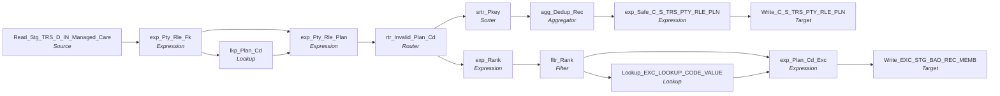

# m_Tgt_C_S_TRS_Pty_Rle_Pln

IDQ mapping &rarr; CDI **Mapping** `m_Tgt_C_S_TRS_Pty_Rle_Pln`.

> Extract TIERS plan data.

[ML 3/7/2022]  Correct exception logging (write Hist_Seq to source_sys_id2, change attribute name to "Plan")
[TLF 5/26/2022] Updated to log BEGIN_DT to PERIOD_START_DATE and SRC_SYS_ID_2 in the exception table.

## Summary

| IDQ transformation | CDI transformation | Count |
|---|---|---|
| AggregatorTx | Aggregator | 1 |
| ExpressionTx | Expression | 5 |
| FilterTx | Filter | 1 |
| LookupTx | Lookup | 2 |
| RouterTx | Router | 1 |
| SorterTx | Sorter | 1 |
| SourceTx | Source | 1 |
| TargetTx | Target | 2 |

Sources:

| Instance | Object | Connection |
|---|---|---|
| Read_Stg_TRS_D_IN_Managed_Care | `STG_TRS_D_IN_MANAGED_CARE` | STAGING |

Targets:

| Instance | Object | Connection |
|---|---|---|
| Write_EXC_STG_BAD_REC_MEMB | `EXC_STG_BAD_REC_MEMB` | STAGING |
| Write_C_S_TRS_PTY_RLE_PLN | `C_S_TRS_PTY_RLE_PLN` | HHS_MDM_ORS |

`$sys.MappingName` is translated to the input parameter `$$MappingName` (default: the mapping name).

## Flow



## Transformations

In data-flow order.

### Read_Stg_TRS_D_IN_Managed_Care

IDQ `SourceTx` &rarr; CDI **Source**. Oracle connector source; carry the SQL override / filter below verbatim.

| Property | Value |
|---|---|
| Connection | STAGING |
| Object | STG_TRS_D_IN_MANAGED_CARE |
| queryMode | SEMI |

Filter (CDI source/lookup *Filter* property; translated):

```sql
MC_PLAN IS NOT NULL
```

SQL override (CDI *SQL Override*; translated):

```sql
SELECT DISTINCT 
M.INDV_ID as INDV_ID,
M.BEGIN_DT,
M.MC_PLAN,
M.HISTORY_SEQ,
M.END_DT,
M.CREATE_DT
FROM "STG_TRS_D_IN_MANAGED_CARE" M 
JOIN 
STG_TRS_VALID_MEMBERS VM
on  M.INDV_ID = VM.INDV_ID
and VM.SRC_TBL='MCI'
WHERE MC_PLAN IS NOT NULL
AND (M.BEGIN_DT < M.END_DT OR M.END_DT IS NULL)
 ORDER BY M."INDV_ID" ASC,
 M."MC_PLAN" ASC,
M."BEGIN_DT" ASC,
M."END_DT" ASC
```

Columns: `None`, `None`, `None`, `None`, `None`, `None`

### exp_Pty_Rle_Fk

IDQ `ExpressionTx` &rarr; CDI **Expression**. Same expression language; variable fields are supported.

| Field | Kind | Type | Expression (CDI) |
|---|---|---|---|
| in_INDV_ID | in/out | double | `in_INDV_ID` |
| in_BEGIN_DT | in | date/time |  |
| in_MC_PLAN | in/out | string(2) | `in_MC_PLAN` |
| in_END_DT | in | date/time |  |
| CREATE_DT | in/out | date/time |  |
| PERIOD_START_DATE | out | date/time | `in_BEGIN_DT` |
| PERIOD_END_DATE | out | date/time | `in_END_DT` |
| PTY_RLE_FK | out | string(255) | `in_INDV_ID \|\| '\|Member'` |
| SRC_SYS | out | string(20) | `'TRS'` |
| HISTORY_SEQ | in/out | double |  |

Links (target field &larr; upstream field):

| Field | From |
|---|---|
| in_INDV_ID | Read_Stg_TRS_D_IN_Managed_Care.INDV_ID |
| in_BEGIN_DT | Read_Stg_TRS_D_IN_Managed_Care.BEGIN_DT |
| in_MC_PLAN | Read_Stg_TRS_D_IN_Managed_Care.MC_PLAN |
| in_END_DT | Read_Stg_TRS_D_IN_Managed_Care.END_DT |
| CREATE_DT | Read_Stg_TRS_D_IN_Managed_Care.CREATE_DT |
| HISTORY_SEQ | Read_Stg_TRS_D_IN_Managed_Care.HISTORY_SEQ |

### lkp_Plan_Cd

IDQ `LookupTx` &rarr; CDI **Lookup**. Connected lookup unless a return port is set (then unconnected).

| Property | Value |
|---|---|
| Connection | STAGING |
| Object | V_LOOKUP_CODE_VALUE (view) |
| Lookup condition | SRC_CODE_VALUE = in_MC_PLAN |
| Multiple matches | Return any row |
| Cache | static cache |
| Cache file name prefix | TRS_LKP_PLAN_CD_ |

Filter (CDI source/lookup *Filter* property; translated):

```sql
"V_LOOKUP_CODE_VALUE"."CODE_TYPE"='PLAN_CD'
AND "V_LOOKUP_CODE_VALUE"."SRC_SYS"='MAX'
```

| Lookup input field | Type |
|---|---|
| in_MC_PLAN | string(2) |

| Return / pass-through field | Feeds |
|---|---|
| MSTR_CODE_VALUE | exp_Pty_Rle_Plan.PLN_MSTR_CD |

Links (target field &larr; upstream field):

| Field | From |
|---|---|
| in_MC_PLAN | exp_Pty_Rle_Fk.in_MC_PLAN |

### exp_Pty_Rle_Plan

IDQ `ExpressionTx` &rarr; CDI **Expression**. Same expression language; variable fields are supported.

| Field | Kind | Type | Expression (CDI) |
|---|---|---|---|
| PTY_RLE_FK | in/out | string(255) | `PTY_RLE_FK` |
| PLN_MSTR_CD | in/out | string(255) |  |
| PKEY_PRTY_RL_PLAN | out | string(255) | `PTY_RLE_FK \|\| '\|' \|\| PLN_MSTR_CD` |
| PERIOD_START_DATE | in/out | date/time | `PERIOD_START_DATE` |
| PERIOD_END_DATE | in/out | date/time | `PERIOD_END_DATE` |
| SRC_SYS | in/out | string(20) | `SRC_SYS` |
| in_INDV_ID | in/out | double | `in_INDV_ID` |
| SRC_SYS_PLAN_CD | in/out | string(10) | `SRC_SYS_PLAN_CD` |
| CREATE_DT | in/out | date/time |  |
| HISTORY_SEQ | in/out | double |  |

Links (target field &larr; upstream field):

| Field | From |
|---|---|
| PLN_MSTR_CD | lkp_Plan_Cd.MSTR_CODE_VALUE |
| PERIOD_START_DATE | exp_Pty_Rle_Fk.PERIOD_START_DATE |
| PERIOD_END_DATE | exp_Pty_Rle_Fk.PERIOD_END_DATE |
| PTY_RLE_FK | exp_Pty_Rle_Fk.PTY_RLE_FK |
| SRC_SYS | exp_Pty_Rle_Fk.SRC_SYS |
| in_INDV_ID | exp_Pty_Rle_Fk.in_INDV_ID |
| SRC_SYS_PLAN_CD | exp_Pty_Rle_Fk.in_MC_PLAN |
| CREATE_DT | exp_Pty_Rle_Fk.CREATE_DT |
| HISTORY_SEQ | exp_Pty_Rle_Fk.HISTORY_SEQ |

### rtr_Invalid_Plan_Cd

IDQ `RouterTx` &rarr; CDI **Router**. One output group per IDQ group; the default group is created automatically.

| Output group | Condition |
|---|---|
| VALID | `NOT ISNULL(PLN_MSTR_CD)` |
| Default | (default group) |

Links (target field &larr; upstream field):

| Field | From |
|---|---|
| PTY_RLE_FK | exp_Pty_Rle_Plan.PTY_RLE_FK |
| PLN_MSTR_CD | exp_Pty_Rle_Plan.PLN_MSTR_CD |
| PKEY_PRTY_RL_PLAN | exp_Pty_Rle_Plan.PKEY_PRTY_RL_PLAN |
| PERIOD_START_DATE | exp_Pty_Rle_Plan.PERIOD_START_DATE |
| PERIOD_END_DATE | exp_Pty_Rle_Plan.PERIOD_END_DATE |
| SRC_SYS | exp_Pty_Rle_Plan.SRC_SYS |
| in_INDV_ID | exp_Pty_Rle_Plan.in_INDV_ID |
| SRC_SYS_PLAN_CD | exp_Pty_Rle_Plan.SRC_SYS_PLAN_CD |
| CREATE_DT | exp_Pty_Rle_Plan.CREATE_DT |
| HISTORY_SEQ | exp_Pty_Rle_Plan.HISTORY_SEQ |

### srtr_Pkey

IDQ `SorterTx` &rarr; CDI **Sorter**. Sort keys in the order listed; distinct, case and null settings below.

| # | Sort key | Order |
|---|---|---|
| 1 | PKEY_PRTY_RL_PLAN | ascending |
| 2 | PERIOD_START_DATE | ascending |
| 3 | PERIOD_END_DATE | ascending |
| 4 | PLN_FK | ascending |
| 5 | PTY_RLE_FK | ascending |

| Property | Value |
|---|---|
| Distinct | no |
| Case sensitive | yes |
| Null treated high | yes |

Links (target field &larr; upstream field):

| Field | From |
|---|---|
| PKEY_PRTY_RL_PLAN | rtr_Invalid_Plan_Cd.VALID.PKEY_PRTY_RL_PLAN |
| PTY_RLE_FK | rtr_Invalid_Plan_Cd.VALID.PTY_RLE_FK |
| PLN_FK | rtr_Invalid_Plan_Cd.VALID.PLN_MSTR_CD |
| PERIOD_START_DATE | rtr_Invalid_Plan_Cd.VALID.PERIOD_START_DATE |
| PERIOD_END_DATE | rtr_Invalid_Plan_Cd.VALID.PERIOD_END_DATE |
| CREATE_DT | rtr_Invalid_Plan_Cd.VALID.CREATE_DT |

### exp_Rank

IDQ `ExpressionTx` &rarr; CDI **Expression**. Same expression language; variable fields are supported.

| Field | Kind | Type | Expression (CDI) |
|---|---|---|---|
| in_INDV_ID | in/out | double | `in_INDV_ID` |
| PTY_RLE_FK | in/out | string(255) | `PTY_RLE_FK` |
| v_RANK | variable | integer | `IIF(in_INDV_ID<>LAST_INDV_ID,1,v_RANK+1)` |
| RANK | out | integer | `v_RANK` |
| PLN_MSTR_CD | in/out | string(255) | `PLN_MSTR_CD` |
| PKEY_PRTY_RL_PLAN | in/out | string(255) | `PKEY_PRTY_RL_PLAN` |
| PERIOD_START_DATE | in/out | date/time | `PERIOD_START_DATE` |
| PERIOD_END_DATE | in/out | date/time | `PERIOD_END_DATE` |
| SRC_SYS_PLAN_CD | in/out | string(10) | `SRC_SYS_PLAN_CD` |
| SRC_SYS | in/out | string(20) | `SRC_SYS` |
| EXC_CODE_INV_PLN_CD | out | string(50) | `'Invalid_Plan'` |
| LAST_INDV_ID | variable | double | `in_INDV_ID` |
| HISTORY_SEQ | in/out | double | `HISTORY_SEQ` |

Links (target field &larr; upstream field):

| Field | From |
|---|---|
| PTY_RLE_FK | rtr_Invalid_Plan_Cd.Default.PTY_RLE_FK |
| PLN_MSTR_CD | rtr_Invalid_Plan_Cd.Default.PLN_MSTR_CD |
| PKEY_PRTY_RL_PLAN | rtr_Invalid_Plan_Cd.Default.PKEY_PRTY_RL_PLAN |
| PERIOD_START_DATE | rtr_Invalid_Plan_Cd.Default.PERIOD_START_DATE |
| PERIOD_END_DATE | rtr_Invalid_Plan_Cd.Default.PERIOD_END_DATE |
| SRC_SYS | rtr_Invalid_Plan_Cd.Default.SRC_SYS |
| in_INDV_ID | rtr_Invalid_Plan_Cd.Default.in_INDV_ID |
| SRC_SYS_PLAN_CD | rtr_Invalid_Plan_Cd.Default.SRC_SYS_PLAN_CD |
| HISTORY_SEQ | rtr_Invalid_Plan_Cd.Default.HISTORY_SEQ |

### fltr_Rank

IDQ `FilterTx` &rarr; CDI **Filter**. Advanced filter condition.

Filter condition:

```
RANK=1
```

Links (target field &larr; upstream field):

| Field | From |
|---|---|
| in_INDV_ID | exp_Rank.in_INDV_ID |
| PTY_RLE_FK | exp_Rank.PTY_RLE_FK |
| RANK | exp_Rank.RANK |
| SRC_SYS_PLAN_CD | exp_Rank.SRC_SYS_PLAN_CD |
| EXC_CODE_INV_PLN_CD | exp_Rank.EXC_CODE_INV_PLN_CD |
| SRC_SYS | exp_Rank.SRC_SYS |
| HISTORY_SEQ | exp_Rank.HISTORY_SEQ |
| PERIOD_START_DATE | exp_Rank.PERIOD_START_DATE |

### agg_Dedup_Rec

IDQ `AggregatorTx` &rarr; CDI **Aggregator**. Group-by fields and aggregate expressions below.

| Property | Value |
|---|---|
| Group by | `PKEY_PRTY_RL_PLAN` |
| Sorted input | no |

| Field | Kind | Type | Aggregate expression (CDI) |
|---|---|---|---|
| PKEY_PRTY_RL_PLAN | group by | string(255) |  |
| out_Pkey_Prty_Rl_Plan | out | string(255) | `MAX(PKEY_PRTY_RL_PLAN)` |
| PERIOD_START_DATE | in/out | date/time |  |
| PERIOD_END_DATE | in/out | date/time |  |
| PLN_FK | in/out | string(255) |  |
| PTY_RLE_FK | in/out | string(255) |  |
| CREATE_DT | in/out | date/time |  |

Links (target field &larr; upstream field):

| Field | From |
|---|---|
| PKEY_PRTY_RL_PLAN | srtr_Pkey.PKEY_PRTY_RL_PLAN |
| PERIOD_START_DATE | srtr_Pkey.PERIOD_START_DATE |
| PERIOD_END_DATE | srtr_Pkey.PERIOD_END_DATE |
| PLN_FK | srtr_Pkey.PLN_FK |
| PTY_RLE_FK | srtr_Pkey.PTY_RLE_FK |
| CREATE_DT | srtr_Pkey.CREATE_DT |

### exp_Safe_C_S_TRS_PTY_RLE_PLN

IDQ `ExpressionTx` &rarr; CDI **Expression**. Same expression language; variable fields are supported.

| Field | Kind | Type | Expression (CDI) |
|---|---|---|---|
| PKEY_SRC_OBJECT | in/out | string(255) |  |
| ROWID_OBJECT | in/out | string(14) | `ROWID_OBJECT` |
| DELETED_IND | in/out | decimal(38) | `DELETED_IND` |
| DELETED_DATE | in/out | date/time | `DELETED_DATE` |
| DELETED_BY | in/out | string(50) | `DELETED_BY` |
| PERIOD_START_DATE | in/out | date/time |  |
| PERIOD_END_DATE | in/out | date/time |  |
| v_VERS_SEQ_NUM | variable | integer | `--IIF(PKEY_SRC_OBJECT<>V_LAST_PKEY, 1, --v_VERS_SEQ_NUM+1)<br><br>1` |
| VERSION_SEQ (stale timeline: omit) | out | decimal(38) | `v_VERS_SEQ_NUM` |
| LAST_UPDATE_DATE | out | date/time | `SESSSTARTTIME` |
| UPDATED_BY | in/out | string(50) | `UPDATED_BY` |
| CREATE_DATE | in/out | date/time | `CREATE_DATE` |
| CREATOR | in/out | string(50) | `CREATOR` |
| SRC_ROWID | in/out | string(30) | `SRC_ROWID` |
| HUB_STATE_IND | in/out | decimal(38) | `HUB_STATE_IND` |
| PTY_RLE_FK | in/out | string(255) |  |
| PLN_FK | in/out | string(255) |  |
| V_LAST_PKEY | variable | string(255) | `PKEY_SRC_OBJECT` |
| PERIOD_REFERENCE_TIME (stale timeline: omit) | out | date/time | `IIF(NOT ISNULL(PERIOD_END_DATE),SESSSTARTTIME,NULL)` |
| TIMELINE_ACTION (stale timeline: omit) | out | decimal(38) | `--IIF(NOT ISNULL(PERIOD_END_DATE),'2',NULL)<br>NULL` |

Links (target field &larr; upstream field):

| Field | From |
|---|---|
| PKEY_SRC_OBJECT | agg_Dedup_Rec.out_Pkey_Prty_Rl_Plan |
| PERIOD_START_DATE | agg_Dedup_Rec.PERIOD_START_DATE |
| PERIOD_END_DATE | agg_Dedup_Rec.PERIOD_END_DATE |
| PTY_RLE_FK | agg_Dedup_Rec.PTY_RLE_FK |
| PLN_FK | agg_Dedup_Rec.PLN_FK |
| CREATE_DATE | agg_Dedup_Rec.CREATE_DT |
| SRC_ROWID | agg_Dedup_Rec.out_Pkey_Prty_Rl_Plan |

### Write_C_S_TRS_PTY_RLE_PLN

IDQ `TargetTx` &rarr; CDI **Target**. Oracle connector target.

| Property | Value |
|---|---|
| Connection | HHS_MDM_ORS |
| Object | C_S_TRS_PTY_RLE_PLN |
| Operation | Insert |
| Truncate target table | yes |
| Load type | normal (no bulk load) |
| Reject file | Write_C_S_TRS_PTY_RLE_PLN1.bad |

Links (target field &larr; upstream field):

| Field | From |
|---|---|
| PKEY_SRC_OBJECT | exp_Safe_C_S_TRS_PTY_RLE_PLN.PKEY_SRC_OBJECT |
| PERIOD_START_DATE | exp_Safe_C_S_TRS_PTY_RLE_PLN.PERIOD_START_DATE |
| PERIOD_END_DATE | exp_Safe_C_S_TRS_PTY_RLE_PLN.PERIOD_END_DATE |
| VERSION_SEQ (stale timeline: do not map) | exp_Safe_C_S_TRS_PTY_RLE_PLN.VERSION_SEQ |
| LAST_UPDATE_DATE | exp_Safe_C_S_TRS_PTY_RLE_PLN.LAST_UPDATE_DATE |
| PTY_RLE_FK | exp_Safe_C_S_TRS_PTY_RLE_PLN.PTY_RLE_FK |
| PLN_FK | exp_Safe_C_S_TRS_PTY_RLE_PLN.PLN_FK |
| UPDATED_BY | exp_Safe_C_S_TRS_PTY_RLE_PLN.UPDATED_BY |
| CREATOR | exp_Safe_C_S_TRS_PTY_RLE_PLN.CREATOR |
| HUB_STATE_IND | exp_Safe_C_S_TRS_PTY_RLE_PLN.HUB_STATE_IND |
| ROWID_OBJECT | exp_Safe_C_S_TRS_PTY_RLE_PLN.ROWID_OBJECT |
| DELETED_IND | exp_Safe_C_S_TRS_PTY_RLE_PLN.DELETED_IND |
| DELETED_DATE | exp_Safe_C_S_TRS_PTY_RLE_PLN.DELETED_DATE |
| DELETED_BY | exp_Safe_C_S_TRS_PTY_RLE_PLN.DELETED_BY |
| SRC_ROWID | exp_Safe_C_S_TRS_PTY_RLE_PLN.PKEY_SRC_OBJECT |
| CREATE_DATE | exp_Safe_C_S_TRS_PTY_RLE_PLN.LAST_UPDATE_DATE |
| SRC_LAST_UPD_DT | exp_Safe_C_S_TRS_PTY_RLE_PLN.CREATE_DATE |

### Lookup_EXC_LOOKUP_CODE_VALUE

IDQ `LookupTx` &rarr; CDI **Lookup**. Connected lookup unless a return port is set (then unconnected).

| Property | Value |
|---|---|
| Connection | STAGING |
| Object | EXC_LOOKUP_CODE_VALUE |
| Lookup condition | EXCEPTION_CODE = EXC_CODE_INV_PLN_CD |
| Multiple matches | Return any row |
| Cache | static cache |

| Lookup input field | Type |
|---|---|
| EXC_CODE_INV_PLN_CD | string(50) |

| Return / pass-through field | Feeds |
|---|---|
| EXCEPTION_DESC | exp_Plan_Cd_Exc.EXCEPTION_DESC |
| EXCEPTION_TYPE | exp_Plan_Cd_Exc.EXCEPTION_TYPE |

Links (target field &larr; upstream field):

| Field | From |
|---|---|
| EXC_CODE_INV_PLN_CD | fltr_Rank.EXC_CODE_INV_PLN_CD |

### exp_Plan_Cd_Exc

IDQ `ExpressionTx` &rarr; CDI **Expression**. Same expression language; variable fields are supported.

| Field | Kind | Type | Expression (CDI) |
|---|---|---|---|
| EXCEPTION_CODE | in/out | string(300) |  |
| EXCEPTION_DESC | in/out | string(300) |  |
| EXCEPTION_TYPE | in/out | string(300) |  |
| PTY_RLE_FK | in/out | string(255) | `PTY_RLE_FK` |
| SRC_SYS_PLAN_CD | in/out | string(10) |  |
| in_INDV_ID | in/out | double |  |
| SRC_SYS | in/out | string(20) |  |
| ATTR_NM | out | string(10) | `'Plan'` |
| MAPPING_NM | out | string(100) | `Substr($$MappingName, INSTR($$MappingName,'/',0)+1)` |
| RUN_DATE | out | date/time | `SESSSTARTTIME` |
| HISTORY_SEQ | in/out | double |  |
| PERIOD_START_DATE | in/out | date/time |  |
| out_PERIOD_START_DATE | out | string(10) | `TO_CHAR(PERIOD_START_DATE,'YYYY-MM-DD')` |

Links (target field &larr; upstream field):

| Field | From |
|---|---|
| EXCEPTION_CODE | fltr_Rank.EXC_CODE_INV_PLN_CD |
| EXCEPTION_DESC | Lookup_EXC_LOOKUP_CODE_VALUE.EXCEPTION_DESC |
| EXCEPTION_TYPE | Lookup_EXC_LOOKUP_CODE_VALUE.EXCEPTION_TYPE |
| PTY_RLE_FK | fltr_Rank.PTY_RLE_FK |
| SRC_SYS_PLAN_CD | fltr_Rank.SRC_SYS_PLAN_CD |
| in_INDV_ID | fltr_Rank.in_INDV_ID |
| SRC_SYS | fltr_Rank.SRC_SYS |
| HISTORY_SEQ | fltr_Rank.HISTORY_SEQ |
| PERIOD_START_DATE | fltr_Rank.PERIOD_START_DATE |

### Write_EXC_STG_BAD_REC_MEMB

IDQ `TargetTx` &rarr; CDI **Target**. Oracle connector target.

| Property | Value |
|---|---|
| Connection | STAGING |
| Object | EXC_STG_BAD_REC_MEMB |
| Operation | Insert |
| Truncate target table | no |
| Load type | normal (no bulk load) |
| Reject file | Write_EXC_STG_BAD_REC_MEMB.bad |

Links (target field &larr; upstream field):

| Field | From |
|---|---|
| SRC_SYS | exp_Plan_Cd_Exc.SRC_SYS |
| SRC_SYS_ID_1 | exp_Plan_Cd_Exc.in_INDV_ID |
| EXCEPTION_TYPE | exp_Plan_Cd_Exc.EXCEPTION_TYPE |
| EXCEPTION_DESC | exp_Plan_Cd_Exc.EXCEPTION_DESC |
| EXCEPTION_CODE | exp_Plan_Cd_Exc.EXCEPTION_CODE |
| ATTRIBUTE_VALUE | exp_Plan_Cd_Exc.SRC_SYS_PLAN_CD |
| ATTRIBUTE_NAME | exp_Plan_Cd_Exc.ATTR_NM |
| MAPPING_NAME | exp_Plan_Cd_Exc.MAPPING_NM |
| RUN_DATE | exp_Plan_Cd_Exc.RUN_DATE |
| PERIOD_START_DATE | exp_Plan_Cd_Exc.PERIOD_START_DATE |
| SRC_SYS_ID_2 | exp_Plan_Cd_Exc.out_PERIOD_START_DATE |
