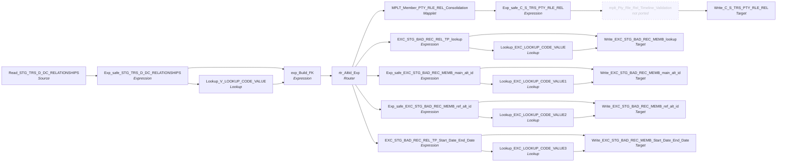

# m_Tgt_C_S_TRS_Pty_Rle_Rel_1_Mem_To_Mem

IDQ mapping &rarr; CDI **Mapping** `m_Tgt_C_S_TRS_Pty_Rle_Rel_1_Mem_To_Mem`.

> Populate a stage table with relationship data between members.  

[ML 8/17/2020] Modify foreign keys relationships to be based on source keys rather than MDM Rowids.
[ML 10/6/2020] Per TC, Do not generate exceptions for Relations to non-valid members.  Forced join in source SQL to include on valid members on both sides of the relation.
[TF 11/3/2020] Added write to exception table for Period Start Date > Period End Date.
[ML 3/7/2022] Correct exception logging (update attribute names)
[KK 6/10/2026] Corrected EXC_CODE_LKP Precision value.

## Summary

| IDQ transformation | CDI transformation | Count |
|---|---|---|
| ExpressionTx | Expression | 7 |
| LookupTx | Lookup | 5 |
| MappletTx | Mapplet | 1 |
| RouterTx | Router | 1 |
| SourceTx | Source | 1 |
| TargetTx | Target | 5 |

## Not ported (stale MDM timeline)

These steps are not built (and not counted above); their sections below say how to rewire around them.

| Step | IDQ type | Reason |
|---|---|---|
| mplt_Pty_Rle_Rel_Timeline_Validation | MappletTx | Calls the retired mapplet `mplt_Pty_Rle_Rel_Timeline_Validation`, which duplicates end-dated relationships into open and closed versions, re-ranks `VERSION_SEQ`, sets `PERIOD_REFERENCE_TIME` / `TIMELINE_ACTION` and forces `HUB_STATE_IND` on open rows. Link the fields that feed it straight to the fields it fed. |

Sources:

| Instance | Object | Connection |
|---|---|---|
| Read_STG_TRS_D_DC_RELATIONSHIPS | `STG_TRS_D_DC_RELATIONSHIPS` | STAGING |

Targets:

| Instance | Object | Connection |
|---|---|---|
| Write_EXC_STG_BAD_REC_MEMB_lookup | `EXC_STG_BAD_REC_MEMB` | STAGING |
| Write_EXC_STG_BAD_REC_MEMB_main_alt_id | `EXC_STG_BAD_REC_MEMB` | STAGING |
| Write_EXC_STG_BAD_REC_MEMB_ref_alt_id | `EXC_STG_BAD_REC_MEMB` | STAGING |
| Write_C_S_TRS_PTY_RLE_REL | `C_S_TRS_PTY_RLE_REL` | HHS_MDM_ORS |
| Write_EXC_STG_BAD_REC_MEMB_Start_Date_End_Date | `EXC_STG_BAD_REC_MEMB` | STAGING |

## Parameters

Create as CDI input parameters (`$$Name`); defaults go in the parameter file.

| Parameter | Type | Precision | Default | Used in this mapping |
|---|---|---|---|---|
| ABSENT_PAR_SQ_ALT_ID_TP | string | 3 | 012 | no (declared only) |
| INDV_ID_ALT_ID_TP | string | 3 | 007 | yes |

`$sys.MappingName` is translated to the input parameter `$$MappingName` (default: the mapping name).

## Flow



## Transformations

In data-flow order.

### Read_STG_TRS_D_DC_RELATIONSHIPS

IDQ `SourceTx` &rarr; CDI **Source**. Oracle connector source; carry the SQL override / filter below verbatim.

| Property | Value |
|---|---|
| Connection | STAGING |
| Object | STG_TRS_D_DC_RELATIONSHIPS |
| queryMode | SEMI |

SQL override (CDI *SQL Override*; translated):

```sql
WITH min_pk as  -- find 1 source key per indiv, prioritze the mci record
(
SELECT 	 indv_id
		,MIN(pty_pk) pty_pk
FROM stg_trs_valid_members
GROUP BY indv_id
)
SELECT /*+ parallel (4) */ 
    rel.indv_id,
    ref_indv_id,
    eff_begin_dt,
    eff_end_dt,
    hist_nav_ind,
    relationship_type_cd,
    pk1.pty_pk 				as pty_pkey,
    pk2.pty_pk 				as ref_pty_pkey,
    '$$INDV_ID_ALT_ID_TP' 	as pty_alt_id_tp,
    create_dt,
    update_dt
FROM stg_trs_d_dc_relationships rel
JOIN min_pk pk1
	ON rel.indv_id = pk1.indv_id
JOIN min_pk pk2
	ON rel.ref_indv_id = pk2.indv_id
-- WHERE ora_hash(sub.indv_id,999) = 1 -- 1/1000th sample for testing
ORDER BY indv_id, eff_end_dt
```

Columns: `None`, `None`, `None`, `None`, `None`, `None`, `None`, `None`, `None`, `None`, `None`

### Exp_safe_STG_TRS_D_DC_RELATIONSHIPS

IDQ `ExpressionTx` &rarr; CDI **Expression**. Same expression language; variable fields are supported.

| Field | Kind | Type | Expression (CDI) |
|---|---|---|---|
| INDV_ID | in/out | double |  |
| REF_INDV_ID | in/out | double |  |
| EFF_BEGIN_DT | in/out | date/time |  |
| EFF_END_DT | in/out | date/time |  |
| HIST_NAV_IND | in/out | string(1) |  |
| RELATIONSHIP_TYPE_CD | in/out | string(8) |  |
| PTY_PKEY | in/out | string(255) |  |
| REF_PTY_PKEY | in/out | string(255) |  |
| SRC_SYS | out | string(10) | `'TRS'` |
| CREATE_DT | in/out | date/time |  |
| UPDATE_DT | in/out | date/time |  |

Links (target field &larr; upstream field):

| Field | From |
|---|---|
| INDV_ID | Read_STG_TRS_D_DC_RELATIONSHIPS.INDV_ID |
| REF_INDV_ID | Read_STG_TRS_D_DC_RELATIONSHIPS.REF_INDV_ID |
| EFF_BEGIN_DT | Read_STG_TRS_D_DC_RELATIONSHIPS.EFF_BEGIN_DT |
| EFF_END_DT | Read_STG_TRS_D_DC_RELATIONSHIPS.EFF_END_DT |
| RELATIONSHIP_TYPE_CD | Read_STG_TRS_D_DC_RELATIONSHIPS.RELATIONSHIP_TYPE_CD |
| CREATE_DT | Read_STG_TRS_D_DC_RELATIONSHIPS.CREATE_DT |
| UPDATE_DT | Read_STG_TRS_D_DC_RELATIONSHIPS.UPDATE_DT |
| PTY_PKEY | Read_STG_TRS_D_DC_RELATIONSHIPS.PTY_PKEY |
| REF_PTY_PKEY | Read_STG_TRS_D_DC_RELATIONSHIPS.REF_PTY_PKEY |
| HIST_NAV_IND | Read_STG_TRS_D_DC_RELATIONSHIPS.HIST_NAV_IND |

### Lookup_V_LOOKUP_CODE_VALUE

IDQ `LookupTx` &rarr; CDI **Lookup**. Connected lookup unless a return port is set (then unconnected).

| Property | Value |
|---|---|
| Connection | STAGING |
| Object | V_LOOKUP_CODE_VALUE (view) |
| Lookup condition | SRC_CODE_VALUE = RELATIONSHIP_TYPE_CD AND SRC_SYS = SRC_SYS_IN |
| Multiple matches | Return any row |
| Cache | static cache |
| Cache file name prefix | V_LKP_REL_CD_ |

Filter (CDI source/lookup *Filter* property; translated):

```sql
"V_LOOKUP_CODE_VALUE"."CODE_TYPE"='PTY_REL'
```

| Lookup input field | Type |
|---|---|
| RELATIONSHIP_TYPE_CD | string(8) |
| SRC_SYS_IN | string(10) |

| Return / pass-through field | Feeds |
|---|---|
| MSTR_CODE_VALUE | exp_Build_FK.in_RELATIONSHIP_TYPE_MSTR_CD |

Links (target field &larr; upstream field):

| Field | From |
|---|---|
| RELATIONSHIP_TYPE_CD | Exp_safe_STG_TRS_D_DC_RELATIONSHIPS.RELATIONSHIP_TYPE_CD |
| SRC_SYS_IN | Exp_safe_STG_TRS_D_DC_RELATIONSHIPS.SRC_SYS |

### exp_Build_FK

IDQ `ExpressionTx` &rarr; CDI **Expression**. Same expression language; variable fields are supported.

| Field | Kind | Type | Expression (CDI) |
|---|---|---|---|
| in_INDV_ID | in/out | double | `in_INDV_ID` |
| in_REF_INDV_ID | in/out | double | `in_REF_INDV_ID` |
| in_RELATIONSHIP_TYPE_CD | in/out | string(8) | `in_RELATIONSHIP_TYPE_CD` |
| in_RELATIONSHIP_TYPE_MSTR_CD | in/out | string(255) | `in_RELATIONSHIP_TYPE_MSTR_CD` |
| in_PTY_FK_INDV | in | string(255) |  |
| in_PTY_FK_REF_INDV | in | string(255) |  |
| v_PTY_RLE_FK_REF_INDV | variable | string(255) | `IIF( ISNULL(in_PTY_FK_REF_INDV)<br>	,NULL<br>	,LTRIM(RTRIM(in_PTY_FK_REF_INDV)) \|\| '\|Member'<br>	)<br><br>` |
| v_PTY_RLE_FK_INDV | variable | string(255) | `IIF( ISNULL(in_PTY_FK_INDV)<br>	,NULL<br>	,LTRIM(RTRIM(in_PTY_FK_INDV)) \|\| '\|Member'<br>	)<br>` |
| PERIOD_START_DATE | in/out | date/time | `PERIOD_START_DATE` |
| PERIOD_END_DATE | in/out | date/time | `PERIOD_END_DATE` |
| PTY_RLE_FK_1 | out | string(255) | `v_PTY_RLE_FK_INDV` |
| PTY_RLE_FK_2 | out | string(255) | `v_PTY_RLE_FK_REF_INDV` |
| PKEY_SRC_OBJECT | out | string(255) | `v_PTY_RLE_FK_INDV \|\| '\|' \|\| <br>v_PTY_RLE_FK_REF_INDV \|\| '\|' \|\|<br>in_RELATIONSHIP_TYPE_MSTR_CD` |
| CREATE_DT | in/out | date/time |  |
| UPDATE_DT | in/out | date/time |  |

Links (target field &larr; upstream field):

| Field | From |
|---|---|
| PERIOD_START_DATE | Exp_safe_STG_TRS_D_DC_RELATIONSHIPS.EFF_BEGIN_DT |
| PERIOD_END_DATE | Exp_safe_STG_TRS_D_DC_RELATIONSHIPS.EFF_END_DT |
| in_INDV_ID | Exp_safe_STG_TRS_D_DC_RELATIONSHIPS.INDV_ID |
| in_REF_INDV_ID | Exp_safe_STG_TRS_D_DC_RELATIONSHIPS.REF_INDV_ID |
| in_RELATIONSHIP_TYPE_CD | Exp_safe_STG_TRS_D_DC_RELATIONSHIPS.RELATIONSHIP_TYPE_CD |
| in_RELATIONSHIP_TYPE_MSTR_CD | Lookup_V_LOOKUP_CODE_VALUE.MSTR_CODE_VALUE |
| CREATE_DT | Exp_safe_STG_TRS_D_DC_RELATIONSHIPS.CREATE_DT |
| UPDATE_DT | Exp_safe_STG_TRS_D_DC_RELATIONSHIPS.UPDATE_DT |
| in_PTY_FK_INDV | Exp_safe_STG_TRS_D_DC_RELATIONSHIPS.PTY_PKEY |
| in_PTY_FK_REF_INDV | Exp_safe_STG_TRS_D_DC_RELATIONSHIPS.REF_PTY_PKEY |

### rtr_AltId_Exp

IDQ `RouterTx` &rarr; CDI **Router**. One output group per IDQ group; the default group is created automatically.

| Output group | Condition |
|---|---|
| Invalid_Main_Alt_Id | `ISNULL(PTY_RLE_FK_1) = true` |
| Invalid_Ref_Alt_Id | `ISNULL(PTY_RLE_FK_2) = true` |
| Invalid_Lookup | `ISNULL(REL_TYPE_CODE) = true` |
| Period_Start_Dt_GT_Period_End_Date | `PERIOD_START_DATE > PERIOD_END_DATE` |
| Default | (default group) |

Links (target field &larr; upstream field):

| Field | From |
|---|---|
| PKEY_SRC_OBJECT | exp_Build_FK.PKEY_SRC_OBJECT |
| PERIOD_START_DATE | exp_Build_FK.PERIOD_START_DATE |
| PERIOD_END_DATE | exp_Build_FK.PERIOD_END_DATE |
| PTY_RLE_FK_1 | exp_Build_FK.PTY_RLE_FK_1 |
| PTY_RLE_FK_2 | exp_Build_FK.PTY_RLE_FK_2 |
| in_REF_INDV_ID | exp_Build_FK.in_REF_INDV_ID |
| in_INDV_ID | exp_Build_FK.in_INDV_ID |
| CREATE_DT | exp_Build_FK.CREATE_DT |
| UPDATE_DT | exp_Build_FK.UPDATE_DT |
| REL_TYPE_CODE | exp_Build_FK.in_RELATIONSHIP_TYPE_MSTR_CD |
| REL_TP_SRC | exp_Build_FK.in_RELATIONSHIP_TYPE_CD |

### MPLT_Member_PTY_RLE_REL_Consolidation

IDQ `MappletTx` &rarr; CDI **Mapplet**. Reusable CDI mapplet (see the mapplets folder).

Mapplet: [`mplt_Member_Pty_Rle_Rel_Consolidation`](../mapplets/mplt_Member_Pty_Rle_Rel_Consolidation.md)

Links (target field &larr; upstream field):

| Field | From |
|---|---|
| Group.PKEY_SRC_OBJECT | rtr_AltId_Exp.Default.PKEY_SRC_OBJECT |
| Group.PERIOD_START_DATE | rtr_AltId_Exp.Default.PERIOD_START_DATE |
| Group.PERIOD_END_DATE | rtr_AltId_Exp.Default.PERIOD_END_DATE |
| Group.PTY_RLE_FK_1 | rtr_AltId_Exp.Default.PTY_RLE_FK_1 |
| Group.PTY_RLE_FK_2 | rtr_AltId_Exp.Default.PTY_RLE_FK_2 |
| Group.REL_TP_CD | rtr_AltId_Exp.Default.REL_TYPE_CODE |
| Group.CREATE_DT | rtr_AltId_Exp.Default.CREATE_DT |
| Group.UPDATE_DT | rtr_AltId_Exp.Default.UPDATE_DT |

### Exp_safe_C_S_TRS_PTY_RLE_REL

IDQ `ExpressionTx` &rarr; CDI **Expression**. Same expression language; variable fields are supported.

| Field | Kind | Type | Expression (CDI) |
|---|---|---|---|
| PKEY_SRC_OBJECT | in/out | string(255) |  |
| ROWID_OBJECT | in/out | string(14) |  |
| DELETED_IND | in/out | decimal(38) |  |
| DELETED_DATE | in/out | date/time |  |
| DELETED_BY | in/out | string(50) |  |
| PERIOD_START_DATE | in/out | date/time |  |
| PERIOD_END_DATE | in/out | date/time |  |
| VERSION_SEQ (stale timeline: omit) | in/out | decimal(38) |  |
| PERIOD_REFERENCE_TIME (stale timeline: omit) | out | date/time | `IIF(NOT ISNULL(PERIOD_END_DATE),SESSSTARTTIME,NULL)<br><br><br><br>` |
| TIMELINE_ACTION (stale timeline: omit) | out | decimal(38) | `IIF(NOT ISNULL(PERIOD_END_DATE),'2',NULL)<br>` |
| LAST_UPDATE_DATE | in/out | date/time |  |
| UPDATED_BY | in/out | string(50) |  |
| CREATE_DATE | in/out | date/time |  |
| UPDATE_DT | in/out | date/time | `UPDATE_DT` |
| CREATOR | in/out | string(50) |  |
| SRC_ROWID | in/out | string(30) |  |
| HUB_STATE_IND | in/out | decimal(38) |  |
| PTY_RLE_FK_1 | in/out | string(255) |  |
| PTY_RLE_FK_2 | in/out | string(255) |  |
| REL_TYPE_CODE | out | string(255) | `'Member Relationship'` |
| HIERARCHY_CODE | in/out | string(255) |  |
| REL_TP | in/out | string(255) |  |
| SRC_LAST_UPDATE_DATE | out | date/time | `IIF(not isnull(CREATE_DATE) and not isnull(UPDATE_DT),<br><br>DECODE(true,<br>DATE_COMPARE(CREATE_DATE,UPDATE_DT)<0,UPDATE_DT,<br>DATE_COMPARE(CREATE_DATE,UPDATE_DT)>0,CREATE_DATE,<br>UPDATE_DT),<br><br>DECODE(true,<br>not isnull(CREATE_DATE),CREATE_DATE,<br>not isnull(UPDATE_DT),UPDATE_DT<br>))` |

Links (target field &larr; upstream field):

| Field | From |
|---|---|
| PKEY_SRC_OBJECT | MPLT_Member_PTY_RLE_REL_Consolidation.NEWOUTPUT.PKEY_SRC_OBJECT |
| PERIOD_START_DATE | MPLT_Member_PTY_RLE_REL_Consolidation.NEWOUTPUT.PERIOD_START_DATE |
| PERIOD_END_DATE | MPLT_Member_PTY_RLE_REL_Consolidation.NEWOUTPUT.PERIOD_END_DATE |
| VERSION_SEQ (stale timeline: do not map) | MPLT_Member_PTY_RLE_REL_Consolidation.NEWOUTPUT.VERSION_SEQ |
| LAST_UPDATE_DATE | MPLT_Member_PTY_RLE_REL_Consolidation.NEWOUTPUT.LAST_UPDATE_DATE |
| SRC_ROWID | MPLT_Member_PTY_RLE_REL_Consolidation.NEWOUTPUT.SRC_ROWID |
| PTY_RLE_FK_1 | MPLT_Member_PTY_RLE_REL_Consolidation.NEWOUTPUT.PTY_RLE_FK_1 |
| PTY_RLE_FK_2 | MPLT_Member_PTY_RLE_REL_Consolidation.NEWOUTPUT.PTY_RLE_FK_2 |
| HIERARCHY_CODE | MPLT_Member_PTY_RLE_REL_Consolidation.NEWOUTPUT.HIERARCHY_CODE |
| REL_TP | MPLT_Member_PTY_RLE_REL_Consolidation.NEWOUTPUT.REL_TP_CD |
| CREATE_DATE | MPLT_Member_PTY_RLE_REL_Consolidation.NEWOUTPUT.CREATE_DT |
| UPDATE_DT | MPLT_Member_PTY_RLE_REL_Consolidation.NEWOUTPUT.UPDATE_DT |

### EXC_STG_BAD_REC_REL_TP_lookup

IDQ `ExpressionTx` &rarr; CDI **Expression**. Same expression language; variable fields are supported.

| Field | Kind | Type | Expression (CDI) |
|---|---|---|---|
| REL_TYPE_CODE | in/out | string(255) | `REL_TYPE_CODE` |
| SRC_SYS | out | string(50) | `'TRS'` |
| OBJECT_NAME | out | string(50) | `'C_S_TRS_PTY_RLE_REL'` |
| SRC_SYS_ID_1 | in/out | string(50) |  |
| SRC_SYS_ID_2 | in/out | string(50) |  |
| SRC_SYS_ID_3 | in/out | string(50) |  |
| REL_TP_SRC | in/out | string(255) | `REL_TP_SRC` |
| EXCEPTION_DESC | out | string(300) | `'Invalid lookup value REL_TYPE_CODE ' \|\| REL_TYPE_CODE` |
| RUN_DATE | out | date/time | `systimestamp()` |
| MEMBER_ID | in/out | string(20) |  |
| MAPPING_NAME | out | string(60) | `Substr($$MappingName, INSTR($$MappingName,'/',0)+1)` |
| EXC_CODE_LKP | out | string(10) | `'Invalid_Rel_Type'` |
| ATTR_NM | out | string(50) | `'Relationship Type'` |
| PERIOD_START_DATE | in/out | date/time | `PERIOD_START_DATE` |
| PERIOD_END_DATE | in/out | date/time | `PERIOD_END_DATE` |

Links (target field &larr; upstream field):

| Field | From |
|---|---|
| SRC_SYS_ID_1 | rtr_AltId_Exp.Invalid_Lookup.in_INDV_ID |
| SRC_SYS_ID_2 | rtr_AltId_Exp.Invalid_Lookup.in_REF_INDV_ID |
| SRC_SYS_ID_3 | rtr_AltId_Exp.Invalid_Lookup.PTY_RLE_FK_2 |
| MEMBER_ID | rtr_AltId_Exp.Invalid_Lookup.in_INDV_ID |
| REL_TYPE_CODE | rtr_AltId_Exp.Invalid_Lookup.REL_TYPE_CODE |
| REL_TP_SRC | rtr_AltId_Exp.Invalid_Lookup.REL_TP_SRC |
| PERIOD_START_DATE | rtr_AltId_Exp.Invalid_Lookup.PERIOD_START_DATE |
| PERIOD_END_DATE | rtr_AltId_Exp.Invalid_Lookup.PERIOD_END_DATE |

### Exp_safe_EXC_STG_BAD_REC_MEMB_main_alt_id

IDQ `ExpressionTx` &rarr; CDI **Expression**. Same expression language; variable fields are supported.

| Field | Kind | Type | Expression (CDI) |
|---|---|---|---|
| in_INDV_ID | in/out | double | `in_INDV_ID` |
| in_REF_INDV_ID | in/out | double | `in_REF_INDV_ID` |
| REL_TYPE_CODE | in/out | string(255) | `REL_TYPE_CODE` |
| SRC_SYS | out | string(50) | `'TRS'` |
| OBJECT_NAME | out | string(50) | `'C_S_TRS_PTY_RLE_REL'` |
| EXCEPTION_DESC | out | string(300) | `'Invalid lookup value for main member (' \|\| in_INDV_ID \|\| ') to ref member (' \|\| in_REF_INDV_ID \|\| ') with relationship (' \|\| REL_TYPE_CODE \|\| ')'` |
| RUN_DATE | out | date/time | `systimestamp()` |
| MEMBER_ID | in/out | string(20) |  |
| MAPPING_NAME | out | string(60) | `Substr($$MappingName, INSTR($$MappingName,'/',0)+1)` |
| PERIOD_START_DATE | in/out | date/time | `PERIOD_START_DATE` |
| PERIOD_END_DATE | in/out | date/time | `PERIOD_END_DATE` |
| EXC_CODE_MEMB | out | string(10) | `'Invalid_Member'` |

Links (target field &larr; upstream field):

| Field | From |
|---|---|
| MEMBER_ID | rtr_AltId_Exp.Invalid_Main_Alt_Id.in_INDV_ID |
| in_INDV_ID | rtr_AltId_Exp.Invalid_Main_Alt_Id.in_INDV_ID |
| in_REF_INDV_ID | rtr_AltId_Exp.Invalid_Main_Alt_Id.in_REF_INDV_ID |
| REL_TYPE_CODE | rtr_AltId_Exp.Invalid_Main_Alt_Id.REL_TYPE_CODE |
| PERIOD_START_DATE | rtr_AltId_Exp.Invalid_Main_Alt_Id.PERIOD_START_DATE |
| PERIOD_END_DATE | rtr_AltId_Exp.Invalid_Main_Alt_Id.PERIOD_END_DATE |

### Exp_safe_EXC_STG_BAD_REC_MEMB_ref_alt_id

IDQ `ExpressionTx` &rarr; CDI **Expression**. Same expression language; variable fields are supported.

| Field | Kind | Type | Expression (CDI) |
|---|---|---|---|
| in_INDV_ID | in/out | double | `in_INDV_ID` |
| in_REF_INDV_ID | in/out | double | `in_REF_INDV_ID` |
| REL_TYPE_CODE | in/out | string(255) | `REL_TYPE_CODE` |
| SRC_SYS | out | string(50) | `'TRS'` |
| OBJECT_NAME | out | string(50) | `'C_S_TRS_PTY_RLE_REL'` |
| EXCEPTION_CODE | in/out | string(300) |  |
| EXCEPTION_DESC | out | string(300) | `'Invalid lookup value for ref member (' \|\| in_REF_INDV_ID \|\| ') to main member (' \|\| in_INDV_ID \|\| ') with relationship (' \|\| REL_TYPE_CODE \|\| ')'` |
| RUN_DATE | out | date/time | `systimestamp()` |
| MEMBER_ID | in/out | string(20) |  |
| PERIOD_START_DATE | in/out | date/time | `PERIOD_START_DATE` |
| PERIOD_END_DATE | in/out | date/time | `PERIOD_END_DATE` |
| MAPPING_NAME | out | string(60) | `Substr($$MappingName, INSTR($$MappingName,'/',0)+1)` |
| EXC_CODE_MEMB | out | string(10) | `'Invalid_Ref_Member'` |

Links (target field &larr; upstream field):

| Field | From |
|---|---|
| MEMBER_ID | rtr_AltId_Exp.Invalid_Ref_Alt_Id.in_INDV_ID |
| in_INDV_ID | rtr_AltId_Exp.Invalid_Ref_Alt_Id.in_INDV_ID |
| in_REF_INDV_ID | rtr_AltId_Exp.Invalid_Ref_Alt_Id.in_REF_INDV_ID |
| REL_TYPE_CODE | rtr_AltId_Exp.Invalid_Ref_Alt_Id.REL_TYPE_CODE |
| PERIOD_START_DATE | rtr_AltId_Exp.Invalid_Ref_Alt_Id.PERIOD_START_DATE |
| PERIOD_END_DATE | rtr_AltId_Exp.Invalid_Ref_Alt_Id.PERIOD_END_DATE |

### mplt_Pty_Rle_Rel_Timeline_Validation (not ported)

IDQ `MappletTx`. **Not ported: stale MDM timeline.** Calls the retired mapplet `mplt_Pty_Rle_Rel_Timeline_Validation`, which duplicates end-dated relationships into open and closed versions, re-ranks `VERSION_SEQ`, sets `PERIOD_REFERENCE_TIME` / `TIMELINE_ACTION` and forces `HUB_STATE_IND` on open rows. Link the fields that feed it straight to the fields it fed.

Links (target field &larr; upstream field):

| Field | From |
|---|---|
| Group.PKEY_SRC_OBJECT | Exp_safe_C_S_TRS_PTY_RLE_REL.PKEY_SRC_OBJECT |
| Group.ROWID_OBJECT | Exp_safe_C_S_TRS_PTY_RLE_REL.ROWID_OBJECT |
| Group.DELETED_IND | Exp_safe_C_S_TRS_PTY_RLE_REL.DELETED_IND |
| Group.DELETED_DATE | Exp_safe_C_S_TRS_PTY_RLE_REL.DELETED_DATE |
| Group.DELETED_BY | Exp_safe_C_S_TRS_PTY_RLE_REL.DELETED_BY |
| Group.PERIOD_START_DATE | Exp_safe_C_S_TRS_PTY_RLE_REL.PERIOD_START_DATE |
| Group.PERIOD_END_DATE | Exp_safe_C_S_TRS_PTY_RLE_REL.PERIOD_END_DATE |
| Group.VERSION_SEQ (stale timeline: do not map) | Exp_safe_C_S_TRS_PTY_RLE_REL.VERSION_SEQ |
| Group.PERIOD_REFERENCE_TIME (stale timeline: do not map) | Exp_safe_C_S_TRS_PTY_RLE_REL.PERIOD_REFERENCE_TIME |
| Group.TIMELINE_ACTION (stale timeline: do not map) | Exp_safe_C_S_TRS_PTY_RLE_REL.TIMELINE_ACTION |
| Group.LAST_UPDATE_DATE | Exp_safe_C_S_TRS_PTY_RLE_REL.LAST_UPDATE_DATE |
| Group.UPDATED_BY | Exp_safe_C_S_TRS_PTY_RLE_REL.UPDATED_BY |
| Group.CREATE_DATE | Exp_safe_C_S_TRS_PTY_RLE_REL.CREATE_DATE |
| Group.CREATOR | Exp_safe_C_S_TRS_PTY_RLE_REL.CREATOR |
| Group.SRC_ROWID | Exp_safe_C_S_TRS_PTY_RLE_REL.SRC_ROWID |
| Group.HUB_STATE_IND | Exp_safe_C_S_TRS_PTY_RLE_REL.HUB_STATE_IND |
| Group.PTY_RLE_FK_1 | Exp_safe_C_S_TRS_PTY_RLE_REL.PTY_RLE_FK_1 |
| Group.PTY_RLE_FK_2 | Exp_safe_C_S_TRS_PTY_RLE_REL.PTY_RLE_FK_2 |
| Group.REL_TYPE_CODE | Exp_safe_C_S_TRS_PTY_RLE_REL.REL_TYPE_CODE |
| Group.HIERARCHY_CODE | Exp_safe_C_S_TRS_PTY_RLE_REL.HIERARCHY_CODE |
| Group.REL_TP | Exp_safe_C_S_TRS_PTY_RLE_REL.REL_TP |
| Group.SRC_LAST_UPD_DT | Exp_safe_C_S_TRS_PTY_RLE_REL.SRC_LAST_UPDATE_DATE |

### Write_C_S_TRS_PTY_RLE_REL

IDQ `TargetTx` &rarr; CDI **Target**. Oracle connector target.

| Property | Value |
|---|---|
| Connection | HHS_MDM_ORS |
| Object | C_S_TRS_PTY_RLE_REL |
| Operation | Insert |
| Truncate target table | yes |
| Load type | normal (no bulk load) |
| Reject file | Write_C_S_TRS_PTY_RLE_REL1.bad |

Links (target field &larr; upstream field):

| Field | From |
|---|---|
| PKEY_SRC_OBJECT | mplt_Pty_Rle_Rel_Timeline_Validation.output_PTY_RLE_REL.PKEY_SRC_OBJECT |
| ROWID_OBJECT | mplt_Pty_Rle_Rel_Timeline_Validation.output_PTY_RLE_REL.ROWID_OBJECT |
| DELETED_IND | mplt_Pty_Rle_Rel_Timeline_Validation.output_PTY_RLE_REL.DELETED_IND |
| DELETED_DATE | mplt_Pty_Rle_Rel_Timeline_Validation.output_PTY_RLE_REL.DELETED_DATE |
| DELETED_BY | mplt_Pty_Rle_Rel_Timeline_Validation.output_PTY_RLE_REL.DELETED_BY |
| PERIOD_START_DATE | mplt_Pty_Rle_Rel_Timeline_Validation.output_PTY_RLE_REL.PERIOD_START_DATE |
| PERIOD_END_DATE | mplt_Pty_Rle_Rel_Timeline_Validation.output_PTY_RLE_REL.PERIOD_END_DATE |
| VERSION_SEQ (stale timeline: do not map) | mplt_Pty_Rle_Rel_Timeline_Validation.output_PTY_RLE_REL.VERSION_SEQ |
| PERIOD_REFERENCE_TIME (stale timeline: do not map) | mplt_Pty_Rle_Rel_Timeline_Validation.output_PTY_RLE_REL.PERIOD_REFERENCE_TIME |
| TIMELINE_ACTION (stale timeline: do not map) | mplt_Pty_Rle_Rel_Timeline_Validation.output_PTY_RLE_REL.TIMELINE_ACTION |
| LAST_UPDATE_DATE | mplt_Pty_Rle_Rel_Timeline_Validation.output_PTY_RLE_REL.LAST_UPDATE_DATE |
| UPDATED_BY | mplt_Pty_Rle_Rel_Timeline_Validation.output_PTY_RLE_REL.UPDATED_BY |
| CREATE_DATE | mplt_Pty_Rle_Rel_Timeline_Validation.output_PTY_RLE_REL.CREATE_DATE |
| CREATOR | mplt_Pty_Rle_Rel_Timeline_Validation.output_PTY_RLE_REL.CREATOR |
| SRC_ROWID | mplt_Pty_Rle_Rel_Timeline_Validation.output_PTY_RLE_REL.SRC_ROWID |
| HUB_STATE_IND | mplt_Pty_Rle_Rel_Timeline_Validation.output_PTY_RLE_REL.HUB_STATE_IND |
| PTY_RLE_FK_1 | mplt_Pty_Rle_Rel_Timeline_Validation.output_PTY_RLE_REL.PTY_RLE_FK_1 |
| PTY_RLE_FK_2 | mplt_Pty_Rle_Rel_Timeline_Validation.output_PTY_RLE_REL.PTY_RLE_FK_2 |
| REL_TYPE_CODE | mplt_Pty_Rle_Rel_Timeline_Validation.output_PTY_RLE_REL.REL_TYPE_CODE |
| HIERARCHY_CODE | mplt_Pty_Rle_Rel_Timeline_Validation.output_PTY_RLE_REL.HIERARCHY_CODE |
| REL_TP | mplt_Pty_Rle_Rel_Timeline_Validation.output_PTY_RLE_REL.REL_TP |
| SRC_LAST_UPD_DT | mplt_Pty_Rle_Rel_Timeline_Validation.output_PTY_RLE_REL.SRC_LAST_UPD_DT |

### EXC_STG_BAD_REC_REL_TP_Start_Date_End_Date

IDQ `ExpressionTx` &rarr; CDI **Expression**. Same expression language; variable fields are supported.

| Field | Kind | Type | Expression (CDI) |
|---|---|---|---|
| REL_TYPE_CODE | in/out | string(255) | `REL_TYPE_CODE` |
| SRC_SYS | out | string(50) | `'TRS'` |
| OBJECT_NAME | out | string(50) | `'C_S_TRS_PTY_RLE_REL'` |
| SRC_SYS_ID_1 | in/out | string(50) |  |
| SRC_SYS_ID_2 | in/out | string(50) |  |
| SRC_SYS_ID_3 | in/out | string(50) |  |
| REL_TP_SRC | in/out | string(255) | `REL_TP_SRC` |
| EXCEPTION_CODE | in/out | string(300) |  |
| EXCEPTION_DESC | out | string(300) | `'Invalid lookup value REL_TYPE_CODE ' \|\| REL_TYPE_CODE` |
| RUN_DATE | out | date/time | `systimestamp()` |
| MEMBER_ID | in/out | string(20) |  |
| MAPPING_NAME | out | string(60) | `Substr($$MappingName, INSTR($$MappingName,'/',0)+1)` |
| EXC_CODE_LKP | out | string(300) | `'Period_Start_Date_>_Period_End_Date'` |
| ATTR_NM | out | string(50) | `'Effective Date'` |
| PERIOD_START_DATE | in/out | date/time | `PERIOD_START_DATE` |
| PERIOD_END_DATE | in/out | date/time | `PERIOD_END_DATE` |

Links (target field &larr; upstream field):

| Field | From |
|---|---|
| SRC_SYS_ID_1 | rtr_AltId_Exp.Period_Start_Dt_GT_Period_End_Date.in_INDV_ID |
| SRC_SYS_ID_2 | rtr_AltId_Exp.Period_Start_Dt_GT_Period_End_Date.in_REF_INDV_ID |
| REL_TP_SRC | rtr_AltId_Exp.Period_Start_Dt_GT_Period_End_Date.REL_TP_SRC |
| PERIOD_START_DATE | rtr_AltId_Exp.Period_Start_Dt_GT_Period_End_Date.PERIOD_START_DATE |
| PERIOD_END_DATE | rtr_AltId_Exp.Period_Start_Dt_GT_Period_End_Date.PERIOD_END_DATE |
| REL_TYPE_CODE | rtr_AltId_Exp.Period_Start_Dt_GT_Period_End_Date.REL_TYPE_CODE |
| SRC_SYS_ID_3 | rtr_AltId_Exp.Period_Start_Dt_GT_Period_End_Date.PTY_RLE_FK_2 |
| MEMBER_ID | rtr_AltId_Exp.Period_Start_Dt_GT_Period_End_Date.in_INDV_ID |

### Lookup_EXC_LOOKUP_CODE_VALUE

IDQ `LookupTx` &rarr; CDI **Lookup**. Connected lookup unless a return port is set (then unconnected).

| Property | Value |
|---|---|
| Connection | STAGING |
| Object | EXC_LOOKUP_CODE_VALUE |
| Lookup condition | EXCEPTION_CODE = EXC_CODE_LKP |
| Multiple matches | Return any row |
| Cache | static cache |

| Lookup input field | Type |
|---|---|
| EXC_CODE_LKP | string(300) |

| Return / pass-through field | Feeds |
|---|---|
| EXCEPTION_TYPE | Write_EXC_STG_BAD_REC_MEMB_lookup.EXCEPTION_TYPE |
| EXCEPTION_DESC | Write_EXC_STG_BAD_REC_MEMB_lookup.EXCEPTION_DESC |
| EXCEPTION_CODE | Write_EXC_STG_BAD_REC_MEMB_lookup.EXCEPTION_CODE |

Links (target field &larr; upstream field):

| Field | From |
|---|---|
| EXC_CODE_LKP | EXC_STG_BAD_REC_REL_TP_lookup.EXC_CODE_LKP |

### Write_EXC_STG_BAD_REC_MEMB_lookup

IDQ `TargetTx` &rarr; CDI **Target**. Oracle connector target.

| Property | Value |
|---|---|
| Connection | STAGING |
| Object | EXC_STG_BAD_REC_MEMB |
| Operation | Insert |
| Truncate target table | no |
| Load type | normal (no bulk load) |
| Reject file | Write_EXC_STG_BAD_REC_MEMB.bad |

Links (target field &larr; upstream field):

| Field | From |
|---|---|
| SRC_SYS | EXC_STG_BAD_REC_REL_TP_lookup.SRC_SYS |
| SRC_SYS_ID_1 | EXC_STG_BAD_REC_REL_TP_lookup.SRC_SYS_ID_1 |
| SRC_SYS_ID_2 | EXC_STG_BAD_REC_REL_TP_lookup.SRC_SYS_ID_2 |
| MAPPING_NAME | EXC_STG_BAD_REC_REL_TP_lookup.MAPPING_NAME |
| RUN_DATE | EXC_STG_BAD_REC_REL_TP_lookup.RUN_DATE |
| SRC_SYS_ID_3 | EXC_STG_BAD_REC_REL_TP_lookup.REL_TP_SRC |
| ATTRIBUTE_VALUE | EXC_STG_BAD_REC_REL_TP_lookup.REL_TP_SRC |
| ATTRIBUTE_NAME | EXC_STG_BAD_REC_REL_TP_lookup.ATTR_NM |
| PERIOD_START_DATE | EXC_STG_BAD_REC_REL_TP_lookup.PERIOD_START_DATE |
| PERIOD_END_DATE | EXC_STG_BAD_REC_REL_TP_lookup.PERIOD_END_DATE |
| EXCEPTION_TYPE | Lookup_EXC_LOOKUP_CODE_VALUE.EXCEPTION_TYPE |
| EXCEPTION_DESC | Lookup_EXC_LOOKUP_CODE_VALUE.EXCEPTION_DESC |
| EXCEPTION_CODE | Lookup_EXC_LOOKUP_CODE_VALUE.EXCEPTION_CODE |

### Lookup_EXC_LOOKUP_CODE_VALUE1

IDQ `LookupTx` &rarr; CDI **Lookup**. Connected lookup unless a return port is set (then unconnected).

| Property | Value |
|---|---|
| Connection | STAGING |
| Object | EXC_LOOKUP_CODE_VALUE |
| Lookup condition | EXCEPTION_CODE = EXC_CODE_LKP |
| Multiple matches | Return any row |
| Cache | static cache |

| Lookup input field | Type |
|---|---|
| EXC_CODE_LKP | string(10) |

| Return / pass-through field | Feeds |
|---|---|
| EXCEPTION_DESC | Write_EXC_STG_BAD_REC_MEMB_main_alt_id.EXCEPTION_DESC |
| EXCEPTION_TYPE | Write_EXC_STG_BAD_REC_MEMB_main_alt_id.EXCEPTION_TYPE |

Links (target field &larr; upstream field):

| Field | From |
|---|---|
| EXC_CODE_LKP | Exp_safe_EXC_STG_BAD_REC_MEMB_main_alt_id.EXC_CODE_MEMB |

### Write_EXC_STG_BAD_REC_MEMB_main_alt_id

IDQ `TargetTx` &rarr; CDI **Target**. Oracle connector target.

| Property | Value |
|---|---|
| Connection | STAGING |
| Object | EXC_STG_BAD_REC_MEMB |
| Operation | Insert |
| Truncate target table | no |
| Load type | normal (no bulk load) |
| Reject file | Write_EXC_STG_BAD_REC_MEMB.bad |

Links (target field &larr; upstream field):

| Field | From |
|---|---|
| SRC_SYS | Exp_safe_EXC_STG_BAD_REC_MEMB_main_alt_id.SRC_SYS |
| RUN_DATE | Exp_safe_EXC_STG_BAD_REC_MEMB_main_alt_id.RUN_DATE |
| MAPPING_NAME | Exp_safe_EXC_STG_BAD_REC_MEMB_main_alt_id.MAPPING_NAME |
| SRC_SYS_ID_1 | Exp_safe_EXC_STG_BAD_REC_MEMB_main_alt_id.in_INDV_ID |
| SRC_SYS_ID_2 | Exp_safe_EXC_STG_BAD_REC_MEMB_main_alt_id.in_REF_INDV_ID |
| SRC_SYS_ID_3 | Exp_safe_EXC_STG_BAD_REC_MEMB_main_alt_id.REL_TYPE_CODE |
| PERIOD_START_DATE | Exp_safe_EXC_STG_BAD_REC_MEMB_main_alt_id.PERIOD_START_DATE |
| PERIOD_END_DATE | Exp_safe_EXC_STG_BAD_REC_MEMB_main_alt_id.PERIOD_END_DATE |
| EXCEPTION_DESC | Lookup_EXC_LOOKUP_CODE_VALUE1.EXCEPTION_DESC |
| EXCEPTION_TYPE | Lookup_EXC_LOOKUP_CODE_VALUE1.EXCEPTION_TYPE |
| EXCEPTION_CODE | Exp_safe_EXC_STG_BAD_REC_MEMB_main_alt_id.EXC_CODE_MEMB |

### Lookup_EXC_LOOKUP_CODE_VALUE2

IDQ `LookupTx` &rarr; CDI **Lookup**. Connected lookup unless a return port is set (then unconnected).

| Property | Value |
|---|---|
| Connection | STAGING |
| Object | EXC_LOOKUP_CODE_VALUE |
| Lookup condition | EXCEPTION_CODE = EXC_CODE_LKP |
| Multiple matches | Return any row |
| Cache | static cache |

| Lookup input field | Type |
|---|---|
| EXC_CODE_LKP | string(10) |

| Return / pass-through field | Feeds |
|---|---|
| EXCEPTION_DESC | Write_EXC_STG_BAD_REC_MEMB_ref_alt_id.EXCEPTION_DESC |
| EXCEPTION_TYPE | Write_EXC_STG_BAD_REC_MEMB_ref_alt_id.EXCEPTION_TYPE |

Links (target field &larr; upstream field):

| Field | From |
|---|---|
| EXC_CODE_LKP | Exp_safe_EXC_STG_BAD_REC_MEMB_ref_alt_id.EXC_CODE_MEMB |

### Write_EXC_STG_BAD_REC_MEMB_ref_alt_id

IDQ `TargetTx` &rarr; CDI **Target**. Oracle connector target.

| Property | Value |
|---|---|
| Connection | STAGING |
| Object | EXC_STG_BAD_REC_MEMB |
| Operation | Insert |
| Truncate target table | no |
| Load type | normal (no bulk load) |
| Reject file | Write_EXC_STG_BAD_REC_MEMB.bad |

Links (target field &larr; upstream field):

| Field | From |
|---|---|
| SRC_SYS | Exp_safe_EXC_STG_BAD_REC_MEMB_ref_alt_id.SRC_SYS |
| RUN_DATE | Exp_safe_EXC_STG_BAD_REC_MEMB_ref_alt_id.RUN_DATE |
| MAPPING_NAME | Exp_safe_EXC_STG_BAD_REC_MEMB_ref_alt_id.MAPPING_NAME |
| SRC_SYS_ID_1 | Exp_safe_EXC_STG_BAD_REC_MEMB_ref_alt_id.in_INDV_ID |
| SRC_SYS_ID_2 | Exp_safe_EXC_STG_BAD_REC_MEMB_ref_alt_id.in_REF_INDV_ID |
| SRC_SYS_ID_3 | Exp_safe_EXC_STG_BAD_REC_MEMB_ref_alt_id.REL_TYPE_CODE |
| PERIOD_START_DATE | Exp_safe_EXC_STG_BAD_REC_MEMB_ref_alt_id.PERIOD_START_DATE |
| PERIOD_END_DATE | Exp_safe_EXC_STG_BAD_REC_MEMB_ref_alt_id.PERIOD_END_DATE |
| EXCEPTION_CODE | Exp_safe_EXC_STG_BAD_REC_MEMB_ref_alt_id.EXC_CODE_MEMB |
| EXCEPTION_DESC | Lookup_EXC_LOOKUP_CODE_VALUE2.EXCEPTION_DESC |
| EXCEPTION_TYPE | Lookup_EXC_LOOKUP_CODE_VALUE2.EXCEPTION_TYPE |

### Lookup_EXC_LOOKUP_CODE_VALUE3

IDQ `LookupTx` &rarr; CDI **Lookup**. Connected lookup unless a return port is set (then unconnected).

| Property | Value |
|---|---|
| Connection | STAGING |
| Object | EXC_LOOKUP_CODE_VALUE |
| Lookup condition | EXCEPTION_CODE = EXC_CODE_LKP |
| Multiple matches | Return any row |
| Cache | static cache |

| Lookup input field | Type |
|---|---|
| EXC_CODE_LKP | string(300) |

| Return / pass-through field | Feeds |
|---|---|
| EXCEPTION_DESC | Write_EXC_STG_BAD_REC_MEMB_Start_Date_End_Date.EXCEPTION_DESC |
| EXCEPTION_TYPE | Write_EXC_STG_BAD_REC_MEMB_Start_Date_End_Date.EXCEPTION_TYPE |

Links (target field &larr; upstream field):

| Field | From |
|---|---|
| EXC_CODE_LKP | EXC_STG_BAD_REC_REL_TP_Start_Date_End_Date.EXC_CODE_LKP |

### Write_EXC_STG_BAD_REC_MEMB_Start_Date_End_Date

IDQ `TargetTx` &rarr; CDI **Target**. Oracle connector target.

| Property | Value |
|---|---|
| Connection | STAGING |
| Object | EXC_STG_BAD_REC_MEMB |
| Operation | Insert |
| Truncate target table | no |
| Load type | normal (no bulk load) |
| Reject file | Write_EXC_STG_BAD_REC_MEMB.bad |

Links (target field &larr; upstream field):

| Field | From |
|---|---|
| SRC_SYS | EXC_STG_BAD_REC_REL_TP_Start_Date_End_Date.SRC_SYS |
| SRC_SYS_ID_1 | EXC_STG_BAD_REC_REL_TP_Start_Date_End_Date.SRC_SYS_ID_1 |
| SRC_SYS_ID_2 | EXC_STG_BAD_REC_REL_TP_Start_Date_End_Date.SRC_SYS_ID_2 |
| MAPPING_NAME | EXC_STG_BAD_REC_REL_TP_Start_Date_End_Date.MAPPING_NAME |
| RUN_DATE | EXC_STG_BAD_REC_REL_TP_Start_Date_End_Date.RUN_DATE |
| SRC_SYS_ID_3 | EXC_STG_BAD_REC_REL_TP_Start_Date_End_Date.REL_TP_SRC |
| ATTRIBUTE_NAME | EXC_STG_BAD_REC_REL_TP_Start_Date_End_Date.ATTR_NM |
| PERIOD_START_DATE | EXC_STG_BAD_REC_REL_TP_Start_Date_End_Date.PERIOD_START_DATE |
| PERIOD_END_DATE | EXC_STG_BAD_REC_REL_TP_Start_Date_End_Date.PERIOD_END_DATE |
| EXCEPTION_CODE | EXC_STG_BAD_REC_REL_TP_Start_Date_End_Date.EXC_CODE_LKP |
| EXCEPTION_DESC | Lookup_EXC_LOOKUP_CODE_VALUE3.EXCEPTION_DESC |
| EXCEPTION_TYPE | Lookup_EXC_LOOKUP_CODE_VALUE3.EXCEPTION_TYPE |
