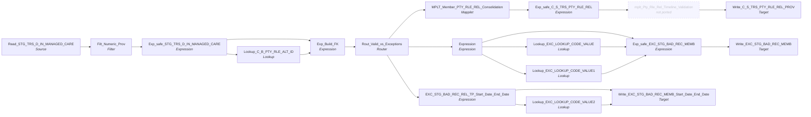

# m_Tgt_C_S_TRS_Pty_Rle_Rel_2_Mem_To_PCP

IDQ mapping &rarr; CDI **Mapping** `m_Tgt_C_S_TRS_Pty_Rle_Rel_2_Mem_To_PCP`.

> Populate a stage table with relationship data between member and provider.  Provider relations are via TPI and are only checked against C21 (SOR for TPIs)

[ML 7/14/2020] Modify foreign keys relationships to be based on source keys rather than MDM Rowids.
[TF 11/3/2020] Add route for writing to exception table when Period Start Date > Period End Date
[ML 3/7/2022] Correct exception logging (include HISTORY_SEQ, update attribute names)

## Summary

| IDQ transformation | CDI transformation | Count |
|---|---|---|
| ExpressionTx | Expression | 6 |
| FilterTx | Filter | 1 |
| LookupTx | Lookup | 4 |
| MappletTx | Mapplet | 1 |
| RouterTx | Router | 1 |
| SourceTx | Source | 1 |
| TargetTx | Target | 3 |

## Not ported (stale MDM timeline)

These steps are not built (and not counted above); their sections below say how to rewire around them.

| Step | IDQ type | Reason |
|---|---|---|
| mplt_Pty_Rle_Rel_Timeline_Validation | MappletTx | Calls the retired mapplet `mplt_Pty_Rle_Rel_Timeline_Validation`, which duplicates end-dated relationships into open and closed versions, re-ranks `VERSION_SEQ`, sets `PERIOD_REFERENCE_TIME` / `TIMELINE_ACTION` and forces `HUB_STATE_IND` on open rows. Link the fields that feed it straight to the fields it fed. |

Sources:

| Instance | Object | Connection |
|---|---|---|
| Read_STG_TRS_D_IN_MANAGED_CARE | `STG_TRS_D_IN_MANAGED_CARE` | STAGING |

Targets:

| Instance | Object | Connection |
|---|---|---|
| Write_EXC_STG_BAD_REC_MEMB | `EXC_STG_BAD_REC_MEMB` | STAGING |
| Write_C_S_TRS_PTY_RLE_REL_PROV | `C_S_TRS_PTY_RLE_REL_PROV` | HHS_MDM_ORS |
| Write_EXC_STG_BAD_REC_MEMB_Start_Date_End_Date | `EXC_STG_BAD_REC_MEMB` | STAGING |

## Parameters

Create as CDI input parameters (`$$Name`); defaults go in the parameter file.

| Parameter | Type | Precision | Default | Used in this mapping |
|---|---|---|---|---|
| PCP_REL_TP | string | 3 | 100 | yes |

`$sys.MappingName` is translated to the input parameter `$$MappingName` (default: the mapping name).

## Flow



## Transformations

In data-flow order.

### Read_STG_TRS_D_IN_MANAGED_CARE

IDQ `SourceTx` &rarr; CDI **Source**. Oracle connector source; carry the SQL override / filter below verbatim.

| Property | Value |
|---|---|
| Connection | STAGING |
| Object | STG_TRS_D_IN_MANAGED_CARE |
| queryMode | SEMI |

Filter (CDI source/lookup *Filter* property; translated):

```sql
PROVIDER_NUM is not null
```

SQL override (CDI *SQL Override*; translated):

```sql
WITH min_pk as  -- find 1 source key per indv, prioritze the mci record
(
SELECT 	 indv_id
		,MIN(pty_pk) pty_pk
FROM stg_trs_valid_members
GROUP BY indv_id
)
SELECT
	mc.indv_id,
	mc.history_seq,
	mc.mc_prog_code,
	mc.begin_dt,
	mc.create_dt,
	mc.provider_num,
	mc.end_dt,
	vm.pty_pk

FROM stg_trs_d_in_managed_care mc
JOIN min_pk vm
on mc.indv_id = vm.indv_id
WHERE  provider_num is not null
--and  ora_hash(STG_TRS_D_IN_MANAGED_CARE.INDV_ID,999) = 1  -- 1/1000TH Sample for testing only
ORDER BY mc.indv_id, mc.end_dt

--[JC 08/12/2020 modified to include create adn update dates for use in logic for src_last_update_date
--SELECT distinct STG_TRS_D_IN_MANAGED_CARE.INDV_ID,
--STG_TRS_D_IN_MANAGED_CARE.MC_PROG_CODE,STG_TRS_D_IN_MANAGED_CARE.BEGIN_DT,
--STG_TRS_D_IN_MANAGED_CARE.CREATE_DT,STG_TRS_D_IN_MANAGED_CARE.PROVIDER_NUM,
--STG_TRS_D_IN_MANAGED_CARE.END_DT
--FROM STG_TRS_D_IN_MANAGED_CARE
--JOIN
--STG_TRS_VALID_MEMBERS VM
--on STG_TRS_D_IN_MANAGED_CARE .INDV_ID = VM.INDV_ID
--WHERE  PROVIDER_NUM is not null
----and ROWNUM < 10000
--ORDER BY STG_TRS_D_IN_MANAGED_CARE.INDV_ID, STG_TRS_D_IN_MANAGED_CARE.END_DT
```

Columns: `None`, `None`, `None`, `None`, `None`, `None`, `None`, `None`

### Filt_Numeric_Prov

IDQ `FilterTx` &rarr; CDI **Filter**. Advanced filter condition.

Filter condition:

```
IS_NUMBER(PROVIDER_NUM)
```

Links (target field &larr; upstream field):

| Field | From |
|---|---|
| INDV_ID | Read_STG_TRS_D_IN_MANAGED_CARE.INDV_ID |
| MC_PROG_CODE | Read_STG_TRS_D_IN_MANAGED_CARE.MC_PROG_CODE |
| BEGIN_DT | Read_STG_TRS_D_IN_MANAGED_CARE.BEGIN_DT |
| CREATE_DT | Read_STG_TRS_D_IN_MANAGED_CARE.CREATE_DT |
| PROVIDER_NUM | Read_STG_TRS_D_IN_MANAGED_CARE.PROVIDER_NUM |
| END_DT | Read_STG_TRS_D_IN_MANAGED_CARE.END_DT |
| PTY_PK | Read_STG_TRS_D_IN_MANAGED_CARE.PTY_PK |
| HISTORY_SEQ | Read_STG_TRS_D_IN_MANAGED_CARE.HISTORY_SEQ |

### Exp_safe_STG_TRS_D_IN_MANAGED_CARE

IDQ `ExpressionTx` &rarr; CDI **Expression**. Same expression language; variable fields are supported.

| Field | Kind | Type | Expression (CDI) |
|---|---|---|---|
| INDV_ID | in/out | double |  |
| MC_PROG_CODE | in/out | string(1) |  |
| BEGIN_DT | in/out | date/time |  |
| CREATE_DT | in/out | date/time |  |
| PROVIDER_NUM | in/out | string(9) |  |
| END_DT | in/out | date/time |  |
| PTY_PK | in/out | string(255) |  |

Links (target field &larr; upstream field):

| Field | From |
|---|---|
| INDV_ID | Filt_Numeric_Prov.INDV_ID |
| BEGIN_DT | Filt_Numeric_Prov.BEGIN_DT |
| CREATE_DT | Filt_Numeric_Prov.CREATE_DT |
| PROVIDER_NUM | Filt_Numeric_Prov.PROVIDER_NUM |
| END_DT | Filt_Numeric_Prov.END_DT |
| MC_PROG_CODE | Filt_Numeric_Prov.MC_PROG_CODE |
| PTY_PK | Filt_Numeric_Prov.PTY_PK |

### Lookup_C_B_PTY_RLE_ALT_ID

IDQ `LookupTx` &rarr; CDI **Lookup**. Connected lookup unless a return port is set (then unconnected).

| Property | Value |
|---|---|
| Connection | HHS_MDM_ORS |
| Object | C_B_PTY_RLE_ALT_ID |
| queryMode | SEMI |
| Lookup condition | ALT_ID_VAL = PROVIDER_NUM |
| Multiple matches | Return any row |
| Cache | static cache |

SQL override (CDI *SQL Override*; translated):

```sql
with tpi_src_key as
(
select
	bo.alt_id_val
	,xr.pkey_src_object
	-- In the event the record has been re-classed use the source key with the latest system update date via row number
	,row_number() over (partition by bo.alt_id_val order by xr.src_last_upd_dt desc) src_key_rn
from c_b_pty_rle_alt_id bo
inner join c_b_pty_rle_alt_id_xref xr
	on bo.rowid_object = xr.rowid_object
where bo.alt_id_tp = '006'
	and xr.rowid_system = 'C21'
	and xr.hub_state_ind = 1
)
select
	alt_id_val
	,pkey_src_object
from tpi_src_key
where  src_key_rn = 1
```

| Lookup input field | Type |
|---|---|
| PROVIDER_NUM | string(9) |

| Return / pass-through field | Feeds |
|---|---|
| PKEY_SRC_OBJECT | Exp_Build_FK.in_PTY_RLE_FK_PROVIDER |

Links (target field &larr; upstream field):

| Field | From |
|---|---|
| PROVIDER_NUM | Exp_safe_STG_TRS_D_IN_MANAGED_CARE.PROVIDER_NUM |

### Exp_Build_FK

IDQ `ExpressionTx` &rarr; CDI **Expression**. Same expression language; variable fields are supported.

| Field | Kind | Type | Expression (CDI) |
|---|---|---|---|
| INDV_ID | in/out | double |  |
| in_PROVIDER_NUM | in/out | string(9) |  |
| in_PTY_RLE_FK_MEMBER | in | string(255) |  |
| in_PTY_RLE_FK_PROVIDER | in | string(255) |  |
| PERIOD_START_DATE | in/out | date/time | `PERIOD_START_DATE` |
| PERIOD_END_DATE | in/out | date/time | `PERIOD_END_DATE` |
| v_PTY_RLE_FK_1 | variable | string(255) | `IIF( ISNULL(in_PTY_RLE_FK_MEMBER)<br>	,NULL<br>	,LTRIM(RTRIM(in_PTY_RLE_FK_MEMBER)) \|\| '\|Member'<br>	)` |
| v_PTY_RLE_FK_2_Trim | variable | string(255) | `LTRIM(RTRIM(in_PTY_RLE_FK_PROVIDER))` |
| v_PTY_RLE_FK_2_Parse | variable | string(255) | `SUBSTR(v_PTY_RLE_FK_2_Trim, 1, INSTR(v_PTY_RLE_FK_2_Trim,'\|',1,2) -1)<br>-- Keep characters before the 2nd pipe (RLE Src Key)<br>` |
| PTY_RLE_FK_1 | out | string(255) | `v_PTY_RLE_FK_1` |
| PTY_RLE_FK_2 | out | string(255) | `v_PTY_RLE_FK_2_Parse` |
| REL_TYPE_CODE | out | string(255) | `IIF(INSTR(v_PTY_RLE_FK_2_Trim,'\|HCO',1,1) > 0<br>	,'Member PCO'<br>	,'Member PCP'<br>	)<br>-- Rle key ending in HCO are PCO ` |
| PKEY_SRC_OBJECT | out | string(255) | `v_PTY_RLE_FK_1 \|\| '\|' \|\|  v_PTY_RLE_FK_2_Parse \|\| '\|' \|\| $$PCP_REL_TP` |
| CREATE_DT | in/out | date/time |  |

Links (target field &larr; upstream field):

| Field | From |
|---|---|
| PERIOD_START_DATE | Exp_safe_STG_TRS_D_IN_MANAGED_CARE.BEGIN_DT |
| in_PROVIDER_NUM | Exp_safe_STG_TRS_D_IN_MANAGED_CARE.PROVIDER_NUM |
| PERIOD_END_DATE | Exp_safe_STG_TRS_D_IN_MANAGED_CARE.END_DT |
| CREATE_DT | Exp_safe_STG_TRS_D_IN_MANAGED_CARE.CREATE_DT |
| INDV_ID | Exp_safe_STG_TRS_D_IN_MANAGED_CARE.INDV_ID |
| in_PTY_RLE_FK_PROVIDER | Lookup_C_B_PTY_RLE_ALT_ID.PKEY_SRC_OBJECT |
| in_PTY_RLE_FK_MEMBER | Exp_safe_STG_TRS_D_IN_MANAGED_CARE.PTY_PK |

### Rout_Valid_vs_Exceptions

IDQ `RouterTx` &rarr; CDI **Router**. One output group per IDQ group; the default group is created automatically.

| Output group | Condition |
|---|---|
| Period_Start_Date_GT_Period_End_Date | `PERIOD_START_DATE > PERIOD_END_DATE` |
| Valid_Records | `NOT ISNULL(PTY_RLE_FK_1) AND NOT ISNULL(PTY_RLE_FK_2) AND (PERIOD_START_DATE <= PERIOD_END_DATE OR ISNULL(PERIOD_END_DATE) )` |
| Default | (default group) |

Links (target field &larr; upstream field):

| Field | From |
|---|---|
| PKEY_SRC_OBJECT | Exp_Build_FK.PKEY_SRC_OBJECT |
| PERIOD_START_DATE | Exp_Build_FK.PERIOD_START_DATE |
| PERIOD_END_DATE | Exp_Build_FK.PERIOD_END_DATE |
| PTY_RLE_FK_1 | Exp_Build_FK.PTY_RLE_FK_1 |
| PTY_RLE_FK_2 | Exp_Build_FK.PTY_RLE_FK_2 |
| REL_TYPE_CODE | Exp_Build_FK.REL_TYPE_CODE |
| in_PROVIDER_NUM | Exp_Build_FK.in_PROVIDER_NUM |
| CREATE_DT | Exp_Build_FK.CREATE_DT |
| in_INDV_ID | Exp_Build_FK.INDV_ID |

### MPLT_Member_PTY_RLE_REL_Consolidation

IDQ `MappletTx` &rarr; CDI **Mapplet**. Reusable CDI mapplet (see the mapplets folder).

Mapplet: [`mplt_Member_Pty_Rle_Rel_Consolidation`](../mapplets/mplt_Member_Pty_Rle_Rel_Consolidation.md)

Links (target field &larr; upstream field):

| Field | From |
|---|---|
| Group.PKEY_SRC_OBJECT | Rout_Valid_vs_Exceptions.Valid_Records.PKEY_SRC_OBJECT |
| Group.PERIOD_START_DATE | Rout_Valid_vs_Exceptions.Valid_Records.PERIOD_START_DATE |
| Group.PERIOD_END_DATE | Rout_Valid_vs_Exceptions.Valid_Records.PERIOD_END_DATE |
| Group.PTY_RLE_FK_1 | Rout_Valid_vs_Exceptions.Valid_Records.PTY_RLE_FK_1 |
| Group.PTY_RLE_FK_2 | Rout_Valid_vs_Exceptions.Valid_Records.PTY_RLE_FK_2 |
| Group.REL_TP_CD | Rout_Valid_vs_Exceptions.Valid_Records.REL_TYPE_CODE |
| Group.CREATE_DT | Rout_Valid_vs_Exceptions.Valid_Records.CREATE_DT |

### Exp_safe_C_S_TRS_PTY_RLE_REL

IDQ `ExpressionTx` &rarr; CDI **Expression**. Same expression language; variable fields are supported.

| Field | Kind | Type | Expression (CDI) |
|---|---|---|---|
| PKEY_SRC_OBJECT | in/out | string(255) |  |
| ROWID_OBJECT | in/out | string(14) | `ROWID_OBJECT` |
| DELETED_IND | in/out | decimal(38) | `DELETED_IND` |
| DELETED_DATE | in/out | date/time | `DELETED_DATE` |
| DELETED_BY | in/out | string(50) | `DELETED_BY` |
| PERIOD_START_DATE | in/out | date/time |  |
| PERIOD_END_DATE | in/out | date/time |  |
| VERSION_SEQ (stale timeline: omit) | in/out | decimal(38) |  |
| LAST_UPDATE_DATE | in/out | date/time |  |
| UPDATED_BY | in/out | string(50) | `UPDATED_BY` |
| CREATE_DATE | in/out | date/time | `CREATE_DATE` |
| CREATOR | in/out | string(50) | `CREATOR` |
| SRC_ROWID | in/out | string(30) |  |
| HUB_STATE_IND | in/out | decimal(38) | `HUB_STATE_IND` |
| PTY_RLE_FK_1 | in/out | string(255) |  |
| PTY_RLE_FK_2 | in/out | string(255) |  |
| REL_TYPE_CODE | in/out | string(255) | `REL_TYPE_CODE` |
| HIERARCHY_CODE | in/out | string(255) |  |
| REL_TP | out | string(255) | `$$PCP_REL_TP` |
| PERIOD_REFERENCE_TIME (stale timeline: omit) | out | date/time | `IIF(NOT ISNULL(PERIOD_END_DATE),SESSSTARTTIME,NULL)<br>` |
| TIMELINE_ACTION (stale timeline: omit) | out | decimal(38) | `IIF(NOT ISNULL(PERIOD_END_DATE),'2',NULL)` |
| SRC_LAST_UPD_DT | in/out | date/time | `SRC_LAST_UPD_DT` |
| ATTRIBUTE_VALUE | in/out | string(40) | `ATTRIBUTE_VALUE` |

Links (target field &larr; upstream field):

| Field | From |
|---|---|
| PKEY_SRC_OBJECT | MPLT_Member_PTY_RLE_REL_Consolidation.NEWOUTPUT.PKEY_SRC_OBJECT |
| PERIOD_START_DATE | MPLT_Member_PTY_RLE_REL_Consolidation.NEWOUTPUT.PERIOD_START_DATE |
| PERIOD_END_DATE | MPLT_Member_PTY_RLE_REL_Consolidation.NEWOUTPUT.PERIOD_END_DATE |
| VERSION_SEQ (stale timeline: do not map) | MPLT_Member_PTY_RLE_REL_Consolidation.NEWOUTPUT.VERSION_SEQ |
| LAST_UPDATE_DATE | MPLT_Member_PTY_RLE_REL_Consolidation.NEWOUTPUT.LAST_UPDATE_DATE |
| SRC_ROWID | MPLT_Member_PTY_RLE_REL_Consolidation.NEWOUTPUT.SRC_ROWID |
| PTY_RLE_FK_1 | MPLT_Member_PTY_RLE_REL_Consolidation.NEWOUTPUT.PTY_RLE_FK_1 |
| PTY_RLE_FK_2 | MPLT_Member_PTY_RLE_REL_Consolidation.NEWOUTPUT.PTY_RLE_FK_2 |
| REL_TYPE_CODE | MPLT_Member_PTY_RLE_REL_Consolidation.NEWOUTPUT.REL_TP_CD |
| HIERARCHY_CODE | MPLT_Member_PTY_RLE_REL_Consolidation.NEWOUTPUT.HIERARCHY_CODE |
| SRC_LAST_UPD_DT | MPLT_Member_PTY_RLE_REL_Consolidation.NEWOUTPUT.CREATE_DT |

### Expression

IDQ `ExpressionTx` &rarr; CDI **Expression**. Same expression language; variable fields are supported.

| Field | Kind | Type | Expression (CDI) |
|---|---|---|---|
| in_INDV_ID | in/out | double | `in_INDV_ID` |
| in_PROVIDER_NUM | in/out | string(9) | `in_PROVIDER_NUM` |
| PKEY_SRC_OBJECT | in/out | string(255) | `PKEY_SRC_OBJECT` |
| PERIOD_START_DATE | in/out | date/time | `PERIOD_START_DATE` |
| PERIOD_END_DATE | in/out | date/time | `PERIOD_END_DATE` |
| PTY_RLE_FK_1 | in/out | string(255) | `PTY_RLE_FK_1` |
| PTY_RLE_FK_2 | in/out | string(255) | `PTY_RLE_FK_2` |
| REL_TYPE_CODE | in/out | string(255) | `REL_TYPE_CODE` |
| EXC_CODE_INV_PCP | out | string(50) | `'Invalid_PCP'` |
| EXC_CODE_INV_MEMB | out | string(50) | `'Invalid_Member'` |

Links (target field &larr; upstream field):

| Field | From |
|---|---|
| in_INDV_ID | Rout_Valid_vs_Exceptions.Default.in_INDV_ID |
| in_PROVIDER_NUM | Rout_Valid_vs_Exceptions.Default.in_PROVIDER_NUM |
| PKEY_SRC_OBJECT | Rout_Valid_vs_Exceptions.Default.PKEY_SRC_OBJECT |
| PERIOD_START_DATE | Rout_Valid_vs_Exceptions.Default.PERIOD_START_DATE |
| PERIOD_END_DATE | Rout_Valid_vs_Exceptions.Default.PERIOD_END_DATE |
| PTY_RLE_FK_1 | Rout_Valid_vs_Exceptions.Default.PTY_RLE_FK_1 |
| PTY_RLE_FK_2 | Rout_Valid_vs_Exceptions.Default.PTY_RLE_FK_2 |
| REL_TYPE_CODE | Rout_Valid_vs_Exceptions.Default.REL_TYPE_CODE |

### mplt_Pty_Rle_Rel_Timeline_Validation (not ported)

IDQ `MappletTx`. **Not ported: stale MDM timeline.** Calls the retired mapplet `mplt_Pty_Rle_Rel_Timeline_Validation`, which duplicates end-dated relationships into open and closed versions, re-ranks `VERSION_SEQ`, sets `PERIOD_REFERENCE_TIME` / `TIMELINE_ACTION` and forces `HUB_STATE_IND` on open rows. Link the fields that feed it straight to the fields it fed.

Links (target field &larr; upstream field):

| Field | From |
|---|---|
| Group.PKEY_SRC_OBJECT | Exp_safe_C_S_TRS_PTY_RLE_REL.PKEY_SRC_OBJECT |
| Group.ROWID_OBJECT | Exp_safe_C_S_TRS_PTY_RLE_REL.ROWID_OBJECT |
| Group.DELETED_IND | Exp_safe_C_S_TRS_PTY_RLE_REL.DELETED_IND |
| Group.DELETED_DATE | Exp_safe_C_S_TRS_PTY_RLE_REL.DELETED_DATE |
| Group.DELETED_BY | Exp_safe_C_S_TRS_PTY_RLE_REL.DELETED_BY |
| Group.PERIOD_START_DATE | Exp_safe_C_S_TRS_PTY_RLE_REL.PERIOD_START_DATE |
| Group.PERIOD_END_DATE | Exp_safe_C_S_TRS_PTY_RLE_REL.PERIOD_END_DATE |
| Group.VERSION_SEQ (stale timeline: do not map) | Exp_safe_C_S_TRS_PTY_RLE_REL.VERSION_SEQ |
| Group.LAST_UPDATE_DATE | Exp_safe_C_S_TRS_PTY_RLE_REL.LAST_UPDATE_DATE |
| Group.UPDATED_BY | Exp_safe_C_S_TRS_PTY_RLE_REL.UPDATED_BY |
| Group.CREATE_DATE | Exp_safe_C_S_TRS_PTY_RLE_REL.CREATE_DATE |
| Group.CREATOR | Exp_safe_C_S_TRS_PTY_RLE_REL.CREATOR |
| Group.SRC_ROWID | Exp_safe_C_S_TRS_PTY_RLE_REL.SRC_ROWID |
| Group.HUB_STATE_IND | Exp_safe_C_S_TRS_PTY_RLE_REL.HUB_STATE_IND |
| Group.PTY_RLE_FK_1 | Exp_safe_C_S_TRS_PTY_RLE_REL.PTY_RLE_FK_1 |
| Group.PTY_RLE_FK_2 | Exp_safe_C_S_TRS_PTY_RLE_REL.PTY_RLE_FK_2 |
| Group.REL_TYPE_CODE | Exp_safe_C_S_TRS_PTY_RLE_REL.REL_TYPE_CODE |
| Group.HIERARCHY_CODE | Exp_safe_C_S_TRS_PTY_RLE_REL.HIERARCHY_CODE |
| Group.REL_TP | Exp_safe_C_S_TRS_PTY_RLE_REL.REL_TP |
| Group.PERIOD_REFERENCE_TIME (stale timeline: do not map) | Exp_safe_C_S_TRS_PTY_RLE_REL.PERIOD_REFERENCE_TIME |
| Group.TIMELINE_ACTION (stale timeline: do not map) | Exp_safe_C_S_TRS_PTY_RLE_REL.TIMELINE_ACTION |
| Group.SRC_LAST_UPD_DT | Exp_safe_C_S_TRS_PTY_RLE_REL.SRC_LAST_UPD_DT |

### Write_C_S_TRS_PTY_RLE_REL_PROV

IDQ `TargetTx` &rarr; CDI **Target**. Oracle connector target.

| Property | Value |
|---|---|
| Connection | HHS_MDM_ORS |
| Object | C_S_TRS_PTY_RLE_REL_PROV |
| Operation | Insert |
| Truncate target table | yes |
| Load type | normal (no bulk load) |
| Reject file | Write_C_S_TRS_PTY_RLE_REL_PROV.bad |

Links (target field &larr; upstream field):

| Field | From |
|---|---|
| PKEY_SRC_OBJECT | mplt_Pty_Rle_Rel_Timeline_Validation.output_PTY_RLE_REL.PKEY_SRC_OBJECT |
| ROWID_OBJECT | mplt_Pty_Rle_Rel_Timeline_Validation.output_PTY_RLE_REL.ROWID_OBJECT |
| DELETED_IND | mplt_Pty_Rle_Rel_Timeline_Validation.output_PTY_RLE_REL.DELETED_IND |
| DELETED_DATE | mplt_Pty_Rle_Rel_Timeline_Validation.output_PTY_RLE_REL.DELETED_DATE |
| DELETED_BY | mplt_Pty_Rle_Rel_Timeline_Validation.output_PTY_RLE_REL.DELETED_BY |
| PERIOD_START_DATE | mplt_Pty_Rle_Rel_Timeline_Validation.output_PTY_RLE_REL.PERIOD_START_DATE |
| PERIOD_END_DATE | mplt_Pty_Rle_Rel_Timeline_Validation.output_PTY_RLE_REL.PERIOD_END_DATE |
| VERSION_SEQ (stale timeline: do not map) | mplt_Pty_Rle_Rel_Timeline_Validation.output_PTY_RLE_REL.VERSION_SEQ |
| PERIOD_REFERENCE_TIME (stale timeline: do not map) | mplt_Pty_Rle_Rel_Timeline_Validation.output_PTY_RLE_REL.PERIOD_REFERENCE_TIME |
| TIMELINE_ACTION (stale timeline: do not map) | mplt_Pty_Rle_Rel_Timeline_Validation.output_PTY_RLE_REL.TIMELINE_ACTION |
| LAST_UPDATE_DATE | mplt_Pty_Rle_Rel_Timeline_Validation.output_PTY_RLE_REL.LAST_UPDATE_DATE |
| UPDATED_BY | mplt_Pty_Rle_Rel_Timeline_Validation.output_PTY_RLE_REL.UPDATED_BY |
| CREATE_DATE | mplt_Pty_Rle_Rel_Timeline_Validation.output_PTY_RLE_REL.CREATE_DATE |
| CREATOR | mplt_Pty_Rle_Rel_Timeline_Validation.output_PTY_RLE_REL.CREATOR |
| SRC_ROWID | mplt_Pty_Rle_Rel_Timeline_Validation.output_PTY_RLE_REL.SRC_ROWID |
| HUB_STATE_IND | mplt_Pty_Rle_Rel_Timeline_Validation.output_PTY_RLE_REL.HUB_STATE_IND |
| PTY_RLE_FK_1 | mplt_Pty_Rle_Rel_Timeline_Validation.output_PTY_RLE_REL.PTY_RLE_FK_1 |
| PTY_RLE_FK_2 | mplt_Pty_Rle_Rel_Timeline_Validation.output_PTY_RLE_REL.PTY_RLE_FK_2 |
| REL_TYPE_CODE | mplt_Pty_Rle_Rel_Timeline_Validation.output_PTY_RLE_REL.REL_TYPE_CODE |
| HIERARCHY_CODE | mplt_Pty_Rle_Rel_Timeline_Validation.output_PTY_RLE_REL.HIERARCHY_CODE |
| REL_TP | mplt_Pty_Rle_Rel_Timeline_Validation.output_PTY_RLE_REL.REL_TP |
| SRC_LAST_UPD_DT | mplt_Pty_Rle_Rel_Timeline_Validation.output_PTY_RLE_REL.SRC_LAST_UPD_DT |

### EXC_STG_BAD_REC_REL_TP_Start_Date_End_Date

IDQ `ExpressionTx` &rarr; CDI **Expression**. Same expression language; variable fields are supported.

| Field | Kind | Type | Expression (CDI) |
|---|---|---|---|
| REL_TYPE_CODE | in/out | string(255) | `REL_TYPE_CODE` |
| SRC_SYS | out | string(50) | `'TRS'` |
| OBJECT_NAME | out | string(50) | `'C_S_TRS_PTY_RLE_REL_PROV'` |
| SRC_SYS_ID_1 | in/out | string(50) |  |
| SRC_SYS_ID_2 | in/out | string(50) |  |
| SRC_SYS_ID_3 | in/out | string(50) |  |
| RUN_DATE | out | date/time | `systimestamp()` |
| MEMBER_ID | in/out | string(20) |  |
| MAPPING_NAME | out | string(60) | `Substr($$MappingName, INSTR($$MappingName,'/',0)+1)` |
| EXC_CODE_LKP | out | string(50) | `'Period_Start_Date_>_Period_End_Date'` |
| ATTR_NM | out | string(50) | `'Effective Date'` |
| PERIOD_START_DATE | in/out | date/time | `PERIOD_START_DATE` |
| PERIOD_END_DATE | in/out | date/time | `PERIOD_END_DATE` |

Links (target field &larr; upstream field):

| Field | From |
|---|---|
| SRC_SYS_ID_1 | Rout_Valid_vs_Exceptions.Period_Start_Date_GT_Period_End_Date.in_INDV_ID |
| SRC_SYS_ID_2 | Rout_Valid_vs_Exceptions.Period_Start_Date_GT_Period_End_Date.in_PROVIDER_NUM |
| PERIOD_START_DATE | Rout_Valid_vs_Exceptions.Period_Start_Date_GT_Period_End_Date.PERIOD_START_DATE |
| PERIOD_END_DATE | Rout_Valid_vs_Exceptions.Period_Start_Date_GT_Period_End_Date.PERIOD_END_DATE |
| REL_TYPE_CODE | Rout_Valid_vs_Exceptions.Period_Start_Date_GT_Period_End_Date.REL_TYPE_CODE |
| SRC_SYS_ID_3 | Rout_Valid_vs_Exceptions.Period_Start_Date_GT_Period_End_Date.PTY_RLE_FK_2 |
| MEMBER_ID | Rout_Valid_vs_Exceptions.Period_Start_Date_GT_Period_End_Date.in_INDV_ID |

### Lookup_EXC_LOOKUP_CODE_VALUE

IDQ `LookupTx` &rarr; CDI **Lookup**. Connected lookup unless a return port is set (then unconnected).

| Property | Value |
|---|---|
| Connection | STAGING |
| Object | EXC_LOOKUP_CODE_VALUE |
| Lookup condition | EXCEPTION_CODE = EXC_ID_INV_PCP |
| Multiple matches | Return any row |
| Cache | static cache |

| Lookup input field | Type |
|---|---|
| EXC_ID_INV_PCP | string(50) |

| Return / pass-through field | Feeds |
|---|---|
| EXCEPTION_DESC | Exp_safe_EXC_STG_BAD_REC_MEMB.EXCEPTION_DESC_PCP |
| EXCEPTION_TYPE | Exp_safe_EXC_STG_BAD_REC_MEMB.EXCEPTION_TYPE_PCP |

Links (target field &larr; upstream field):

| Field | From |
|---|---|
| EXC_ID_INV_PCP | Expression.EXC_CODE_INV_PCP |

### Lookup_EXC_LOOKUP_CODE_VALUE1

IDQ `LookupTx` &rarr; CDI **Lookup**. Connected lookup unless a return port is set (then unconnected).

| Property | Value |
|---|---|
| Connection | STAGING |
| Object | EXC_LOOKUP_CODE_VALUE |
| Lookup condition | EXCEPTION_CODE = EXC_ID_INV_MEMB |
| Multiple matches | Return any row |
| Cache | static cache |

| Lookup input field | Type |
|---|---|
| EXC_ID_INV_MEMB | string(50) |

| Return / pass-through field | Feeds |
|---|---|
| EXCEPTION_DESC | Exp_safe_EXC_STG_BAD_REC_MEMB.EXCEPTION_DESC_MEMB |
| EXCEPTION_TYPE | Exp_safe_EXC_STG_BAD_REC_MEMB.EXCEPTION_TYPE_MEMB |

Links (target field &larr; upstream field):

| Field | From |
|---|---|
| EXC_ID_INV_MEMB | Expression.EXC_CODE_INV_MEMB |

### Exp_safe_EXC_STG_BAD_REC_MEMB

IDQ `ExpressionTx` &rarr; CDI **Expression**. Same expression language; variable fields are supported.

| Field | Kind | Type | Expression (CDI) |
|---|---|---|---|
| SRC_SYS | out | string(50) | `'TRS'` |
| OBJECT_NAME | out | string(50) | `'C_S_TRS_PTY_RLE_REL'` |
| PTY_RLE_FK_1 | in/out | string(255) | `PTY_RLE_FK_1` |
| PTY_RLE_FK_2 | in/out | string(255) | `PTY_RLE_FK_2` |
| EXCEPTION_CODE_PCP | in/out | string(300) |  |
| EXCEPTION_DESC_PCP | in/out | string(300) | `EXCEPTION_DESC_PCP` |
| EXCEPTION_TYPE_PCP | in/out | string(300) |  |
| EXCEPTION_CODE_MEMB | in/out | string(300) |  |
| EXCEPTION_DESC_MEMB | in/out | string(300) |  |
| EXCEPTION_TYPE_MEMB | in/out | string(300) |  |
| PKEY_SRC_OBJECT | in/out | string(255) | `PKEY_SRC_OBJECT` |
| RUN_DATE | out | date/time | `systimestamp()` |
| EXC_CODE_ALL | out | string(300) | `DECODE(true<br>, ISNULL(PTY_RLE_FK_1)<br>, EXCEPTION_CODE_MEMB<br>, ISNULL(PTY_RLE_FK_2)<br>, EXCEPTION_CODE_PCP<br>, NULL<br>)<br><br>--old code updated by TLF 8/25/2023<br>--IIF(ISNULL(PTY_RLE_FK_1), EXCEPTION_CODE_MEMB \|\| '\|' , NULL) \|\|<br>--IIF(ISNULL(PTY_RLE_FK_2), EXCEPTION_CODE_PCP, NULL)` |
| EXC_DESC_ALL | out | string(300) | `DECODE(true<br>, ISNULL(PTY_RLE_FK_1)<br>, EXCEPTION_DESC_MEMB<br>, ISNULL(PTY_RLE_FK_2)<br>, EXCEPTION_DESC_PCP<br>, NULL<br>)<br><br>--old code updated by TLF 8/25/2023<br>--IIF(ISNULL(PTY_RLE_FK_1), EXCEPTION_DESC_MEMB \|\| '\|' , NULL) \|\| <br>--IIF(ISNULL(PTY_RLE_FK_2), EXCEPTION_DESC_PCP, NULL)` |
| MEMBER_ID | in/out | string(20) |  |
| PLAN_ID_MCO | in/out | string(20) |  |
| REL_TYPE_CODE | in/out | string(255) | `REL_TYPE_CODE` |
| PRIMARY_CARE_PROVIDER | in/out | string(20) |  |
| ERROR_TYPE_ALL | out | string(50) | `DECODE(true<br>, ISNULL(PTY_RLE_FK_1)<br>, EXCEPTION_TYPE_MEMB<br>, ISNULL(PTY_RLE_FK_2)<br>, EXCEPTION_TYPE_PCP<br>, NULL<br>)<br><br>--old code updated by TLF 8/25/2023<br>--IIF(ISNULL(PTY_RLE_FK_1), EXCEPTION_TYPE_MEMB \|\| '\|' , NULL) \|\|<br>--IIF(ISNULL(PTY_RLE_FK_2), EXCEPTION_TYPE_PCP, NULL)` |
| MAPPING_NAME | out | string(60) | `Substr($$MappingName, INSTR($$MappingName,'/',0)+1)` |
| PERIOD_START_DATE | in/out | date/time | `PERIOD_START_DATE` |
| PERIOD_END_DATE | in/out | date/time | `PERIOD_END_DATE` |
| ATTRIBUTE_NAME | out | string(10) | `'Provider'` |

Links (target field &larr; upstream field):

| Field | From |
|---|---|
| MEMBER_ID | Expression.in_INDV_ID |
| PRIMARY_CARE_PROVIDER | Expression.in_PROVIDER_NUM |
| PERIOD_START_DATE | Expression.PERIOD_START_DATE |
| PERIOD_END_DATE | Expression.PERIOD_END_DATE |
| PKEY_SRC_OBJECT | Expression.PKEY_SRC_OBJECT |
| PTY_RLE_FK_1 | Expression.PTY_RLE_FK_1 |
| PTY_RLE_FK_2 | Expression.PTY_RLE_FK_2 |
| REL_TYPE_CODE | Expression.REL_TYPE_CODE |
| EXCEPTION_DESC_PCP | Lookup_EXC_LOOKUP_CODE_VALUE.EXCEPTION_DESC |
| EXCEPTION_CODE_PCP | Expression.EXC_CODE_INV_PCP |
| EXCEPTION_DESC_MEMB | Lookup_EXC_LOOKUP_CODE_VALUE1.EXCEPTION_DESC |
| EXCEPTION_CODE_MEMB | Expression.EXC_CODE_INV_MEMB |
| EXCEPTION_TYPE_PCP | Lookup_EXC_LOOKUP_CODE_VALUE.EXCEPTION_TYPE |
| EXCEPTION_TYPE_MEMB | Lookup_EXC_LOOKUP_CODE_VALUE1.EXCEPTION_TYPE |

### Write_EXC_STG_BAD_REC_MEMB

IDQ `TargetTx` &rarr; CDI **Target**. Oracle connector target.

| Property | Value |
|---|---|
| Connection | STAGING |
| Object | EXC_STG_BAD_REC_MEMB |
| Operation | Insert |
| Truncate target table | no |
| Load type | normal (no bulk load) |
| Reject file | Write_EXC_STG_BAD_REC_MEMB.bad |

Links (target field &larr; upstream field):

| Field | From |
|---|---|
| SRC_SYS | Exp_safe_EXC_STG_BAD_REC_MEMB.SRC_SYS |
| RUN_DATE | Exp_safe_EXC_STG_BAD_REC_MEMB.RUN_DATE |
| MAPPING_NAME | Exp_safe_EXC_STG_BAD_REC_MEMB.MAPPING_NAME |
| EXCEPTION_CODE | Exp_safe_EXC_STG_BAD_REC_MEMB.EXC_CODE_ALL |
| EXCEPTION_DESC | Exp_safe_EXC_STG_BAD_REC_MEMB.EXC_DESC_ALL |
| EXCEPTION_TYPE | Exp_safe_EXC_STG_BAD_REC_MEMB.ERROR_TYPE_ALL |
| PERIOD_START_DATE | Exp_safe_EXC_STG_BAD_REC_MEMB.PERIOD_START_DATE |
| PERIOD_END_DATE | Exp_safe_EXC_STG_BAD_REC_MEMB.PERIOD_END_DATE |
| SRC_SYS_ID_1 | Exp_safe_EXC_STG_BAD_REC_MEMB.MEMBER_ID |
| SRC_SYS_ID_2 | Exp_safe_EXC_STG_BAD_REC_MEMB.PRIMARY_CARE_PROVIDER |
| ATTRIBUTE_VALUE | Exp_safe_EXC_STG_BAD_REC_MEMB.PRIMARY_CARE_PROVIDER |
| ATTRIBUTE_NAME | Exp_safe_EXC_STG_BAD_REC_MEMB.ATTRIBUTE_NAME |

### Lookup_EXC_LOOKUP_CODE_VALUE2

IDQ `LookupTx` &rarr; CDI **Lookup**. Connected lookup unless a return port is set (then unconnected).

| Property | Value |
|---|---|
| Connection | STAGING |
| Object | EXC_LOOKUP_CODE_VALUE |
| Lookup condition | EXCEPTION_CODE = EXC_CODE_LKP |
| Multiple matches | Return any row |
| Cache | static cache |

| Lookup input field | Type |
|---|---|
| EXC_CODE_LKP | string(50) |

| Return / pass-through field | Feeds |
|---|---|
| EXCEPTION_DESC | Write_EXC_STG_BAD_REC_MEMB_Start_Date_End_Date.EXCEPTION_DESC |
| EXCEPTION_TYPE | Write_EXC_STG_BAD_REC_MEMB_Start_Date_End_Date.EXCEPTION_TYPE |

Links (target field &larr; upstream field):

| Field | From |
|---|---|
| EXC_CODE_LKP | EXC_STG_BAD_REC_REL_TP_Start_Date_End_Date.EXC_CODE_LKP |

### Write_EXC_STG_BAD_REC_MEMB_Start_Date_End_Date

IDQ `TargetTx` &rarr; CDI **Target**. Oracle connector target.

| Property | Value |
|---|---|
| Connection | STAGING |
| Object | EXC_STG_BAD_REC_MEMB |
| Operation | Insert |
| Truncate target table | no |
| Load type | normal (no bulk load) |
| Reject file | Write_EXC_STG_BAD_REC_MEMB.bad |

Links (target field &larr; upstream field):

| Field | From |
|---|---|
| SRC_SYS | EXC_STG_BAD_REC_REL_TP_Start_Date_End_Date.SRC_SYS |
| SRC_SYS_ID_1 | EXC_STG_BAD_REC_REL_TP_Start_Date_End_Date.SRC_SYS_ID_1 |
| SRC_SYS_ID_2 | EXC_STG_BAD_REC_REL_TP_Start_Date_End_Date.SRC_SYS_ID_2 |
| MAPPING_NAME | EXC_STG_BAD_REC_REL_TP_Start_Date_End_Date.MAPPING_NAME |
| RUN_DATE | EXC_STG_BAD_REC_REL_TP_Start_Date_End_Date.RUN_DATE |
| ATTRIBUTE_NAME | EXC_STG_BAD_REC_REL_TP_Start_Date_End_Date.ATTR_NM |
| PERIOD_START_DATE | EXC_STG_BAD_REC_REL_TP_Start_Date_End_Date.PERIOD_START_DATE |
| PERIOD_END_DATE | EXC_STG_BAD_REC_REL_TP_Start_Date_End_Date.PERIOD_END_DATE |
| SRC_SYS_ID_3 | EXC_STG_BAD_REC_REL_TP_Start_Date_End_Date.SRC_SYS_ID_3 |
| EXCEPTION_CODE | EXC_STG_BAD_REC_REL_TP_Start_Date_End_Date.EXC_CODE_LKP |
| EXCEPTION_DESC | Lookup_EXC_LOOKUP_CODE_VALUE2.EXCEPTION_DESC |
| EXCEPTION_TYPE | Lookup_EXC_LOOKUP_CODE_VALUE2.EXCEPTION_TYPE |
