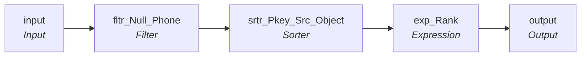

# mplt_Member_Pty_Rle_Phn_Consolidation

IDQ mapplet &rarr; CDI **Mapplet** `mplt_Member_Pty_Rle_Phn_Consolidation`.

## Summary

| IDQ transformation | CDI transformation | Count |
|---|---|---|
| ExpressionTx | Expression | 1 |
| FilterTx | Filter | 1 |
| MappletInputTx | Input | 1 |
| MappletOutputTx | Output | 1 |
| SorterTx | Sorter | 1 |

## Flow



## Transformations

In data-flow order.

### input

IDQ `MappletInputTx` &rarr; CDI **Input**. Mapplet Input transformation.

| Field | Type |
|---|---|
| PKEY_SRC_OBJECT | string(255) |
| PTY_RLE_FK | string(255) |
| PERIOD_START_DATE | date/time |
| USG_TP | string(50) |
| PHN_TP | string(20) |
| PHN_NUM | string(20) |
| PREF_LVL | string(20) |
| FILE_DATE | date/time |

### fltr_Null_Phone

IDQ `FilterTx` &rarr; CDI **Filter**. Advanced filter condition.

Filter condition:

```
ISNULL(PHN_NUM) = 0
```

Links (target field &larr; upstream field):

| Field | From |
|---|---|
| PERIOD_START_DATE | input.PERIOD_START_DATE |
| PKEY_SRC_OBJECT | input.PKEY_SRC_OBJECT |
| PTY_RLE_FK | input.PTY_RLE_FK |
| FILE_DATE | input.FILE_DATE |
| USG_TP | input.USG_TP |
| PHN_TP | input.PHN_TP |
| PHN_NUM | input.PHN_NUM |
| PREF_LVL | input.PREF_LVL |

### srtr_Pkey_Src_Object

IDQ `SorterTx` &rarr; CDI **Sorter**. Sort keys in the order listed; distinct, case and null settings below.

| # | Sort key | Order |
|---|---|---|
| 1 | FILE_DATE | ascending |
| 2 | PKEY_SRC_OBJECT | ascending |
| 3 | PERIOD_START_DATE | ascending |

| Property | Value |
|---|---|
| Distinct | yes |
| Case sensitive | yes |
| Null treated high | yes |

Links (target field &larr; upstream field):

| Field | From |
|---|---|
| PERIOD_START_DATE | fltr_Null_Phone.PERIOD_START_DATE |
| PKEY_SRC_OBJECT | fltr_Null_Phone.PKEY_SRC_OBJECT |
| PTY_RLE_FK | fltr_Null_Phone.PTY_RLE_FK |
| FILE_DATE | fltr_Null_Phone.FILE_DATE |
| USG_TP | fltr_Null_Phone.USG_TP |
| PHN_TP | fltr_Null_Phone.PHN_TP |
| PHN_NUM | fltr_Null_Phone.PHN_NUM |
| PREF_LVL | fltr_Null_Phone.PREF_LVL |

### exp_Rank

IDQ `ExpressionTx` &rarr; CDI **Expression**. Same expression language; variable fields are supported.

| Field | Kind | Type | Expression (CDI) |
|---|---|---|---|
| PKEY_SRC_OBJECT | in/out | string(255) |  |
| PTY_RLE_FK | in/out | string(255) |  |
| PERIOD_START_DATE | in/out | date/time |  |
| USG_TP | in/out | string(50) |  |
| PHN_TP | in/out | string(20) |  |
| PHN_NUM | in/out | string(20) |  |
| PREF_LVL | in/out | string(20) |  |
| FILE_DATE | in | date/time |  |
| v_CUR_PKEY_SRC_OBJECT | variable | string(255) | `PKEY_SRC_OBJECT` |
| v_CUR_RANK (stale timeline: omit) | variable | integer | `IIF(v_CUR_PKEY_SRC_OBJECT <> v_LST_PKEY_SRC_OBJECT, 1, v_LST_RANK + 1)` |
| VERSION_SEQ (stale timeline: omit) | out | decimal(38) | `v_CUR_RANK` |
| v_LST_PKEY_SRC_OBJECT | variable | string(255) | `v_CUR_PKEY_SRC_OBJECT` |
| v_LST_RANK (stale timeline: omit) | variable | integer | `v_CUR_RANK` |
| LAST_UPDATE_DATE | out | date/time | `SYSTIMESTAMP()` |
| SRC_ROWID | out | string(30) | `PKEY_SRC_OBJECT` |

Links (target field &larr; upstream field):

| Field | From |
|---|---|
| PERIOD_START_DATE | srtr_Pkey_Src_Object.PERIOD_START_DATE |
| PKEY_SRC_OBJECT | srtr_Pkey_Src_Object.PKEY_SRC_OBJECT |
| PTY_RLE_FK | srtr_Pkey_Src_Object.PTY_RLE_FK |
| FILE_DATE | srtr_Pkey_Src_Object.FILE_DATE |
| USG_TP | srtr_Pkey_Src_Object.USG_TP |
| PHN_TP | srtr_Pkey_Src_Object.PHN_TP |
| PHN_NUM | srtr_Pkey_Src_Object.PHN_NUM |
| PREF_LVL | srtr_Pkey_Src_Object.PREF_LVL |

### output

IDQ `MappletOutputTx` &rarr; CDI **Output**. Mapplet Output transformation.

| Field | Type |
|---|---|
| PKEY_SRC_OBJECT | string(255) |
| PTY_RLE_FK | string(255) |
| PERIOD_START_DATE | date/time |
| USG_TP | string(50) |
| PHN_TP | string(20) |
| PHN_NUM | string(20) |
| PREF_LVL | string(20) |
| VERSION_SEQ | decimal(38) |
| LAST_UPDATE_DATE | date/time |
| SRC_ROWID | string(30) |

Links (target field &larr; upstream field):

| Field | From |
|---|---|
| PERIOD_START_DATE | exp_Rank.PERIOD_START_DATE |
| PKEY_SRC_OBJECT | exp_Rank.PKEY_SRC_OBJECT |
| PTY_RLE_FK | exp_Rank.PTY_RLE_FK |
| LAST_UPDATE_DATE | exp_Rank.LAST_UPDATE_DATE |
| SRC_ROWID | exp_Rank.SRC_ROWID |
| VERSION_SEQ (stale timeline: do not map) | exp_Rank.VERSION_SEQ |
| USG_TP | exp_Rank.USG_TP |
| PHN_TP | exp_Rank.PHN_TP |
| PHN_NUM | exp_Rank.PHN_NUM |
| PREF_LVL | exp_Rank.PREF_LVL |
