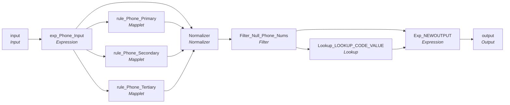

# mplt_Member_Pty_Rle_Phn_Normalization

IDQ mapplet &rarr; CDI **Mapplet** `mplt_Member_Pty_Rle_Phn_Normalization`.

## Summary

| IDQ transformation | CDI transformation | Count |
|---|---|---|
| ExpressionTx | Expression | 2 |
| FilterTx | Filter | 1 |
| LookupTx | Lookup | 1 |
| MappletInputTx | Input | 1 |
| MappletOutputTx | Output | 1 |
| MappletTx | Mapplet | 3 |
| NormalizerTx | Normalizer | 1 |

## Parameters

Create as CDI input parameters (`$$Name`); defaults go in the parameter file.

| Parameter | Type | Precision | Default | Used in this mapplet |
|---|---|---|---|---|
| SRC_SYS | string | 1000 | P84 | no (declared only) |
| OBJECT_NAME | string | 1000 | C_S_P84_ADDR | no (declared only) |

## Flow



## Transformations

In data-flow order.

### input

IDQ `MappletInputTx` &rarr; CDI **Input**. Mapplet Input transformation.

| Field | Type |
|---|---|
| PERIOD_START_DATE | date/time |
| PTY_FK | string(255) |
| USG_TP_Primary | string(50) |
| PHN_TP_Primary | string(20) |
| PHN_NUM_Primary | string(20) |
| USG_TP_Secondary | string(50) |
| PHN_TP_Secondary | string(20) |
| PHN_NUM_Secondary | string(20) |
| USG_TP_Tertiary | string(50) |
| PHN_TP_Tertiary | string(20) |
| PHN_NUM_Tertiary | string(20) |
| SRC_SYS | string(10) |
| CaseNumber | double |

### exp_Phone_Input

IDQ `ExpressionTx` &rarr; CDI **Expression**. Same expression language; variable fields are supported.

| Field | Kind | Type | Expression (CDI) |
|---|---|---|---|
| PERIOD_START_DATE | in/out | date/time | `PERIOD_START_DATE` |
| PTY_FK | in/out | string(255) | `PTY_FK` |
| PREF_LVL_Primary | out | string(20) | `'Primary'` |
| USG_TP_Primary | in/out | string(50) | `USG_TP_Primary` |
| PHN_TP_Primary | in/out | string(20) | `PHN_TP_Primary` |
| PHN_NUM_Primary | in/out | string(20) | `PHN_NUM_Primary` |
| PREF_LVL_Secondary | out | string(20) | `'Secondary'` |
| USG_TP_Secondary | in/out | string(50) | `USG_TP_Secondary` |
| PHN_TP_Secondary | in/out | string(20) | `PHN_TP_Secondary` |
| PHN_NUM_Secondary | in/out | string(20) | `PHN_NUM_Secondary` |
| PREF_LVL_Tertiary | out | string(20) | `'Tertiary'` |
| USG_TP_Tertiary | in/out | string(50) | `USG_TP_Tertiary` |
| PHN_TP_Tertiary | in/out | string(20) | `PHN_TP_Tertiary` |
| PHN_NUM_Tertiary | in/out | string(20) | `PHN_NUM_Tertiary` |
| SRC_SYS | in/out | string(10) | `SRC_SYS` |
| CaseNumber | in/out | double | `CaseNumber` |

Links (target field &larr; upstream field):

| Field | From |
|---|---|
| PERIOD_START_DATE | input.PERIOD_START_DATE |
| PTY_FK | input.PTY_FK |
| USG_TP_Primary | input.USG_TP_Primary |
| PHN_TP_Primary | input.PHN_TP_Primary |
| PHN_NUM_Primary | input.PHN_NUM_Primary |
| USG_TP_Secondary | input.USG_TP_Secondary |
| PHN_TP_Secondary | input.PHN_TP_Secondary |
| PHN_NUM_Secondary | input.PHN_NUM_Secondary |
| USG_TP_Tertiary | input.USG_TP_Tertiary |
| PHN_TP_Tertiary | input.PHN_TP_Tertiary |
| PHN_NUM_Tertiary | input.PHN_NUM_Tertiary |
| SRC_SYS | input.SRC_SYS |
| CaseNumber | input.CaseNumber |

### rule_Phone_Primary

IDQ `MappletTx` &rarr; CDI **Mapplet**. Reusable CDI mapplet (see the mapplets folder).

Mapplet: [`rule_Phone_Std`](../mapplets/rule_Phone_Std.md)

Links (target field &larr; upstream field):

| Field | From |
|---|---|
| Group.Phone | exp_Phone_Input.PHN_NUM_Primary |

### rule_Phone_Secondary

IDQ `MappletTx` &rarr; CDI **Mapplet**. Reusable CDI mapplet (see the mapplets folder).

Mapplet: [`rule_Phone_Std`](../mapplets/rule_Phone_Std.md)

Links (target field &larr; upstream field):

| Field | From |
|---|---|
| Group.Phone | exp_Phone_Input.PHN_NUM_Secondary |

### rule_Phone_Tertiary

IDQ `MappletTx` &rarr; CDI **Mapplet**. Reusable CDI mapplet (see the mapplets folder).

Mapplet: [`rule_Phone_Std`](../mapplets/rule_Phone_Std.md)

Links (target field &larr; upstream field):

| Field | From |
|---|---|
| Group.Phone | exp_Phone_Input.PHN_NUM_Tertiary |

### Normalizer

IDQ `NormalizerTx` &rarr; CDI **Normalizer**. Normalized fields with their occurrence counts below.

Normalized fields (a record with *Occurs* > 1 is a multiple-occurring field group):

| Field / record | Type | Occurs |
|---|---|---|
| PERIOD_START_DATE | date/time | 1 |
| PTY_FK | string(255) | 1 |
| Attributes | record | 3 |
| &nbsp;&nbsp;PREF_LVL | string(20) | 1 |
| &nbsp;&nbsp;USG_TP | string(50) | 1 |
| &nbsp;&nbsp;PHN_TP | string(20) | 1 |
| &nbsp;&nbsp;PHN_NUM | string(20) | 1 |
| &nbsp;&nbsp;DQ_Exception | string(300) | 1 |
| &nbsp;&nbsp;DQ_Exception_Code | string(300) | 1 |
| SRC_SYS | string(10) | 1 |
| CaseNumber | double | 1 |

Links (target field &larr; upstream field):

| Field | From |
|---|---|
| PERIOD_START_DATE | exp_Phone_Input.PERIOD_START_DATE |
| PTY_FK | exp_Phone_Input.PTY_FK |
| PREF_LVL_Primary | exp_Phone_Input.PREF_LVL_Primary |
| USG_TP_Primary | exp_Phone_Input.USG_TP_Primary |
| PHN_TP_Primary | exp_Phone_Input.PHN_TP_Primary |
| PREF_LVL_Secondary | exp_Phone_Input.PREF_LVL_Secondary |
| USG_TP_Secondary | exp_Phone_Input.USG_TP_Secondary |
| PHN_TP_Secondary | exp_Phone_Input.PHN_TP_Secondary |
| USG_TP_Tertiary | exp_Phone_Input.USG_TP_Tertiary |
| PREF_LVL_Tertiary | exp_Phone_Input.PREF_LVL_Tertiary |
| PHN_TP_Tertiary | exp_Phone_Input.PHN_TP_Tertiary |
| PHN_NUM_Primary | rule_Phone_Primary.NEWOUTPUT.Phone |
| PHN_NUM_Tertiary | rule_Phone_Tertiary.NEWOUTPUT.Phone |
| PHN_NUM_Secondary | rule_Phone_Secondary.NEWOUTPUT.Phone |
| SRC_SYS | exp_Phone_Input.SRC_SYS |
| DQ_Exception_Code_Secondary | rule_Phone_Secondary.NEWOUTPUT.Phone_Exception_Code |
| DQ_Exception_Secondary | rule_Phone_Secondary.NEWOUTPUT.Phone_Exception_Desc |
| DQ_Exception_Code_Tertiary | rule_Phone_Tertiary.NEWOUTPUT.Phone_Exception_Code |
| DQ_Exception_Tertiary | rule_Phone_Tertiary.NEWOUTPUT.Phone_Exception_Desc |
| DQ_Exception_Code_Primary | rule_Phone_Primary.NEWOUTPUT.Phone_Exception_Code |
| DQ_Exception_Primary | rule_Phone_Primary.NEWOUTPUT.Phone_Exception_Desc |
| CaseNumber | exp_Phone_Input.CaseNumber |

### Filter_Null_Phone_Nums

IDQ `FilterTx` &rarr; CDI **Filter**. Advanced filter condition.

Filter condition:

```
ISNULL(PHN_NUM) = false
```

Links (target field &larr; upstream field):

| Field | From |
|---|---|
| PERIOD_START_DATE | Normalizer.PERIOD_START_DATE |
| PTY_FK | Normalizer.PTY_FK |
| PREF_LVL | Normalizer.PREF_LVL |
| USG_TP | Normalizer.USG_TP |
| PHN_TP | Normalizer.PHN_TP |
| PHN_NUM | Normalizer.PHN_NUM |
| DQ_Exception | Normalizer.DQ_Exception |
| DQ_Exception_Code | Normalizer.DQ_Exception_Code |
| SRC_SYS | Normalizer.SRC_SYS |
| CaseNumber | Normalizer.CaseNumber |

### Lookup_LOOKUP_CODE_VALUE

IDQ `LookupTx` &rarr; CDI **Lookup**. Connected lookup unless a return port is set (then unconnected).

| Property | Value |
|---|---|
| Connection | STAGING |
| Object | LOOKUP_CODE_VALUE |
| Lookup condition | MSTR_REF_CODE = USG_TP AND SRC_SYS = SRC_SYS1 |
| Multiple matches | Return any row |
| Cache | static cache |

Filter (CDI source/lookup *Filter* property; translated):

```sql
"LOOKUP_CODE_VALUE"."CODE_TYPE" = 'PHN_USG_TP'
```

| Lookup input field | Type |
|---|---|
| USG_TP | string(50) |
| SRC_SYS1 | string(10) |

| Return / pass-through field | Feeds |
|---|---|
| MSTR_REF_LABEL | Exp_NEWOUTPUT.MSTR_REF_LABEL |
| MSTR_REF_CODE | Exp_NEWOUTPUT.MSTR_REF_CODE |

Links (target field &larr; upstream field):

| Field | From |
|---|---|
| USG_TP | Filter_Null_Phone_Nums.USG_TP |
| SRC_SYS1 | Filter_Null_Phone_Nums.SRC_SYS |

### Exp_NEWOUTPUT

IDQ `ExpressionTx` &rarr; CDI **Expression**. Same expression language; variable fields are supported.

| Field | Kind | Type | Expression (CDI) |
|---|---|---|---|
| PERIOD_START_DATE | in/out | date/time |  |
| PTY_FK | in/out | string(255) |  |
| PTY_RLE_FK_v | variable | string(255) | `PTY_FK \|\| '\|Member'` |
| PTY_RLE_FK | out | string(255) | `PTY_RLE_FK_v` |
| PREF_LVL | in/out | string(20) |  |
| USG_TP | in/out | string(50) |  |
| PHN_TP | in/out | string(20) |  |
| PHN_NUM | in/out | string(20) |  |
| DQ_Exception | in/out | string(300) |  |
| DQ_Exception_Code | in/out | string(300) |  |
| SRC_SYS | in/out | string(10) |  |
| MSTR_REF_CODE | in/out | string(20) |  |
| MSTR_REF_LABEL | in/out | string(255) |  |
| PKEY_SRC_OBJECT | out | string(255) | `PTY_RLE_FK_v \|\| '\|' \|\| PHN_TP \|\| '\|' \|\| MSTR_REF_CODE \|\| '\|' \|\| PHN_NUM<br>--[JC 08/12/2020] PTY_RLE_FK_v \|\| '\|' \|\| PHN_TP \|\| '\|' \|\| MSTR_REF_LABEL \|\| '\|' \|\| PHN_NUM` |
| CaseNumber | in/out | double |  |

Links (target field &larr; upstream field):

| Field | From |
|---|---|
| PERIOD_START_DATE | Filter_Null_Phone_Nums.PERIOD_START_DATE |
| PTY_FK | Filter_Null_Phone_Nums.PTY_FK |
| PREF_LVL | Filter_Null_Phone_Nums.PREF_LVL |
| USG_TP | Filter_Null_Phone_Nums.USG_TP |
| PHN_TP | Filter_Null_Phone_Nums.PHN_TP |
| PHN_NUM | Filter_Null_Phone_Nums.PHN_NUM |
| DQ_Exception | Filter_Null_Phone_Nums.DQ_Exception |
| DQ_Exception_Code | Filter_Null_Phone_Nums.DQ_Exception_Code |
| MSTR_REF_LABEL | Lookup_LOOKUP_CODE_VALUE.MSTR_REF_LABEL |
| SRC_SYS | Filter_Null_Phone_Nums.SRC_SYS |
| MSTR_REF_CODE | Lookup_LOOKUP_CODE_VALUE.MSTR_REF_CODE |
| CaseNumber | Filter_Null_Phone_Nums.CaseNumber |

### output

IDQ `MappletOutputTx` &rarr; CDI **Output**. Mapplet Output transformation.

| Field | Type |
|---|---|
| PERIOD_START_DATE | date/time |
| PTY_FK | string(255) |
| PTY_RLE_FK | string(255) |
| PREF_LVL | string(20) |
| USG_TP | string(50) |
| PHN_TP | string(20) |
| PHN_NUM | string(20) |
| DQ_Exception | string(300) |
| DQ_Exception_Code | string(300) |
| PKEY_SRC_OBJECT | string(255) |
| SRC_SYS | string(10) |
| CaseNumber | double |

Links (target field &larr; upstream field):

| Field | From |
|---|---|
| PERIOD_START_DATE | Exp_NEWOUTPUT.PERIOD_START_DATE |
| PTY_FK | Exp_NEWOUTPUT.PTY_FK |
| PREF_LVL | Exp_NEWOUTPUT.PREF_LVL |
| USG_TP | Exp_NEWOUTPUT.USG_TP |
| PHN_TP | Exp_NEWOUTPUT.PHN_TP |
| PHN_NUM | Exp_NEWOUTPUT.PHN_NUM |
| DQ_Exception | Exp_NEWOUTPUT.DQ_Exception |
| DQ_Exception_Code | Exp_NEWOUTPUT.DQ_Exception_Code |
| PKEY_SRC_OBJECT | Exp_NEWOUTPUT.PKEY_SRC_OBJECT |
| SRC_SYS | Exp_NEWOUTPUT.SRC_SYS |
| PTY_RLE_FK | Exp_NEWOUTPUT.PTY_RLE_FK |
| CaseNumber | Exp_NEWOUTPUT.CaseNumber |
