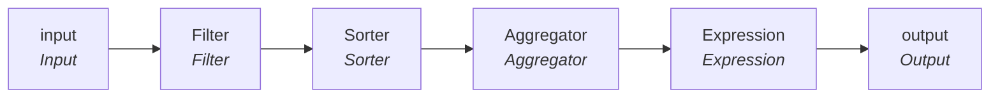

# mplt_Member_Pty_Rle_Rel_Consolidation

IDQ mapplet &rarr; CDI **Mapplet** `mplt_Member_Pty_Rle_Rel_Consolidation`.

## Summary

| IDQ transformation | CDI transformation | Count |
|---|---|---|
| AggregatorTx | Aggregator | 1 |
| ExpressionTx | Expression | 1 |
| FilterTx | Filter | 1 |
| MappletInputTx | Input | 1 |
| MappletOutputTx | Output | 1 |
| SorterTx | Sorter | 1 |

## Flow



## Transformations

In data-flow order.

### input

IDQ `MappletInputTx` &rarr; CDI **Input**. Mapplet Input transformation.

| Field | Type |
|---|---|
| PKEY_SRC_OBJECT | string(255) |
| PERIOD_START_DATE | date/time |
| PERIOD_END_DATE | date/time |
| PTY_RLE_FK_1 | string(255) |
| PTY_RLE_FK_2 | string(255) |
| REL_TP_CD | string(255) |
| CREATE_DT | date/time |
| UPDATE_DT | date/time |

### Filter

IDQ `FilterTx` &rarr; CDI **Filter**. Advanced filter condition.

Filter condition:

```
NOT ISNULL(REL_TP)
```

Links (target field &larr; upstream field):

| Field | From |
|---|---|
| PERIOD_START_DATE | input.PERIOD_START_DATE |
| PKEY_SRC_OBJECT | input.PKEY_SRC_OBJECT |
| PTY_RLE_FK_1 | input.PTY_RLE_FK_1 |
| PTY_RLE_FK_2 | input.PTY_RLE_FK_2 |
| REL_TP | input.REL_TP_CD |
| PERIOD_END_DATE | input.PERIOD_END_DATE |
| CREATE_DT | input.CREATE_DT |
| UPDATE_DT | input.UPDATE_DT |

### Sorter

IDQ `SorterTx` &rarr; CDI **Sorter**. Sort keys in the order listed; distinct, case and null settings below.

| # | Sort key | Order |
|---|---|---|
| 1 | PKEY_SRC_OBJECT | ascending |
| 2 | PERIOD_END_DATE | ascending |
| 3 | PERIOD_START_DATE | ascending |

| Property | Value |
|---|---|
| Distinct | yes |
| Case sensitive | yes |
| Null treated high | yes |

Links (target field &larr; upstream field):

| Field | From |
|---|---|
| PERIOD_START_DATE | Filter.PERIOD_START_DATE |
| PKEY_SRC_OBJECT | Filter.PKEY_SRC_OBJECT |
| PTY_RLE_FK_1 | Filter.PTY_RLE_FK_1 |
| PTY_RLE_FK_2 | Filter.PTY_RLE_FK_2 |
| REL_TP | Filter.REL_TP |
| PERIOD_END_DATE | Filter.PERIOD_END_DATE |
| CREATE_DT | Filter.CREATE_DT |
| UPDATE_DT | Filter.UPDATE_DT |

### Aggregator

IDQ `AggregatorTx` &rarr; CDI **Aggregator**. Group-by fields and aggregate expressions below.

| Property | Value |
|---|---|
| Group by | `PKEY_SRC_OBJECT`, `PERIOD_END_DATE`, `PERIOD_START_DATE` |
| Sorted input | yes |

| Field | Kind | Type | Aggregate expression (CDI) |
|---|---|---|---|
| PKEY_SRC_OBJECT | group by | string(255) |  |
| PERIOD_START_DATE | group by | date/time |  |
| PERIOD_END_DATE | group by | date/time |  |
| PTY_RLE_FK_1 | in/out | string(255) |  |
| PTY_RLE_FK_2 | in/out | string(255) |  |
| REL_TP | in/out | string(255) |  |
| PERIOD_START_DT_OUT | out | date/time | `MIN(PERIOD_START_DATE)` |
| CREATE_DT | in/out | date/time |  |
| UPDATE_DT | in/out | date/time |  |

Links (target field &larr; upstream field):

| Field | From |
|---|---|
| PKEY_SRC_OBJECT | Sorter.PKEY_SRC_OBJECT |
| PERIOD_START_DATE | Sorter.PERIOD_START_DATE |
| PERIOD_END_DATE | Sorter.PERIOD_END_DATE |
| PTY_RLE_FK_1 | Sorter.PTY_RLE_FK_1 |
| PTY_RLE_FK_2 | Sorter.PTY_RLE_FK_2 |
| REL_TP | Sorter.REL_TP |
| CREATE_DT | Sorter.CREATE_DT |
| UPDATE_DT | Sorter.UPDATE_DT |

### Expression

IDQ `ExpressionTx` &rarr; CDI **Expression**. Same expression language; variable fields are supported.

| Field | Kind | Type | Expression (CDI) |
|---|---|---|---|
| PKEY_SRC_OBJECT | in/out | string(255) |  |
| PERIOD_START_DATE | in/out | date/time |  |
| PERIOD_END_DATE | in/out | date/time |  |
| PTY_RLE_FK_1 | in/out | string(255) |  |
| PTY_RLE_FK_2 | in/out | string(255) |  |
| REL_TP | in/out | string(255) |  |
| v_CUR_PKEY_SRC_OBJECT | variable | string(255) | `PKEY_SRC_OBJECT` |
| v_CUR_RANK (stale timeline: omit) | variable | integer | `IIF(v_CUR_PKEY_SRC_OBJECT <> v_LST_PKEY_SRC_OBJECT, 1, v_LST_RANK + 1)` |
| VERSION_SEQ (stale timeline: omit) | out | decimal(38) | `v_CUR_RANK` |
| v_LST_PKEY_SRC_OBJECT | variable | string(255) | `v_CUR_PKEY_SRC_OBJECT` |
| v_LST_RANK (stale timeline: omit) | variable | integer | `v_CUR_RANK` |
| LAST_UPDATE_DATE | out | date/time | `SYSTIMESTAMP()` |
| SRC_ROWID | out | string(30) | `PKEY_SRC_OBJECT` |
| HIERARCHY_CODE | out | string(255) | `'Member'` |
| CREATE_DT | in/out | date/time |  |
| UPDATE_DT | in/out | date/time |  |

Links (target field &larr; upstream field):

| Field | From |
|---|---|
| PERIOD_START_DATE | Aggregator.PERIOD_START_DT_OUT |
| PKEY_SRC_OBJECT | Aggregator.PKEY_SRC_OBJECT |
| PTY_RLE_FK_1 | Aggregator.PTY_RLE_FK_1 |
| PTY_RLE_FK_2 | Aggregator.PTY_RLE_FK_2 |
| REL_TP | Aggregator.REL_TP |
| PERIOD_END_DATE | Aggregator.PERIOD_END_DATE |
| CREATE_DT | Aggregator.CREATE_DT |
| UPDATE_DT | Aggregator.UPDATE_DT |

### output

IDQ `MappletOutputTx` &rarr; CDI **Output**. Mapplet Output transformation.

| Field | Type |
|---|---|
| PKEY_SRC_OBJECT | string(255) |
| PERIOD_START_DATE | date/time |
| PERIOD_END_DATE | date/time |
| PTY_RLE_FK_1 | string(255) |
| PTY_RLE_FK_2 | string(255) |
| REL_TP_CD | string(255) |
| VERSION_SEQ | decimal(38) |
| LAST_UPDATE_DATE | date/time |
| SRC_ROWID | string(30) |
| HIERARCHY_CODE | string(255) |
| CREATE_DT | date/time |
| UPDATE_DT | date/time |

Links (target field &larr; upstream field):

| Field | From |
|---|---|
| PERIOD_START_DATE | Expression.PERIOD_START_DATE |
| PKEY_SRC_OBJECT | Expression.PKEY_SRC_OBJECT |
| LAST_UPDATE_DATE | Expression.LAST_UPDATE_DATE |
| SRC_ROWID | Expression.SRC_ROWID |
| VERSION_SEQ (stale timeline: do not map) | Expression.VERSION_SEQ |
| PTY_RLE_FK_1 | Expression.PTY_RLE_FK_1 |
| PTY_RLE_FK_2 | Expression.PTY_RLE_FK_2 |
| REL_TP_CD | Expression.REL_TP |
| PERIOD_END_DATE | Expression.PERIOD_END_DATE |
| HIERARCHY_CODE | Expression.HIERARCHY_CODE |
| CREATE_DT | Expression.CREATE_DT |
| UPDATE_DT | Expression.UPDATE_DT |
