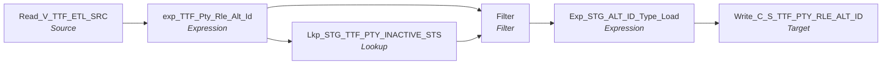

# m_Tgt_C_S_TTF_Pty_Rle_Alt_Id

IDQ mapping &rarr; CDI **Mapping** `m_Tgt_C_S_TTF_Pty_Rle_Alt_Id`.

> MDM Stage Data Load for FSS Alternate ID from STAGING

## Summary

| IDQ transformation | CDI transformation | Count |
|---|---|---|
| ExpressionTx | Expression | 2 |
| FilterTx | Filter | 1 |
| LookupTx | Lookup | 1 |
| SourceTx | Source | 1 |
| TargetTx | Target | 1 |

Sources:

| Instance | Object | Connection |
|---|---|---|
| Read_V_TTF_ETL_SRC | `V_TTF_ETL_SRC` | STAGING |

Targets:

| Instance | Object | Connection |
|---|---|---|
| Write_C_S_TTF_PTY_RLE_ALT_ID | `C_S_TTF_PTY_RLE_ALT_ID` | HHS_MDM_ORS |

## Flow



## Transformations

In data-flow order.

### Read_V_TTF_ETL_SRC

IDQ `SourceTx` &rarr; CDI **Source**. Oracle connector source; carry the SQL override / filter below verbatim.

| Property | Value |
|---|---|
| Connection | STAGING |
| Object | V_TTF_ETL_SRC (view) |

SQL override (CDI *SQL Override*; translated):

```sql
"V_TTF_ETL_SRC"."CLIENTS_ID" in ('199933','174065','173853','208422','173896','173851','208486','199906','190234','208548')
```

Columns: `DEMOGRAPHICS_ID`, `None`, `YEAR`, `MONTH`, `ZIP`, `SEXID`, `COUNTYID`, `GESTAGEATENROLLMENT`, `RACEETHNICITYID`, `SUBMISSIONID`, `ACTIVE`, `MEDICAIDID`, `FIRSTNAME`, `LASTNAME`, `MIDDLENAME`, `DOB`, `LOAD_DATE`, `CREATEDDATE`, `UPDATEDDATE`, `PHONE`, `FYCLIENTS_ID`, `CONTRACTID`, `CLIENTS_ID`, `CLIENTCODE`, `CONTRACTORID`, `None`, `None`, `None`, `None`, `None`

### exp_TTF_Pty_Rle_Alt_Id

IDQ `ExpressionTx` &rarr; CDI **Expression**. Same expression language; variable fields are supported.

| Field | Kind | Type | Expression (CDI) |
|---|---|---|---|
| ID | in/out | decimal(4000) |  |
| CLIENTCODE | in/out | string(10) | `CLIENTCODE` |
| CONTRACTORID | in/out | decimal(20) | `CONTRACTORID` |
| PTY_SRC_KEY | in/out | string(48) | `PTY_SRC_KEY` |
| v_PTY_RLE_FK | variable | string(255) | `PTY_SRC_KEY \|\| '\|Member'` |
| PTY_RLE_FK | out | string(255) | `v_PTY_RLE_FK` |
| v_ALT_ID_TP | variable | string(10) | `'024'` |
| ALT_ID_TP | out | string(3) | `v_ALT_ID_TP` |
| ALT_ID_VAL | out | string(15) | `PTY_SRC_KEY` |
| DATE_CREATED | in/out | date/time |  |
| DATE_MODIFIED | in/out | date/time |  |
| SRC_SYSTEM | out | string(10) | `'TTF'` |
| PKEY_SRC_OBJECT | out | string(255) | `v_PTY_RLE_FK \|\| '\|' \|\| v_ALT_ID_TP \|\| '\|' \|\| PTY_SRC_KEY` |

Links (target field &larr; upstream field):

| Field | From |
|---|---|
| ID | Read_V_TTF_ETL_SRC.CLIENTS_ID |
| DATE_CREATED | Read_V_TTF_ETL_SRC.SUBMITDATE |
| DATE_MODIFIED | Read_V_TTF_ETL_SRC.SUBMITDATE |
| CONTRACTORID | Read_V_TTF_ETL_SRC.CONTRACTID |
| CLIENTCODE | Read_V_TTF_ETL_SRC.CLIENTCODE |
| PTY_SRC_KEY | Read_V_TTF_ETL_SRC.PTY_SRC_KEY |

### Lkp_STG_TTF_PTY_INACTIVE_STS

IDQ `LookupTx` &rarr; CDI **Lookup**. Connected lookup unless a return port is set (then unconnected).

| Property | Value |
|---|---|
| Connection | STAGING |
| Object | STG_TTF_PTY_INACTIVE_STS |
| Lookup condition | SRC_KEY = PTY_SRC_KEY AND ROWID_SYSTEM = SRC_SYSTEM |
| Multiple matches | Return any row |
| Cache | static cache |

| Lookup input field | Type |
|---|---|
| PTY_SRC_KEY | string(48) |
| SRC_SYSTEM | string(10) |

| Return / pass-through field | Feeds |
|---|---|
| DEACTIVATION_STS | Filter.DEACTIVATION_STS |

Links (target field &larr; upstream field):

| Field | From |
|---|---|
| SRC_SYSTEM | exp_TTF_Pty_Rle_Alt_Id.SRC_SYSTEM |
| PTY_SRC_KEY | exp_TTF_Pty_Rle_Alt_Id.PTY_SRC_KEY |

### Filter

IDQ `FilterTx` &rarr; CDI **Filter**. Advanced filter condition.

Filter condition:

```
IsNull(DEACTIVATION_STS)
```

Links (target field &larr; upstream field):

| Field | From |
|---|---|
| ID | exp_TTF_Pty_Rle_Alt_Id.ID |
| PKEY_SRC_OBJECT | exp_TTF_Pty_Rle_Alt_Id.PKEY_SRC_OBJECT |
| PTY_REL_FK | exp_TTF_Pty_Rle_Alt_Id.PTY_RLE_FK |
| ALT_ID_TP | exp_TTF_Pty_Rle_Alt_Id.ALT_ID_TP |
| ALT_ID_VAL | exp_TTF_Pty_Rle_Alt_Id.ALT_ID_VAL |
| DATE_CREATED | exp_TTF_Pty_Rle_Alt_Id.DATE_CREATED |
| DATE_MODIFIED | exp_TTF_Pty_Rle_Alt_Id.DATE_MODIFIED |
| SRC_SYSTEM | exp_TTF_Pty_Rle_Alt_Id.SRC_SYSTEM |
| DEACTIVATION_STS | Lkp_STG_TTF_PTY_INACTIVE_STS.DEACTIVATION_STS |

### Exp_STG_ALT_ID_Type_Load

IDQ `ExpressionTx` &rarr; CDI **Expression**. Same expression language; variable fields are supported.

| Field | Kind | Type | Expression (CDI) |
|---|---|---|---|
| ID | in/out | string(15) | `ID` |
| PKEY_SRC_OBJECT | in/out | string(255) | `PKEY_SRC_OBJECT` |
| PTY_REL_FK | in/out | string(255) | `PTY_REL_FK` |
| ALT_ID_TP | in/out | string(3) | `ALT_ID_TP` |
| ALT_ID_VAL | in/out | string(15) | `ALT_ID_VAL` |
| DATE_CREATED | in/out | date/time | `DATE_CREATED` |
| DATE_MODIFIED | in/out | date/time | `DATE_MODIFIED` |
| PERIOD_START_DATE | out | date/time | `SESSSTARTTIME` |
| Last_Changed_Dt | out | date/time | `IIF(IsNull(DATE_MODIFIED),DATE_CREATED,DATE_MODIFIED)` |
| SRC_SYSTEM | in/out | string(10) | `SRC_SYSTEM` |
| LAST_UPDATE_DATE | out | date/time | `SESSSTARTTIME` |
| SRC_ROWID | out | string(30) | `PKEY_SRC_OBJECT` |
| VERSION_SEQ (stale timeline: omit) | out | decimal(38) | `1` |
| STS_CD | out | string(20) | `'Issued'` |
| HUB_STATE_IND | out | decimal(38) | `1` |

Links (target field &larr; upstream field):

| Field | From |
|---|---|
| PTY_REL_FK | Filter.PTY_REL_FK |
| ALT_ID_TP | Filter.ALT_ID_TP |
| ALT_ID_VAL | Filter.ALT_ID_VAL |
| DATE_CREATED | Filter.DATE_CREATED |
| DATE_MODIFIED | Filter.DATE_MODIFIED |
| PKEY_SRC_OBJECT | Filter.PKEY_SRC_OBJECT |
| ID | Filter.ID |
| SRC_SYSTEM | Filter.SRC_SYSTEM |

### Write_C_S_TTF_PTY_RLE_ALT_ID

IDQ `TargetTx` &rarr; CDI **Target**. Oracle connector target.

| Property | Value |
|---|---|
| Connection | HHS_MDM_ORS |
| Object | C_S_TTF_PTY_RLE_ALT_ID |
| Operation | Insert |
| Truncate target table | yes |
| Load type | normal (no bulk load) |
| Reject file | Write_C_S_FSS_PTY_RLE_ALT_ID.bad |

Links (target field &larr; upstream field):

| Field | From |
|---|---|
| PKEY_SRC_OBJECT | Exp_STG_ALT_ID_Type_Load.PKEY_SRC_OBJECT |
| HUB_STATE_IND | Exp_STG_ALT_ID_Type_Load.HUB_STATE_IND |
| SRC_ROWID | Exp_STG_ALT_ID_Type_Load.SRC_ROWID |
| LAST_UPDATE_DATE | Exp_STG_ALT_ID_Type_Load.LAST_UPDATE_DATE |
| VERSION_SEQ (stale timeline: do not map) | Exp_STG_ALT_ID_Type_Load.VERSION_SEQ |
| CREATE_DATE | Exp_STG_ALT_ID_Type_Load.DATE_CREATED |
| PTY_RLE_FK | Exp_STG_ALT_ID_Type_Load.PTY_REL_FK |
| ALT_ID_TP | Exp_STG_ALT_ID_Type_Load.ALT_ID_TP |
| ALT_ID_VAL | Exp_STG_ALT_ID_Type_Load.ALT_ID_VAL |
| ALT_ID_TP_FLTR | Exp_STG_ALT_ID_Type_Load.ALT_ID_TP |
| STS_CD | Exp_STG_ALT_ID_Type_Load.STS_CD |
| PERIOD_START_DATE | Exp_STG_ALT_ID_Type_Load.PERIOD_START_DATE |
| SRC_LAST_UPD_DT | Exp_STG_ALT_ID_Type_Load.DATE_MODIFIED |
