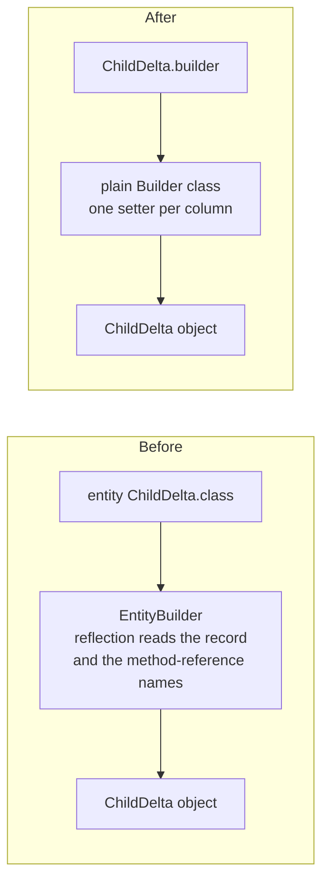
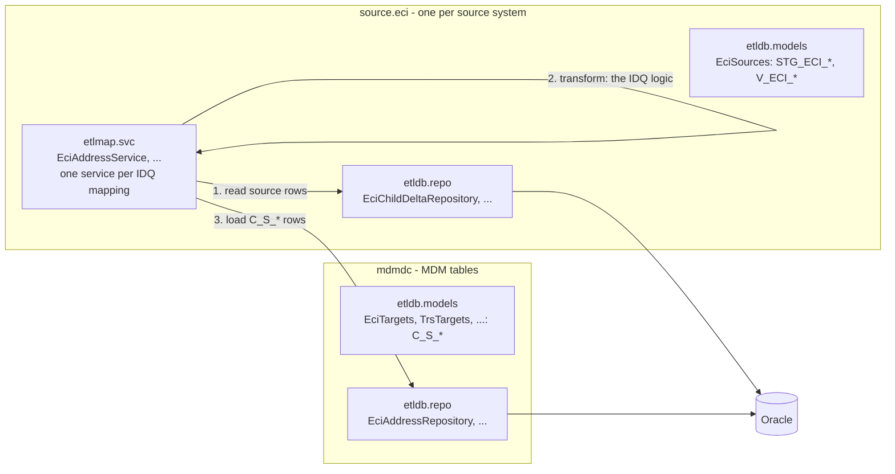
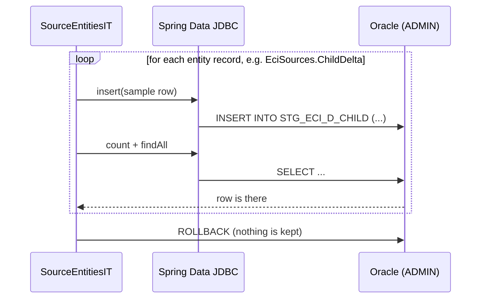
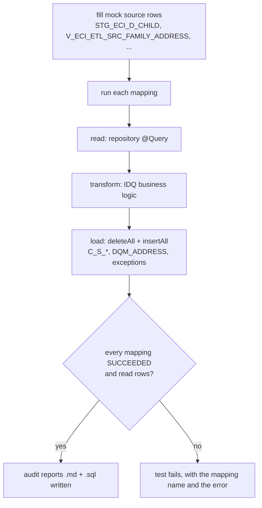

# Other Items to Dig Later


  EntityBuilder was not redundant after the mdmdc move alone. It built mock rows for source and reference tables, which
  mdmdc doesn't touch. These changes made it redundant:
  - Mock data: the 33 records the mock data builds got a plain builder(), the same style FamilyDelta and SnChild already
    had. All chains now read ChildDelta.builder().idChild(id).firstName(...).build().
  - MockTables: it copies a row with shortened prefixed text through Spring Data's InstantiationAwarePropertyAccessor,
    instead of EntityBuilder.from(row).map(...). It now reads table names from Spring Data's mapping metadata. No unit
    test exercises this path in MockTables itself. I checked the copy with a throwaway test on a real record, then
    deleted the test.
  - SourceEntitiesIT: it builds its sample rows with Spring Data's entity instantiator. It compiles, but like the other
    Oracle tests it hasn't been run.
  - Deleted: EntityBuilder.java and EntityBuilderTest.java.

  Reflection still left in main code. None of it is the homemade ORM, but you asked me to double-check:
  - MarkdownTable (audit reports) reads record components and @Column to print rows. It could use Spring Data's mapping
    metadata, as MockTables now does.
  - TableEntities (audit reports) scans the classpath to map a table name to its entity.
  - SampleData finds fill_sample_mock_data_<mapping> methods by name. This is command dispatch, not ORM.
  - TargetBatch.table() and MappingInfo.table() read the @Table annotation directly.
  - Tests only: Fixtures.stub uses a JDK proxy for repository stubs, and SourceEntitiesIT lists the entity holders'
    nested records.

  - MarkdownTable and TableEntities still use reflection. I can move them onto
  Spring Data's mapping metadata on this branch if you want. The PR isn't merged.

  - All 40 tests pass, confirming the Spring-metadata rendering matches the old output, but TableEntities isn't covered.
  I'll write a throwaway Spring Boot test to verify the mapping context includes all @Table entities at startup.

  - The mapping context knows all 89 @Table entities declared in the code
  - MarkdownTable and TableEntities now use Spring Data's mapping metadata instead of their own reflection. I committed
  this as 17daa5b on mdmdc-staging-tables and pushed it, so PR #9 now carries it alongside the mdmdc commit.

  - MarkdownTable (audit-report tables) now reads column names and values from Spring Data's mapping context. The column
    names are the ones Spring Data JDBC itself reads and writes. The record-component and ReflectionUtils code is gone.
    Embedded groups (MdmAudit, Columns.*) and composite keys are still flattened, and AdhocRunReporterTest passes with
    the same headers and values as before.
  - TableEntities builds its table → entity map from the @Table entities Spring Boot already registers at startup,
    instead of scanning the classpath itself. A throwaway startup test found all 89 declared @Table entities, and every
    table I probed resolved: C_S_*, STG_*, C_B_*, LOOKUP_*, EXC_*, DQM_*, V_*. I deleted that test afterwards.
  - AdhocRunReporter now receives the mapping context; its test passes a JdbcMappingContext.

  All 40 unit tests pass on a clean build. The Oracle integration tests are still not run.

  What remains in main code is the SampleData dispatch, which finds fill_sample_mock_data_<mapping> methods by name, and
  the plain @Table reads in TargetBatch.table() and MappingInfo.table(). Neither is ORM-style.

   main now has three changes from PR #9:
  - MDM layer: the C_S_* tables live in mdmdc.etldb.
  - EntityBuilder removed.
  - Audit reports: they read their columns from Spring Data's metadata.

  All 40 unit tests passed before the merge. The Oracle integration tests (OracleWorkflowIT, SourceEntitiesIT) have
  never been run against the shared schema for PRs #8 and #9. That's still the one open check on the new load path.
  
  - what are these two?  OracleWorkflowIT & SourceEntitiesIT. Explain their purpose and why they are important for the integration tests. Explain like I am a Junior developer.

# Write your response below for 'All' of the above content, remember to explain like I am a Junior developer with simple terms and mermaid diagrams if needed.


---

## Answers (written after PR #11)

First, a quick status update, because a few notes above are now out of date:

| Note above says | What is true now |
|---|---|
| `TableEntities` scans the classpath / uses the mapping context | **Deleted** in PR #11. `MappingInfo.targets` now holds entity classes, so nobody needs to look entities up by table name any more. |
| The Oracle integration tests were never run | `OracleWorkflowIT` **passed for ECI** (all 6 mappings) in PR #10, after fixing the ECI mock data. `SourceEntitiesIT` has still **never been run**. TRS, FSS, TTF and WIC have not been run through `OracleWorkflowIT` either. |

The sections below walk through everything in this file, one topic at a time.

### 1. What was the "mini ORM", and what was `EntityBuilder`?

An **ORM** (Object-Relational Mapper) is code that turns database rows into Java objects and back. We use a real
one: **Spring Data JDBC**. Before this refactor the project also had a small homemade one next to it. That was the
"mini ORM", and `EntityBuilder` was its main piece.

Our tables are Java **records**. A record is a class whose fields are fixed when you create it. Some tables have
60+ columns, so creating a row looked like this:

```java
new ChildDelta(42L, null, "Mia", "Lee", null, null, null, null, ... 50 more ...)   // which null is which?!
```

`EntityBuilder` fixed that readability problem with a trick:

```java
entity(ChildDelta.class).with(ChildDelta::idChild, 42L).with(ChildDelta::firstName, "Mia").build();
```

To make that work, it used **reflection**. Reflection is Java code that inspects other code while the program runs:
"what fields does this class have?", "what is the name of this method reference?", "call this constructor for me".
It's powerful, but:

- mistakes only show up when the program runs, not when it compiles
- it's hard to read and hard to debug
- it duplicates what Spring Data already does properly

So we replaced it with **plain builders**: ordinary code the compiler fully checks.

```java
ChildDelta.builder().idChild(42L).firstName("Mia").build();
```



Why it wasn't gone automatically after the `mdmdc` move: `EntityBuilder` was only used to build **mock rows** for the
source tables (`STG_*`, `V_*`) and reference tables (`LOOKUP_*`, ...). `mdmdc` only moved the `C_S_*` tables, so it
never touched that code. That's why the mock data had to be changed separately.

### 2. `MockTables`: the one place that still copies records

`MockTables` writes the mock rows. Every mock text value gets a prefix (for example `Test_001-Christopher`) so you can
tell mock data apart from real data. If the prefix makes the text longer than its column (say `FIRST_NAME` is 15
characters), `MockTables` cuts the text to fit.

Records can't be changed after they are created, so "cut one field" really means "make a copy with one field
different". It used to do that with `EntityBuilder.from(row).map(...)`. Now it asks **Spring Data** to make the copy
(`InstantiationAwarePropertyAccessor`). Spring Data already knows every table, column and constructor, so we reuse that
knowledge instead of keeping our own copy of it.

### 3. Reflection that is still in the code, and why it's okay

| Where | What it does | Is it "mini ORM"? |
|---|---|---|
| `SampleData` | Finds the method `fill_sample_mock_data_<mapping name>` by its name and calls it | No. It's a way to pick which mock-data function to run (a "dispatcher"). |
| `MappingInfo.table()`, `TargetBatch.table()` | Read the `@Table("...")` annotation to get a table name | No. It's one tiny annotation read. |
| `Fixtures.stub` (tests only) | Creates fake repositories whose methods return empty lists | No. It's a test helper, so unit tests never need a database. |
| `SourceEntitiesIT` (test only) | Lists the record classes inside `EciSources`, `TrsSources`, ... | No. It's a test finding what to test. |

`MarkdownTable` (the audit-report tables) now reads columns from Spring Data's metadata. `TableEntities` is gone.

### 4. The `mdmdc` layer, in one picture

The `C_S_*` tables belong to **MDM**, the master data system, not to any one source system, so they now live in their
own package. Each source keeps its own input tables.



### 5. What are `OracleWorkflowIT` and `SourceEntitiesIT`?

First, the two kinds of test in this project:

- **Unit tests** (`EciPkeyTest`, `TrsPkeyTest`, ...) test the **business logic only**. They give `transform(...)`
  some rows and check the result, for example that the key looks like `0000000042F|Member|002|...`. They use fake
  repositories (`Fixtures.stub`) and **never touch a database**. They run in seconds, on every build.
- **Integration tests** ("IT" at the end of the name) check that our code and the **real Oracle database** work
  together. They need the database wallet and network access, and they really write to the shared `ADMIN` schema. So
  they are not part of the normal build: you run them on purpose, e.g. `mvnw test -Dtest=OracleWorkflowIT`.

Why we need both: a unit test can pass even when the real database would reject our rows. That is exactly what
happened in PR #10. The unit tests were green, but Oracle refused the ECI mock rows because `FIRST_NAME`, `ELIG_DATE`
and `LOAD_DATE` are `NOT NULL` in `ADMIN`. Only the integration test could find that.

#### `SourceEntitiesIT`: "does every table record match its real table?"

For **every** entity record (source, workflow, MDM base and reference tables), it:

1. builds one sample row with every column set to a tiny value (`"1"`, `1`, today's date)
2. inserts it into the real table
3. counts the rows, reads them back, and checks that they're there
4. rolls everything back (`@Transactional`), so the database is left exactly as it was



**Why it matters:** if a record has a misspelled column, a column the table doesn't have, or the wrong data type,
this test fails right away, with the table name in the error. Without it, you'd only find out when a real mapping run
breaks. It has **not been run yet** since the refactor. It is the safest one to run first, because it rolls back.

#### `OracleWorkflowIT`: "does the whole ETL actually work end to end?"

It runs the real workflow against the real database:

1. **creates mock source rows** (`fill_sample_mock_data_<mapping>`), with some bad rows on purpose (missing names,
   broken e-mails) so the exception paths run too
2. **runs the mappings**: read → transform → load into the `C_S_*` tables, `DQM_ADDRESS` and `EXC_STG_BAD_REC_MEMB`
3. **checks** that every mapping `SUCCEEDED` and read at least one row
4. `runWritesAuditReports` also checks that an audit report (`.md`) and a replay script (`.sql`) were written for each
   target table



**Why it matters:** this is the only test that proves the **new load path** from PRs #8 and #9 really works on
Oracle:

- the repositories and their SQL
- `deleteAll` respecting the clearable-tables whitelist
- `insertAll` writing the rows
- the transactions around each load

Unlike `SourceEntitiesIT` it does **not** roll back. It keeps mock rows in the shared schema, and the mock data is
generated from a fixed random seed, so a second run creates the same rows again. That's why the second ECI run
collided with the rows of the first one in `DQM_ADDRESS`: that table only ever gets new rows added, and its unique
key doesn't include the run time. Before rerunning, clear the old ECI mock rows:

```sql
DELETE FROM DQM_ADDRESS WHERE SRC_SYSTEM = 'ECI' AND PTY_SRC_KEY LIKE '91000000%';
```

### 6. What's left to dig into

1. Run **`SourceEntitiesIT`**. It's safe because everything is rolled back, and it checks all 89 table records at once.
2. Run **`OracleWorkflowIT` for TRS, FSS, TTF and WIC** (`-Dsource=TRS` etc.). Expect the same kind of `NOT NULL`
   surprises in their mock data. Read the required columns from `USER_TAB_COLUMNS` first, as we did for ECI.
3. Decide how mock rows in **`DQM_ADDRESS`** get cleaned between runs: by hand, or a cleanup step in the test.
